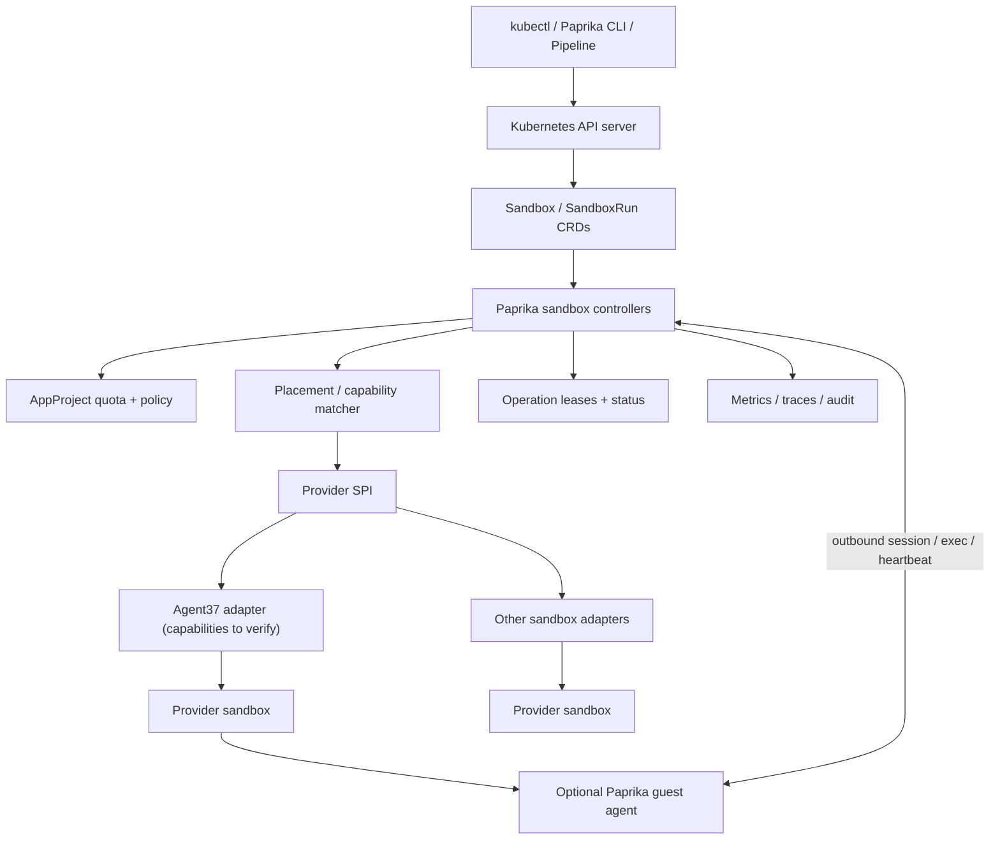
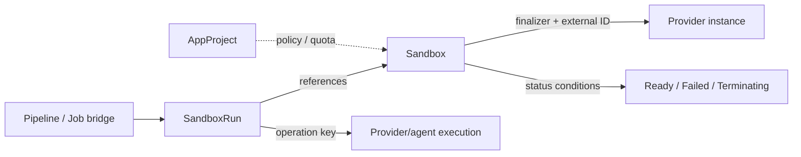
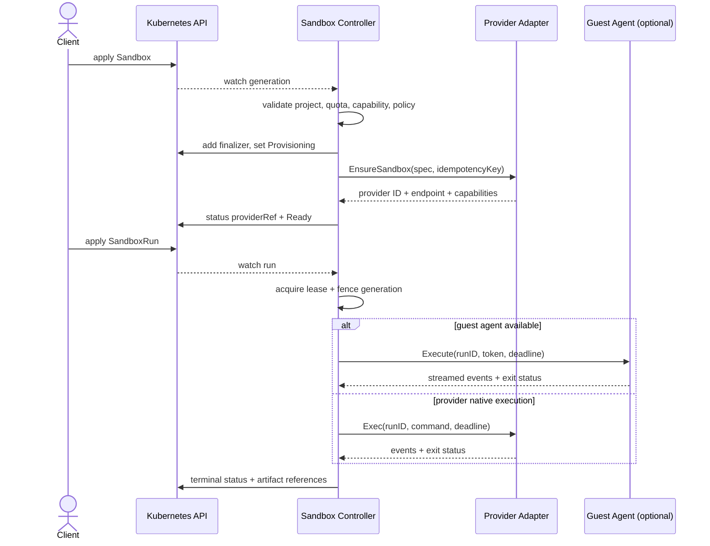
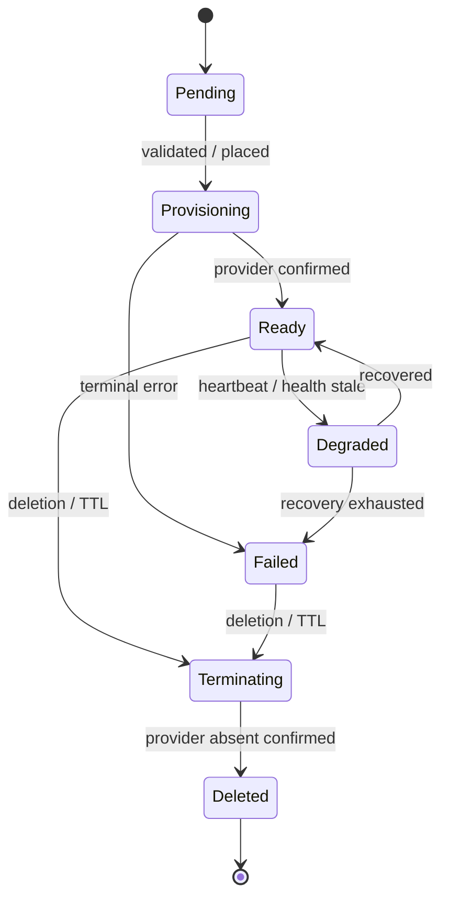
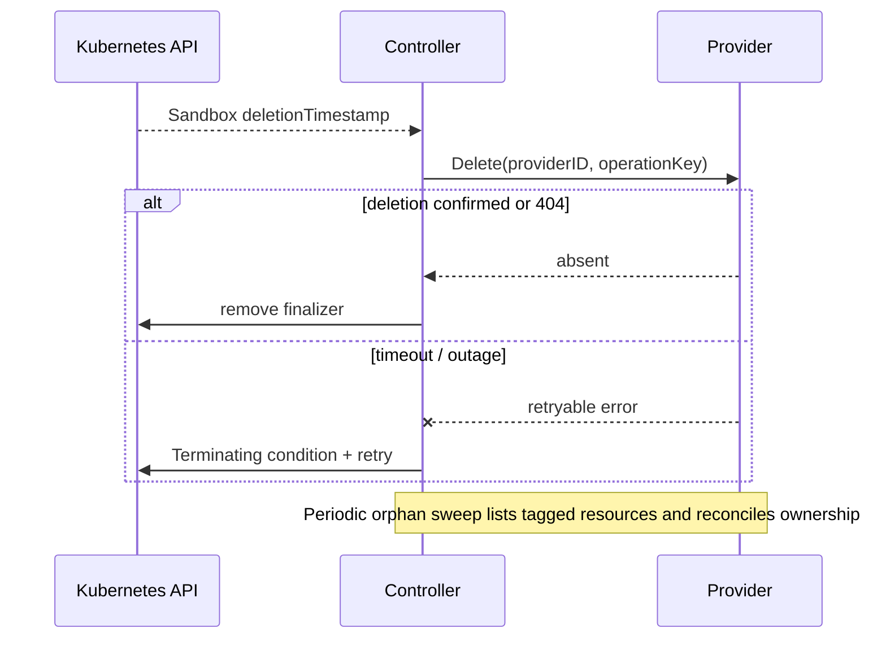

# PRD: Paprika Sandbox-Native Control Plane

**Status:** Proposal / architecture RFC · **Date:** 2026-11-12 · **Owner:** Paprika maintainers · **Target:** experimental alpha

## 1. Executive summary

Extend Paprika's existing Kubernetes operator and application-delivery control plane to provision and reconcile **ephemeral execution sandboxes** across providers (Agent37 as an initial candidate). Offer a Kubernetes-native declarative contract, without claiming that remote sandboxes are full Kubernetes worker nodes. A provider-backed sandbox is a first-class `Sandbox` resource; optional Node/Pod projection is a later compatibility layer. Keep the existing `Application`, `Pipeline`, `Stage`, `Release`, `Cluster`, and `AppProject` contracts intact.

**Core decision:** use Kubernetes CRDs + controller-runtime reconciliation in the existing operator for alpha; a provider adapter interface; a lease-aware Paprika guest agent where supported; an agentless provider-exec fallback. Do **not** initially register one Kubernetes Node per sandbox. Evaluate Virtual Kubelet only after proving workload semantic compatibility.

## 2. Problem, users and outcomes

Users: agent developers running untrusted code, CI/build pipeline owners, Paprika platform operators and multi-tenant teams. Today, a Kubernetes Job assumes cluster capacity and Kubernetes workload semantics; sandbox APIs offer fast isolated execution but divergent provisioning, exec, networking, file and snapshot contracts. Paprika should unify desired state, policy, placement, lifecycle and telemetry.

**Alpha success criteria (targets, not measured facts):**
- Declarative create, exec and teardown via a single provider-neutral API.
- No orphan sandbox after a successful deletion reconciliation; failed provider deletes surface conditions and are retried.
- Every provision/exec/delete action is idempotent or protected by durable operation keys and generation fencing.
- Cross-tenant credential and execution isolation validated by adversarial tests.
- Provider outage, controller restart and stale guest-agent heartbeat recover without duplicate execution.
- Publish p50/p95 provisioning and execution latency and cost-per-session; set numeric SLOs after baseline.

**Non-goals for alpha:** full Kubernetes conformance; arbitrary PodSpec/DaemonSet/CSI/CNI support; pretending remote sandbox networking is cluster Pod networking; GPU orchestration; migrating existing delivery workloads automatically.

## 3. Architectural decisions

| Decision | Alpha choice | Rationale / follow-up |
|---|---|---|
| API surface | `sandboxes.paprika.io/v1alpha1` CRDs | Fits Kubebuilder and current operator; can later add hosted API facade |
| Unit of isolation | one sandbox instance per `Sandbox` | Clear identity, ownership and cost; provider pools are implementation detail |
| Kubernetes Node | **not** per sandbox initially | Node implies kubelet, Pod scheduling, networking, status and volume guarantees |
| Workload API | `Sandbox` + `SandboxRun` | Explicit exec semantics, retries, outputs and deadlines |
| Provider | adapter SPI; Agent37 candidate | Verify actual Agent37 auth, lifecycle, exec, files, snapshots, limits before coding |
| Guest | optional Paprika agent | Provider-native exec remains fallback; no assumptions about inbound connectivity |
| Scheduling | Paprika placement controller for Sandbox resources | Do not compete with kube-scheduler over ordinary Pods |
| Network | outbound default; explicit gateway/ingress later | Avoid false CNI/Service promises |
| Storage | ephemeral filesystem + optional provider snapshot/artifact export | No PVC/CSI equivalence without explicit implementation |
| Durability | Kubernetes API status + operation journal/lease | Restart-safe reconciliation and fencing |
| Multi-tenancy | `AppProject` policy/quotas + namespace RBAC | Reuse current tenant boundaries; secret references scoped and authorized |

## 4. Component topology



### Reconciliation and ownership



### Provision and execution sequence



### Lifecycle state machine



### Delete and orphan recovery



## 5. Proposed API contracts

`Sandbox` is the durable desired-state instance. `SandboxRun` is an immutable execution request referencing a sandbox. The following YAML is **illustrative**, not a generated or installed CRD.

```yaml
apiVersion: sandboxes.paprika.io/v1alpha1
kind: Sandbox
metadata:
  name: agent-session
  namespace: research
spec:
  projectRef: research-team
  providerSelector:
    matchLabels:
      provider: agent37
  runtime:
    image: ghcr.io/example/agent-runtime:latest
    cpu: "2"
    memory: 4Gi
  lifecycle:
    idleTTLSeconds: 900
    maxLifetimeSeconds: 7200
  network:
    egressPolicy: restricted
  execution:
    agentMode: preferred # required | preferred | disabled
```

```yaml
apiVersion: sandboxes.paprika.io/v1alpha1
kind: SandboxRun
metadata:
  name: agent-session-task-001
  namespace: research
spec:
  sandboxRef:
    name: agent-session
  command: ["/bin/sh", "-lc", "python -m pytest -q"]
  timeoutSeconds: 600
  retryPolicy:
    maxAttempts: 1
  artifactPaths: ["/workspace/test-results"]
```

**Suggested status fields:** `observedGeneration`, `phase`, `conditions[]`, `providerRef` (opaque ID, adapter, region), `capabilities`, `leaseEpoch`, `lastHeartbeatTime`, `expiresAt`; for runs `attempt`, `startedAt`, `finishedAt`, `exitCode`, `reason`, `artifactRefs[]`, `executionID`. Never put provider credentials or raw secrets in status.

**Validation:** immutable provider identity once provisioned; resource quota admission; namespace-scoped references; deadline ceilings; deterministic operation keys from UID + generation + action/attempt; strict default-deny ingress and bounded egress.

## 6. Provider service-provider interface (Go sketch)

```go
type Provider interface {
    Name() string
    Capabilities(ctx context.Context) (Capabilities, error)
    Ensure(ctx context.Context, req EnsureRequest) (Instance, error)
    Inspect(ctx context.Context, id string) (Instance, error)
    Execute(ctx context.Context, req ExecRequest) (ExecResult, error)
    Delete(ctx context.Context, id string, operationKey string) error
    ListOwned(ctx context.Context, ownershipTag string) ([]Instance, error)
}
```

Capabilities must be explicit for image support, resource sizing, environment/secrets, file transfer, streaming exec, snapshots, networking, inbound connectivity and lifecycle limits. Unsupported requirements fail validation/placement rather than silently degrading isolation. Agent37 API endpoints, authentication and feature support are **unverified** until an adapter spike validates them against primary docs and a test account.

## 7. Controller logic and invariants

```text
Reconcile(Sandbox):
  load object; check deletion
  if deleting: retry provider delete until absent; remove finalizer
  validate AppProject, namespace permissions, quotas and provider capabilities
  add finalizer before external creation
  compute stable operation key from Sandbox UID + generation
  inspect persisted providerRef or discover instance by ownership tag
  if absent: EnsureSandbox with idempotency key
  observe provider state and optional agent lease
  write status using conflict retries; requeue for health / TTL

Reconcile(SandboxRun):
  resolve Ready sandbox and policy
  claim durable execution lease (UID, attempt, epoch)
  execute once using provider or agent and fenced token
  checkpoint result/artifacts and mark terminal
  on unknown outcome: inspect execution ID before retry
```

**Safety invariants:** never remove finalizer before confirmed provider absence; never execute a run twice merely because a reconcile retries; never schedule to a provider lacking required isolation; reject stale lease epochs; do not expose provider secrets in logs; quota reservation and release must survive crashes. If provider cannot support idempotent execution or inspection, report `Unknown` rather than claiming exactly-once execution.

## 8. Scheduling and node projection

For alpha, select providers based on required capabilities and policy first, then score cost, expected startup latency, region and capacity. Persist the chosen provider to avoid rescheduling an existing instance accidentally. Warm pools are provider-scoped and lease-owned; reconcile pool size from recent demand and explicit budget caps. Charge quota for warm capacity and reclaim on expiry.

**Phase 2 experiment:** a Virtual Kubelet-style virtual node representing a provider *pool*, not each ephemeral sandbox, may translate a deliberately constrained Pod subset into Sandbox + SandboxRun. Only advertise supported resources and conditions. Reject unsupported volumes, privileged mode, host networking, services, probes and pod-to-pod connectivity until implemented. Kubernetes `Node` and `Pod` semantics remain authoritative; projection is opt-in and never the source of truth.

## 9. Security and operational requirements

- Namespace and `AppProject` scoped authorization, quota, admission policies, provider credential isolation and short-lived guest credentials.
- Outbound guest-to-control-plane connectivity where possible; mutually authenticated session with lease epoch, replay protection and scoped command authorization.
- Audit: who requested sandbox/run, policy decision, provider operation, execution status and teardown.
- Egress controls enforced by provider or gateway; deny unsupported policy instead of implying enforcement.
- Bounded logs, artifact size, runtime TTL and cost budget; redaction of secrets and untrusted guest output.
- Reconcile provider drift, stale heartbeats, unknown executions, deleted namespaces and orphan instances.

## 10. Engineering layout and integration points

```text
api/sandboxes/v1alpha1/          # Sandbox, SandboxRun and schemas
internal/controller/sandbox/     # lifecycle, finalizers, TTL
internal/controller/sandboxrun/  # execution and recovery
internal/sandbox/provider/       # SPI, capability contracts, conformance
internal/sandbox/provider/agent37/
internal/sandbox/placement/      # policy + scoring
internal/sandbox/agent/          # optional guest protocol and leases
internal/sandbox/audit/          # events, metrics, traces
config/crd/bases/                # generated CRDs
config/samples/sandboxes/        # example manifests
docs/architecture/               # ADRs and diagrams
```

Integrate with existing `Pipeline` only via an explicit optional sandbox executor, not by replacing current Kubernetes Job execution. Add controller feature gate, RBAC rules, generated manifests, envtest tests and E2E smoke tests.

## 11. Delivery phases and acceptance gates

**P0 — ADRs / provider feasibility:** lock CRD semantics, tenant boundary, provider feature matrix and Agent37 API evidence. Gate: reviewed ADRs and capability test plan.

**P1 — CRDs / controller skeleton:** generated APIs, RBAC, validation, status conditions, finalizers, fake provider. Gate: envtest create/update/delete, restart, TTL, failure injection.

**P2 — Provider adapter:** authenticated Agent37 adapter where supported; provisioning, inspect, delete, exec; tagging and orphan recovery. Gate: live sandbox smoke tests, provider outage tests, no leaked resources.

**P3 — Execution + security:** SandboxRun, leases/fencing, logs/artifacts, project quotas, audit and credential boundaries. Gate: crash/retry and cross-tenant security tests.

**P4 — Operator UX / integrations:** CLI, docs, metrics, Pipeline opt-in executor, optional warm pool. Gate: repeatable end-to-end workflow and published latency/cost benchmarks.

**P5 — Compatibility experiment:** virtual-node/pod projection behind flag, with conformance matrix. Gate: explicit unsupported feature rejection and reliable Pod status mapping.

## 12. Open questions / decisions required

1. Is Agent37 the intended provider product and what are its canonical docs and credentials?
2. Is a managed hosted Paprika API required in addition to the Kubernetes operator?
3. Should sandbox execution be restricted to trusted images or support arbitrary user-supplied code/images?
4. What are the isolation, residency, budget and compliance requirements per `AppProject`?
5. Does the first customer need generic `kubectl apply -f Pod` compatibility, or are native Sandbox CRDs sufficient?

## 13. Risks and mitigations

| Risk | Mitigation |
|---|---|
| Provider APIs do not expose necessary lifecycle primitives | capability gating + provider spike before commitment |
| Sandbox instance misrepresented as full Kubernetes Node | keep native CRDs first; compatibility bridge later |
| Duplicate exec after uncertain timeout | execution IDs, idempotency, lease epochs; Unknown when ambiguous |
| Orphans and uncontrolled spend | finalizers, TTL, provider ownership tags, sweeper, budgets |
| Guest compromise or lateral movement | project isolation, scoped credentials, deny-by-default network |
| Existing Paprika regressions | feature gate and separate controller packages; regression E2E |

**Review disposition:** approve native Sandbox/SandboxRun architecture as the MVP direction; defer virtual kubelet/node emulation pending evidence and conformance work.
