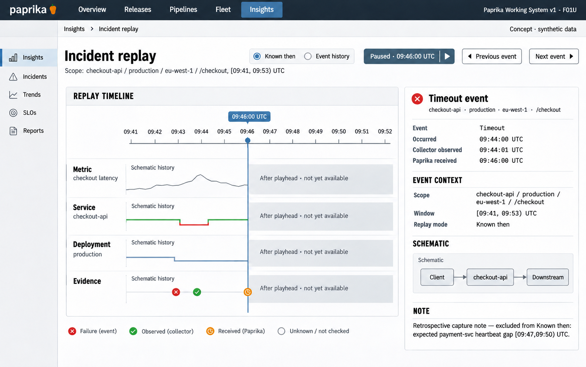

# F01 Incident replay

**Design system:** [Paprika Working System v1](../design-system.md) · **Surface:** Insights · **Status:** proposed feature design.

**Implementation backlog:** [#222](https://github.com/paprikacd/paprika/issues/222).

[Catalogue](../README.md) · [Exact fixture](../fixtures/f01.json) · [Space specification](https://chatgpt.com/space/page_fca6170dff808191bc520e4365f1490b)

## Canonical visual reference



Concept · synthetic data. The artboard describes the proposed interface. The fixture and acceptance criteria below define its meaning; this publication does not mark the feature implemented.

## Working surface

- A shared time ruler above aligned metric, service-state, deployment and evidence tracks; one transport strip and one stable selected-observation inspector.

## Synthetic fixture

Synthetic checkout-api / production / eu-west-1 / route /checkout; selected window [09:41, 09:53) UTC. Pause Known then at 09:46:00 UTC. A timeout occurred at 09:44:00, was observed by a collector at 09:44:01, and arrived in Paprika at 09:46:00. The heartbeat-log gap is [09:47, 09:50).

```json
{
  "scope": {
    "service": "checkout-api",
    "environment": "production",
    "region": "eu-west-1",
    "route": "/checkout"
  },
  "windowUTC": {
    "start": "09:41",
    "endExclusive": "09:53"
  },
  "initialMode": "Known then",
  "initiallyPaused": true,
  "playheadUTC": "09:46:00",
  "timeout": {
    "occurredUTC": "09:44:00",
    "collectorObservedUTC": "09:44:01",
    "paprikaReceivedUTC": "09:46:00"
  },
  "heartbeatLogGapUTC": {
    "start": "09:47",
    "endExclusive": "09:50"
  }
}
```

## Interaction and state contract

- Event history places a record by occurrence time; Known then makes it visible only after its Paprika receipt time. The timeout is excluded from Known then before 09:46:00.
- Occurrence, collector observation and Paprika receipt are three distinct clocks.
- Replay is paused initially; controls move the playhead or selected evidence, not live production state.
- Do not auto-start, smooth through missing observations, or animate numeric readings between fabricated intermediate values.
- The heartbeat-log gap belongs only to the affected signal. Do not imply that every signal is missing there.
- Historical queries alone do not establish what was known at the time; immutable capture ownership is required.

## Backlog implementation specification

The following scope and unchecked acceptance criteria are preserved from the linked implementation issues, read on 2026-11-11. Existing foundations and proposed additions remain distinct.

### Problem and outcome

Build replay on an explicit capture model with trustworthy availability timestamps. Historical queries can reconstruct event order but cannot alone establish what evidence Paprika had at an earlier moment.

### Proposed scope

- Store source event time, collector observed time and Paprika availability separately; do not relabel OTel ObservedTimestamp as Paprika receipt.
- Use the existing time/query owner with cancelled superseded work and stable entity identity. Avoid auto-start and preserve missing intervals.
- When availability timestamps are absent, disable or explicitly limit Known then rather than inventing them.

### Acceptance criteria

- [ ] An event occurring at 09:44:00, collector-observed at 09:44:01 and received at 09:46:00 is absent in Known then at 09:45 and visible at 09:46.
- [ ] Event history can show the record at 09:44 with a clear later-arrival label; future evidence never leaks into Known then.
- [ ] Keyboard/non-drag seeking, selected evidence, gaps and reduced motion preserve exact semantics.

### Dependencies

- https://github.com/paprikacd/paprika/issues/221

### Implementation evidence

- [Existing time window](https://github.com/paprikacd/paprika/blob/17a651ab8edf20337ac5319af93ae7fb2c389b47/ui/src/features/insights/time-window.ts)
- [OTel timestamp semantics](https://opentelemetry.io/docs/specs/otel/logs/data-model/)

Suggested order: **After immutable captures**. Status: proposed feature; the synthetic wireframe is design evidence, not a deployed capability. Implementation sources were inspected at master `17a651ab8edf20337ac5319af93ae7fb2c389b47` on 10 November 2026.

## Related backlog

[#221](https://github.com/paprikacd/paprika/issues/221)

## Earlier creative explorations

These earlier studies retain the feature's exploration history. The canonical artboard above supplies the shared shell and visual direction.

[F01A](../assets/explorations/f01a.png) · [F01B](../assets/explorations/f01b.png) · [Archive index](../explorations/README.md#f01)

## Implementation alignment

Use the existing runtime owners identified in the [design-system contract](../design-system.md#runtime-ownership). Apply the common shell, type, spacing and state vocabulary without replacing this feature's work surface, authorization or data semantics.

The canonical fixture remains available as JSON for implementation and review. Keyboard, narrow-layout and live-data behavior require implementation-specific verification; generated artboards do not establish those results.
