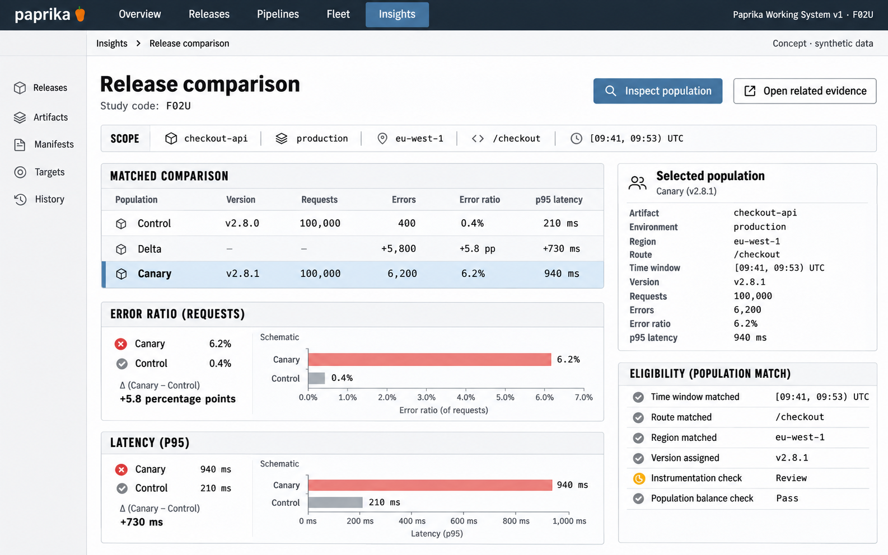

# F02 Release comparison

**Design system:** [Paprika Working System v1](../design-system.md) · **Surface:** Insights · **Status:** proposed feature design.

**Implementation backlog:** [#218](https://github.com/paprikacd/paprika/issues/218).

[Catalogue](../README.md) · [Exact fixture](../fixtures/f02.json) · [Space specification](https://chatgpt.com/space/page_fca6170dff808191bc520e4365f1490b)

## Canonical visual reference



Concept · synthetic data. The artboard describes the proposed interface. The fixture and acceptance criteria below define its meaning; this publication does not mark the feature implemented.

## Working surface

- A control/delta/canary ledger with common-scale comparisons, paired distributions, ranked endpoint evidence and a population/eligibility inspector.

## Synthetic fixture

Synthetic checkout-api / production / eu-west-1 / /checkout over [09:41, 09:53) UTC. Concurrent control v2.8.0 and canary v2.8.1 each have 100,000 requests. Control: 400 errors, 0.4%, p95 210 ms. Canary: 6,200 errors, 6.2%, p95 940 ms. Error-ratio difference: +5.8 percentage points.

```json
{
  "scope": {
    "service": "checkout-api",
    "environment": "production",
    "region": "eu-west-1",
    "route": "/checkout"
  },
  "windowUTC": {
    "start": "09:41",
    "endExclusive": "09:53"
  },
  "cohorts": [
    {
      "name": "control",
      "version": "v2.8.0",
      "requests": 100000,
      "errors": 400,
      "errorPercent": 0.4,
      "p95Ms": 210
    },
    {
      "name": "canary",
      "version": "v2.8.1",
      "requests": 100000,
      "errors": 6200,
      "errorPercent": 6.2,
      "p95Ms": 940
    }
  ],
  "errorDifferencePercentagePoints": 5.8
}
```

The selected interval is [09:41, 09:53) UTC. Only the supplied error ratios and p95 summaries belong to this fixture; extra percentile labels or curve texture in older studies are illustrative.

## Interaction and state contract

- Apply the same selected route, region and interval to both cohorts; show comparison eligibility before interpreting a delta.
- Check bounds, version labels, instrumentation and available populations. Equal request counts alone do not establish comparability or causality.
- The p95 values are independently specified summaries; they require compatible distributions or explicitly scoped source summaries.
- Do not treat individual endpoint example rows as a partition of the selected-route total.
- Selection inspects a population or opens related evidence; it does not approve or promote the candidate.
- Keep blue/control and coral/canary identity or equivalent explicit cohort labels stable under selection and normalization.

## Backlog implementation specification

The following scope and unchecked acceptance criteria are preserved from the linked implementation issues, read on 2026-11-11. Existing foundations and proposed additions remain distinct.

### Problem and outcome

Extend existing temporal comparison to explicitly selected control/canary populations. An investigator should see the observed difference, its population and any incompatibility before interpreting a release regression.

### Proposed scope

- Reuse time-window matching and query ownership; support matched concurrent release cohorts with preserved source, route, region and interval.
- Compare aggregation, units, instrumentation/sampling assumptions and available populations. Do not silently match unmatched series.
- Compute ratios from aggregated numerators/denominators; derive percentiles from compatible distributions or explicitly scoped summaries. Keep cohort difference distinct from causal attribution.

### Acceptance criteria

- [ ] For 100,000 requests in each cohort, 400 control errors and 6,200 canary errors display 0.4%, 6.2% and +5.8 percentage points.
- [ ] The independent p95 fixture summaries of 210 ms and 940 ms are never averaged across instances.
- [ ] A partial or unmatched cohort remains inspectable and cannot appear fully eligible; drilldown preserves comparison context.

### Related integration work

- https://github.com/paprikacd/paprika/issues/216
- https://github.com/paprikacd/paprika/issues/217

The first release-comparison slice can ship with metrics and eligibility checks. Related-log inspection is an integration follow-up, not a prerequisite for showing a valid cohort comparison.

### Implementation evidence

- [Time-window lens](https://github.com/paprikacd/paprika/blob/17a651ab8edf20337ac5319af93ae7fb2c389b47/ui/src/features/insights/time-window-lens.tsx)
- [Window matching](https://github.com/paprikacd/paprika/blob/17a651ab8edf20337ac5319af93ae7fb2c389b47/ui/src/features/insights/time-window.ts)

Suggested order: **First investigation slice**. Status: proposed feature; the synthetic wireframe is design evidence, not a deployed capability. Implementation sources were inspected at master `17a651ab8edf20337ac5319af93ae7fb2c389b47` on 10 November 2026.

## Earlier creative explorations

These earlier studies retain the feature's exploration history. The canonical artboard above supplies the shared shell and visual direction.

[F02A](../assets/explorations/f02a.png) · [F02B](../assets/explorations/f02b.png) · [Archive index](../explorations/README.md#f02)

## Implementation alignment

Use the existing runtime owners identified in the [design-system contract](../design-system.md#runtime-ownership). Apply the common shell, type, spacing and state vocabulary without replacing this feature's work surface, authorization or data semantics.

The canonical fixture remains available as JSON for implementation and review. Keyboard, narrow-layout and live-data behavior require implementation-specific verification; generated artboards do not establish those results.
