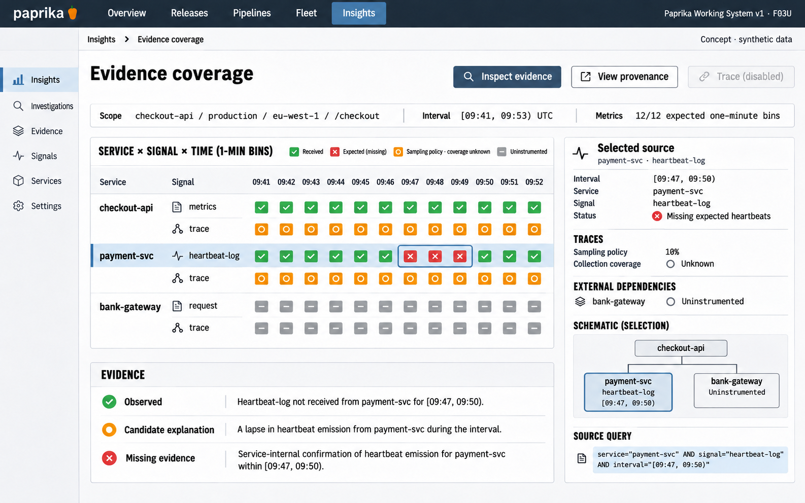

# F03 Evidence coverage

**Design system:** [Paprika Working System v1](../design-system.md) · **Surface:** Insights · **Status:** proposed feature design.

**Implementation backlog:** [#216](https://github.com/paprikacd/paprika/issues/216).

[Catalogue](../README.md) · [Exact fixture](../fixtures/f03.json) · [Space specification](https://chatgpt.com/space/page_fca6170dff808191bc520e4365f1490b)

## Canonical visual reference



Concept · synthetic data. The artboard describes the proposed interface. The fixture and acceptance criteria below define its meaning; this publication does not mark the feature implemented.

## Working surface

- A service-by-signal-by-time matrix with a stable selected-source provenance column and explicit received, expected-but-missing, sampled and uninstrumented states.

## Synthetic fixture

Synthetic checkout-api / production / eu-west-1 / /checkout over [09:41, 09:53) UTC. Metrics have 12 of 12 expected one-minute bins at the end of the window. payment-svc heartbeat logs are missing [09:47, 09:50). Traces have a configured 10% sampling policy; collection coverage is unknown. External bank-gateway is uninstrumented.

```json
{
  "scope": {
    "service": "checkout-api",
    "environment": "production",
    "region": "eu-west-1",
    "route": "/checkout"
  },
  "windowUTC": {
    "start": "09:41",
    "endExclusive": "09:53"
  },
  "metrics": {
    "binMinutes": 1,
    "expectedBins": 12,
    "receivedBins": 12
  },
  "heartbeatLogs": {
    "service": "payment-svc",
    "gapStartUTC": "09:47",
    "gapEndExclusiveUTC": "09:50"
  },
  "traces": {
    "configuredSamplingPercent": 10,
    "collectionCoverage": "Unknown"
  },
  "externalSource": {
    "name": "bank-gateway",
    "instrumentation": "Uninstrumented"
  }
}
```

The 12/12 expected metric bins, the separate payment-svc heartbeat gap and the configured trace sampling policy describe different evidence populations. Trace collection coverage remains unknown.

## Interaction and state contract

- Missing expected heartbeat observations justify a gap; quiet ordinary logs alone do not.
- A configured 10% trace sampling policy is not a measured 10% coverage claim.
- Distinguish received observations, missing expected observations, sampled traces and uninstrumented sources.
- Selecting an observation highlights its exact source interval and query without moving the matrix.
- Candidate explanations keep supporting, contrary and missing evidence separate; do not show an opaque confidence percentage.
- The matrix describes available evidence, not inferred health or root cause.

## Backlog implementation specification

The following scope and unchecked acceptance criteria are preserved from the linked implementation issues, read on 2026-11-11. Existing foundations and proposed additions remain distinct.

### Problem and outcome

Investigators need to distinguish missing expected observations, sampled records, uninstrumented sources and failed queries before relying on a conclusion. Add the coverage/provenance contract shared by comparison, related evidence and saved captures.

### Proposed scope

- Define expected-observation policies separately from sampling and source configuration. Ordinary log silence cannot establish a collection outage.
- Expose received, missing expected, sampled, stale, failed, partial/truncated and uninstrumented states with exact source/query identity and bounds.
- Extend the existing normalized-result, records renderer and host inspection owners; provide keyboard selection and a non-color-only exact table.

### Acceptance criteria

- [ ] The synthetic window [09:41,09:53) has 12 expected metric bins; only the heartbeat-log track has a gap [09:47,09:50).
- [ ] A 10% trace sampling policy is never displayed as measured 10% collection coverage.
- [ ] No-data, failed-query and zero-valued observations remain distinct; changing scope invalidates transient inspection correctly.

### Implementation evidence

- [Result schema](https://github.com/paprikacd/paprika/blob/17a651ab8edf20337ac5319af93ae7fb2c389b47/ui/src/features/insights/schema.ts)
- [Operational records](https://github.com/paprikacd/paprika/blob/17a651ab8edf20337ac5319af93ae7fb2c389b47/ui/src/features/insights/plugins/operational-records.tsx)

Suggested order: **First investigation slice**. Status: proposed feature; the synthetic wireframe is design evidence, not a deployed capability. Implementation sources were inspected at master `17a651ab8edf20337ac5319af93ae7fb2c389b47` on 10 November 2026.

## Earlier creative explorations

These earlier studies retain the feature's exploration history. The canonical artboard above supplies the shared shell and visual direction.

[F03A](../assets/explorations/f03a.png) · [F03B](../assets/explorations/f03b.png) · [Archive index](../explorations/README.md#f03)

## Implementation alignment

Use the existing runtime owners identified in the [design-system contract](../design-system.md#runtime-ownership). Apply the common shell, type, spacing and state vocabulary without replacing this feature's work surface, authorization or data semantics.

The canonical fixture remains available as JSON for implementation and review. Keyboard, narrow-layout and live-data behavior require implementation-specific verification; generated artboards do not establish those results.
