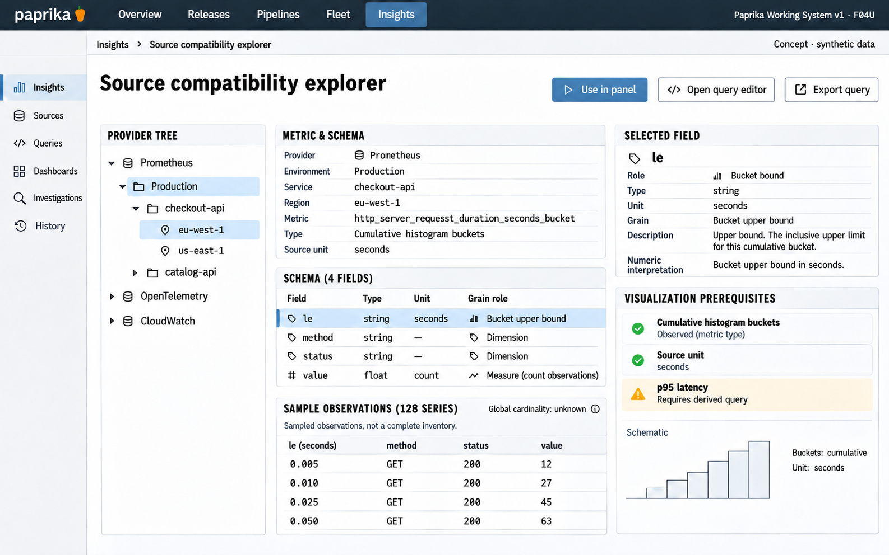

# F04 Source compatibility explorer

**Design system:** [Paprika Working System v1](../design-system.md) · **Surface:** Insights · **Status:** proposed feature design.

**Implementation backlog:** [#220](https://github.com/paprikacd/paprika/issues/220).

[Catalogue](../README.md) · [Exact fixture](../fixtures/f04.json) · [Space specification](https://chatgpt.com/space/page_f668ffb8b1248191beb2f63545ab091b)

## Canonical visual reference



Concept · synthetic data. The artboard describes the proposed interface. The fixture and acceptance criteria below define its meaning; this publication does not mark the feature implemented.

## Working surface

- A provider tree beside an expansive schema workspace, exact sample rows, a selected-field semantic inspector and a visualization-prerequisite rail.

## Synthetic fixture

Synthetic Prometheus production source, checkout-api and eu-west-1. Selected metric http_server_request_duration_seconds_bucket; cumulative histogram buckets; source unit seconds. Select le to inspect upper-bound semantics. 128 inspected series is a bounded sample; global cardinality is unknown.

```json
{
  "providerKind": "Prometheus",
  "environment": "production",
  "service": "checkout-api",
  "region": "eu-west-1",
  "metric": "http_server_request_duration_seconds_bucket",
  "representation": "cumulative histogram buckets",
  "sourceUnit": "seconds",
  "selectedSourceLabel": {
    "name": "le",
    "sourceType": "string",
    "meaning": "bucket upper bound; a numeric view requires explicit parsing"
  },
  "inspectedSeries": 128,
  "inspectionScope": "bounded sample",
  "globalCardinality": "Unknown"
}
```

The source le label is a string. A numerical upper-bound view explicitly parses that value and retains the original label. The 128 inspected series remain a bounded sample.

## Interaction and state contract

- Observed metadata is distinct from inference; visualization compatibility checks type, unit, grain and required roles.
- The p95 view requires an actual derived query rather than renaming a bucket field.
- 128 inspected series is not global cardinality.
- Use in panel transfers the source/query and valid bindings to the existing editor; it does not silently save a dashboard.
- Partial discovery retains inspected bounds and truncation; authentication errors remain attached to their source.
- Cancelled discovery cannot replace a newer selected scope.

## Backlog implementation specification

The following scope and unchecked acceptance criteria are preserved from the linked implementation issues, read on 2026-11-11. Existing foundations and proposed additions remain distinct.

### Problem and outcome

Explore already selects providers, runs supported queries and inspects metadata. Add a compatibility workbench connecting returned fields, units and grain to registered visualizations and an explicit handoff into panel authoring.

### Proposed scope

- Derive field/role diagnostics from actual scoped results and registry requirements; distinguish provider facts, user assertions and inference.
- Expose sampling bounds, freshness, partial discovery and unknown units. Require a real derived query for histogram p95 views.
- Reuse Explorer's explicit Run and retained-result lifecycle. Handoff canonical query/binding IDs without silently saving a dashboard.

### Acceptance criteria

- [ ] 128 inspected series is labeled as a bounded sample; global cardinality remains unknown.
- [ ] Type, unit, grain and required-role mismatches explain why a view is unavailable or needs mapping.
- [ ] A cancelled or older discovery response cannot overwrite newer scope; narrow layout retains exact data and keyboard access.

### Related integration work

- https://github.com/paprikacd/paprika/issues/219

This compatibility view and coordinated repair can be developed independently against the shared registry. Their handoff must use the same canonical binding contract.

### Implementation evidence

- [Explorer](https://github.com/paprikacd/paprika/blob/17a651ab8edf20337ac5319af93ae7fb2c389b47/ui/src/features/insights/explorer.tsx)
- [Registry](https://github.com/paprikacd/paprika/blob/17a651ab8edf20337ac5319af93ae7fb2c389b47/ui/src/features/insights/widget-registry.tsx)
- [Explorer contract](https://github.com/paprikacd/paprika/blob/17a651ab8edf20337ac5319af93ae7fb2c389b47/docs/design/insights/explorer.md)

Suggested order: **Next authoring slice**. Status: proposed feature; the synthetic wireframe is design evidence, not a deployed capability. Implementation sources were inspected at master `17a651ab8edf20337ac5319af93ae7fb2c389b47` on 10 November 2026.

## Earlier creative explorations

These earlier studies retain the feature's exploration history. The canonical artboard above supplies the shared shell and visual direction.

[F04A](../assets/explorations/f04a.png) · [F04B](../assets/explorations/f04b.png) · [Archive index](../explorations/README.md#f04)

## Implementation alignment

Use the existing runtime owners identified in the [design-system contract](../design-system.md#runtime-ownership). Apply the common shell, type, spacing and state vocabulary without replacing this feature's work surface, authorization or data semantics.

The canonical fixture remains available as JSON for implementation and review. Keyboard, narrow-layout and live-data behavior require implementation-specific verification; generated artboards do not establish those results.
