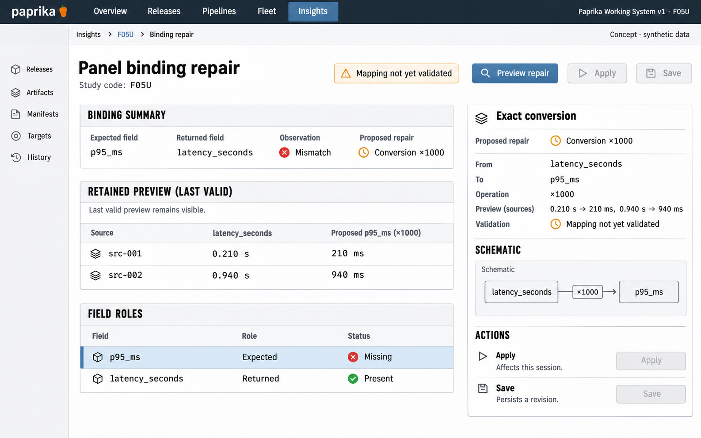

# F05 Panel binding repair

**Design system:** [Paprika Working System v1](../design-system.md) · **Surface:** Insights · **Status:** proposed feature design.

**Implementation backlog:** [#219](https://github.com/paprikacd/paprika/issues/219).

[Catalogue](../README.md) · [Exact fixture](../fixtures/f05.json) · [Space specification](https://chatgpt.com/space/page_f668ffb8b1248191beb2f63545ab091b)

## Canonical visual reference



Concept · synthetic data. The artboard describes the proposed interface. The fixture and acceptance criteria below define its meaning; this publication does not mark the feature implemented.

## Working surface

- A retained last-valid preview, slim binding-role rail, proposed-mapping inspector, exact source rows and a small configuration difference.

## Synthetic fixture

Synthetic saved binding expects p95_ms, but the query now returns latency_seconds. Source values are 0.210 s and 0.940 s. A supported ×1000 conversion yields 210 ms and 940 ms. The invalid draft retains the last valid preview and remains unapplied.

```json
{
  "savedField": "p95_ms",
  "returnedField": "latency_seconds",
  "sourceUnit": "seconds",
  "sourceValues": [
    0.21,
    0.94
  ],
  "proposedSupportedConversion": {
    "operation": "multiply",
    "factor": 1000,
    "resultUnit": "milliseconds",
    "resultValues": [
      210,
      940
    ]
  },
  "draftState": "Invalid and unapplied",
  "lastValidPreview": "Retained"
}
```

## Interaction and state contract

- Unit conversion must be an executable supported operation, not a suffix change.
- If the canonical owner cannot represent the conversion, keep the repair unresolved or change the query through its supported path.
- Invalid mapping cannot Apply; preserve the last valid preview and original scope.
- Apply changes the dashboard session; Save persists a revision. Do not imply that preview or Apply durably saves the document.
- Save conflicts preserve the local repair and require explicit reconciliation with the newer revision.
- Presentation edits remain query-free. The separate request_count/duration_ms conflict demo is a different fixture and must not be merged into this artboard.

## Backlog implementation specification

The following scope and unchecked acceptance criteria are preserved from the linked implementation issues, read on 2026-11-11. Existing foundations and proposed additions remain distinct.

### Problem and outcome

Build on the active editor workbench and existing field validation/suggestions. Consolidate failed roles, repair candidates, binding impact and recoverable persistence into one workflow without losing the last valid preview.

### Proposed scope

- Use PR #208's workbench as the baseline; reuse plugin-config-editor, query-connections and registry validateInput rather than adding a second editor.
- Show failed role/current mapping/compatible candidates and affected bindings. Only advertise unit conversions the canonical owner can execute.
- Preserve invalid draft and last valid preview. Apply changes the session; Save uses the existing conditional revision path. Conflicts retain local work and offer explicit reconciliation.

### Acceptance criteria

- [ ] Missing p95_ms can be repaired to latency_seconds only with executable seconds-to-milliseconds conversion; 0.210 s and 0.940 s become 210 ms and 940 ms.
- [ ] Invalid fields cannot Apply. Presentation-only edits reuse results without provider queries.
- [ ] A simulated r7→r8 conflict retains the binding repair, preserves the newer title after explicit reconciliation, and can be saved as the next revision; Discard restores the applied session.

### Implementation evidence

- [Active workbench PR](https://github.com/paprikacd/paprika/pull/208)
- [Existing validation](https://github.com/paprikacd/paprika/blob/17a651ab8edf20337ac5319af93ae7fb2c389b47/ui/src/features/insights/plugin-config-editor.tsx)
- [Binding suggestions](https://github.com/paprikacd/paprika/blob/17a651ab8edf20337ac5319af93ae7fb2c389b47/ui/src/features/insights/query-connections.ts)

Suggested order: **Authoring follow-up to PR #208**. Status: proposed feature; the synthetic wireframe is design evidence, not a deployed capability. Implementation sources were inspected at master `17a651ab8edf20337ac5319af93ae7fb2c389b47` on 10 November 2026.

## Earlier creative explorations

These earlier studies retain the feature's exploration history. The canonical artboard above supplies the shared shell and visual direction.

[F05A](../assets/explorations/f05a.png) · [F05B](../assets/explorations/f05b.png) · [Archive index](../explorations/README.md#f05)

## Implementation alignment

Use the existing runtime owners identified in the [design-system contract](../design-system.md#runtime-ownership). Apply the common shell, type, spacing and state vocabulary without replacing this feature's work surface, authorization or data semantics.

The canonical fixture remains available as JSON for implementation and review. Keyboard, narrow-layout and live-data behavior require implementation-specific verification; generated artboards do not establish those results.
