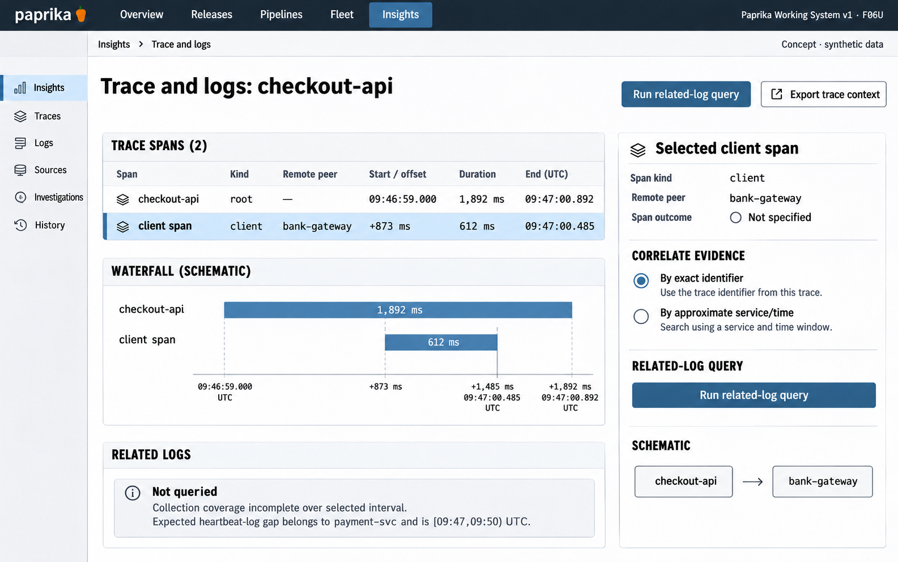

# F06 Related trace and log evidence

**Design system:** [Paprika Working System v1](../design-system.md) · **Surface:** Insights · **Status:** proposed feature design.

**Implementation backlog:** [#217](https://github.com/paprikacd/paprika/issues/217).

[Catalogue](../README.md) · [Exact fixture](../fixtures/f06.json) · [Space specification](https://chatgpt.com/space/page_f668ffb8b1248191beb2f63545ab091b)

## Canonical visual reference



Concept · synthetic data. The artboard describes the proposed interface. The fixture and acceptance criteria below define its meaning; this publication does not mark the feature implemented.

## Working surface

- A broad trace waterfall with readable span hierarchy, thin metric context, a stable selected-span inspector and an explicitly queried related-log region beneath.

## Synthetic fixture

Synthetic trace starts 09:46:59.000 UTC and lasts 1,892 ms. Selected bank-gateway client span begins at +873 ms, lasts 612 ms, and ends at 09:47:00.485 UTC. The expected heartbeat-log gap is [09:47, 09:50).

```json
{
  "traceStartUTC": "09:46:59.000",
  "traceDurationMs": 1892,
  "selectedClientSpan": {
    "destination": "bank-gateway",
    "startOffsetMs": 873,
    "durationMs": 612,
    "endUTC": "09:47:00.485"
  },
  "expectedHeartbeatLogGapUTC": {
    "start": "09:47",
    "endExclusive": "09:50"
  },
  "externalServiceInstrumentation": "Not established by a client span"
}
```

## Interaction and state contract

- Keep relative elapsed offsets, span duration and absolute UTC timestamps distinct and arithmetically consistent.
- A client span to bank-gateway does not imply instrumentation inside the external bank service.
- Run related-log query is an explicit bounded action; selection or hover does not silently query a provider.
- A verified trace/span-ID match is distinct from an approximate service-and-time search.
- No matching logs, absent identifiers, a query error and missing collection are separate states; a gap is not evidence of no errors.
- Preserve authorized source boundaries and exact scope. Real parent and child spans may overlap rather than being sequential.

## Backlog implementation specification

The following scope and unchecked acceptance criteria are preserved from the linked implementation issues, read on 2026-11-11. Existing foundations and proposed additions remain distinct.

### Problem and outcome

The trace waterfall and gateway log queries exist, but Insights needs a canonical result path and a coherent selected-span workflow for related logs. Preserve service, environment, source and time scope across the investigation.

### Proposed scope

- Choose and implement one supported log-result or typed-record normalization path in the canonical Insights schema and authorized provider host.
- Use verified trace/span IDs and bounded time/query limits; no provider fetch on hover.
- Keep no matching logs, absent correlation IDs, unavailable coverage, authorization failure and partial results distinct. Reuse current waterfall ancestry/partial-trace behavior.

### Acceptance criteria

- [ ] The 1,892 ms fixture trace has a selected span at offset 873 ms lasting 612 ms; inspector and interval agree.
- [ ] A timeout at 09:47:00.485 inside the heartbeat gap shows unavailable coverage, never 'no errors'.
- [ ] Pointer, keyboard and narrow span-list inspection retain the selected identity and scope; superseded queries are cancelled.

### Dependencies

- https://github.com/paprikacd/paprika/issues/216

### Implementation evidence

- [Existing waterfall](https://github.com/paprikacd/paprika/blob/17a651ab8edf20337ac5319af93ae7fb2c389b47/ui/src/features/insights/trace-waterfall.tsx)
- [Result schema](https://github.com/paprikacd/paprika/blob/17a651ab8edf20337ac5319af93ae7fb2c389b47/ui/src/features/insights/schema.ts)
- [Trace normalization](https://github.com/paprikacd/paprika/blob/17a651ab8edf20337ac5319af93ae7fb2c389b47/internal/insights/trace_detail.go)

Suggested order: **First investigation slice**. Status: proposed feature; the synthetic wireframe is design evidence, not a deployed capability. Implementation sources were inspected at master `17a651ab8edf20337ac5319af93ae7fb2c389b47` on 10 November 2026.

## Related backlog

[#216](https://github.com/paprikacd/paprika/issues/216)

## Earlier creative explorations

These earlier studies retain the feature's exploration history. The canonical artboard above supplies the shared shell and visual direction.

[F06A](../assets/explorations/f06a.png) · [F06B](../assets/explorations/f06b.png) · [Archive index](../explorations/README.md#f06)

## Implementation alignment

Use the existing runtime owners identified in the [design-system contract](../design-system.md#runtime-ownership). Apply the common shell, type, spacing and state vocabulary without replacing this feature's work surface, authorization or data semantics.

The canonical fixture remains available as JSON for implementation and review. Keyboard, narrow-layout and live-data behavior require implementation-specific verification; generated artboards do not establish those results.
