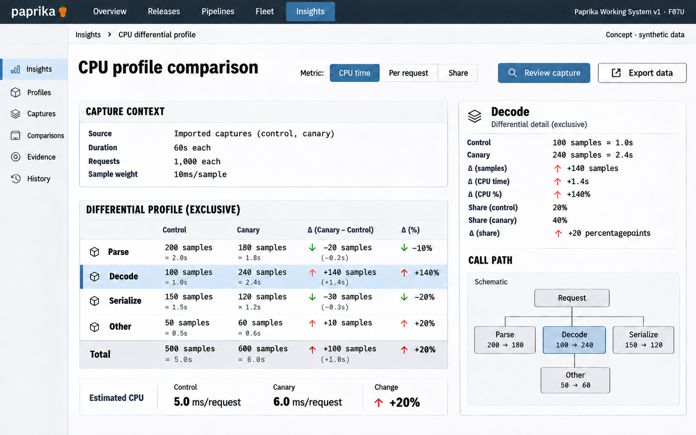

# F07 Differential profile comparison

**Design system:** [Paprika Working System v1](../design-system.md) · **Surface:** Insights · **Status:** proposed feature design.

**Implementation backlog:** [#223](https://github.com/paprikacd/paprika/issues/223) · [#224](https://github.com/paprikacd/paprika/issues/224).

[Catalogue](../README.md) · [Exact fixture](../fixtures/f07.json) · [Space specification](https://chatgpt.com/space/page_f668ffb8b1248191beb2f63545ab091b)

## Canonical visual reference



Concept · synthetic data. The artboard describes the proposed interface. The fixture and acceptance criteria below define its meaning; this publication does not mark the feature implemented.

## Working surface

- Two compatible aligned profile views, a ranked exclusive-attribution difference ledger, a nearby normalization selector and one selected call-path inspector.

## Synthetic fixture

Synthetic captures: 60 seconds and 1,000 requests each; 10 ms per CPU sample. Exclusive samples control→canary: Parse 200→180, Decode 100→240, Serialize 150→120, Other 50→60. Totals 500→600 = estimated CPU 5.0→6.0 s = 5.0→6.0 ms/request, +20%. Decode 1.0→2.4 s (+140%); share 20%→40% (+20 percentage points).

```json
{
  "captureDurationSecondsEach": 60,
  "requestsEach": 1000,
  "cpuSampleMs": 10,
  "exclusiveSamples": [
    {
      "frame": "Parse",
      "control": 200,
      "canary": 180
    },
    {
      "frame": "Decode",
      "control": 100,
      "canary": 240
    },
    {
      "frame": "Serialize",
      "control": 150,
      "canary": 120
    },
    {
      "frame": "Other",
      "control": 50,
      "canary": 60
    }
  ],
  "totalSamples": {
    "control": 500,
    "canary": 600
  },
  "estimatedCpuSeconds": {
    "control": 5.0,
    "canary": 6.0
  },
  "cpuMsPerRequest": {
    "control": 5.0,
    "canary": 6.0,
    "increasePercent": 20
  },
  "selectedDecode": {
    "controlCpuSeconds": 1.0,
    "canaryCpuSeconds": 2.4,
    "increasePercent": 140,
    "controlSharePercent": 20,
    "canarySharePercent": 40,
    "shareDifferencePercentagePoints": 20
  }
}
```

## Interaction and state contract

- CPU time, CPU per request and share are different normalization choices; state the selected measure.
- Exclusive attribution totals reconcile; do not add inclusive parent frames as disjoint costs.
- Sample type, units, duration, workload denominator and symbol identity must be compatible before numerical comparison.
- Incompatible CPU versus allocation profiles block comparison; unmatched or missing symbols remain visible using stable raw frames.
- Imported comparison and authorized live production profiling are separate backlog items.
- Raster stack geometry is schematic; the exact native ledger governs numerical meaning.

## Backlog implementation specification

The following scope and unchecked acceptance criteria are preserved from the linked implementation issues, read on 2026-11-11. Existing foundations and proposed additions remain distinct.

### [#223](https://github.com/paprikacd/paprika/issues/223) Insights: compare imported CPU profiles with explicit normalization

#### Problem and outcome

Extend the lab's single-profile model into a compatible A/B comparison with reconciled self/inclusive accounting and clear normalization. This issue completes import-based comparison; live provider integration is tracked separately.

#### Proposed scope

- Add a comparison adapter on the existing profile model, preserving units, sample weights, capture duration, workload denominator and stable frame identity.
- Reject incompatible CPU/allocation inputs; preserve unmatched stacks and raw frames when symbols are missing.
- Promote the comparison through the canonical renderer/schema/inspection path; imported fixtures must not be represented as live profiling.

#### Acceptance criteria

- [ ] Matched 60-second / 1,000-request fixtures at 10 ms per sample reconcile 500 → 600 exclusive samples to 5 → 6 seconds CPU and 5 → 6 ms/request.
- [ ] Decode's 100 → 240 samples yield 1 → 2.4 seconds CPU, 20% → 40% share and +20 percentage points; no percentage/percentage-point confusion.
- [ ] Inclusive parents are not summed as disjoint costs; incompatible units and partial profiles remain explicit; narrow table-led inspection preserves identity.

#### Implementation evidence

- [Profile model](https://github.com/paprikacd/paprika/blob/17a651ab8edf20337ac5319af93ae7fb2c389b47/labs/widget-lab/src/charts/profiling/profile-model.ts)
- [Registry](https://github.com/paprikacd/paprika/blob/17a651ab8edf20337ac5319af93ae7fb2c389b47/ui/src/features/insights/widget-registry.tsx)

Suggested order: **Next performance slice**. Status: proposed feature; the synthetic wireframe is design evidence, not a deployed capability. Implementation sources were inspected at master `17a651ab8edf20337ac5319af93ae7fb2c389b47` on 10 November 2026.

### [#224](https://github.com/paprikacd/paprika/issues/224) Insights: add an authorized production profile source for comparison

#### Problem and outcome

A working imported-profile comparison does not supply live profiling. Add a bounded authorized profile-source path that feeds the canonical comparison model, with source capability and normalization metadata retained.

#### Proposed scope

- Implement a concrete provider adapter and host-owned cancellable queries; validate actual backend formats rather than treating OTel Profiles Alpha as a settled universal contract.
- Carry profile type, units, sample weighting, build/symbol identity, duration and partial-result metadata to the canonical result.
- Exercise authentication, limits, timeouts, absent profiles and incompatible source pairs separately from the import-only UI.

#### Acceptance criteria

- [ ] Two authorized source captures reproduce the imported-model accounting under the same normalization basis.
- [ ] No renderer private network path or unbounded profile fetch; cancelled queries cannot replace newer selection.
- [ ] A provider failure preserves prior scoped results as stale/failed, and UI distinguishes unavailable live source from valid imported data.

#### Dependencies

- https://github.com/paprikacd/paprika/issues/223

#### Implementation evidence

- [Pyroscope API](https://grafana.com/docs/pyroscope/latest/reference-server-api/)
- [OTel Profiles status](https://opentelemetry.io/docs/specs/otel/profiles/)
- [Current query host](https://github.com/paprikacd/paprika/blob/17a651ab8edf20337ac5319af93ae7fb2c389b47/ui/src/features/insights/query.ts)

Suggested order: **After imported profile comparison**. Status: proposed feature; the synthetic wireframe is design evidence, not a deployed capability. Implementation sources were inspected at master `17a651ab8edf20337ac5319af93ae7fb2c389b47` on 10 November 2026.

## Earlier creative explorations

These earlier studies retain the feature's exploration history. The canonical artboard above supplies the shared shell and visual direction.

[F07A](../assets/explorations/f07a.png) · [F07B](../assets/explorations/f07b.png) · [Archive index](../explorations/README.md#f07)

## Implementation alignment

Use the existing runtime owners identified in the [design-system contract](../design-system.md#runtime-ownership). Apply the common shell, type, spacing and state vocabulary without replacing this feature's work surface, authorization or data semantics.

The canonical fixture remains available as JSON for implementation and review. Keyboard, narrow-layout and live-data behavior require implementation-specific verification; generated artboards do not establish those results.
