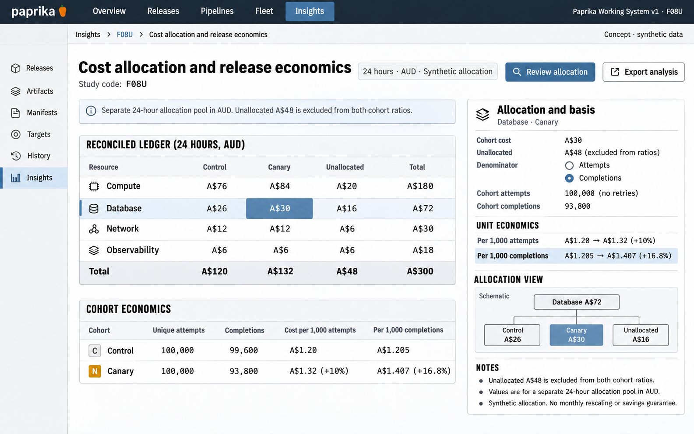

# F08 Cost allocation and release economics

**Design system:** [Paprika Working System v1](../design-system.md) · **Surface:** Insights · **Status:** proposed feature design.

**Implementation backlog:** [#225](https://github.com/paprikacd/paprika/issues/225).

[Catalogue](../README.md) · [Exact fixture](../fixtures/f08.json) · [Space specification](https://chatgpt.com/space/page_f668ffb8b1248191beb2f63545ab091b)

## Canonical visual reference



Concept · synthetic data. The artboard describes the proposed interface. The fixture and acceptance criteria below define its meaning; this publication does not mark the feature implemented.

## Working surface

- A reconciled category-by-cohort allocation ledger, a visible unallocated column, a selected-allocation inspector and a denominator-aware unit-cost comparison.

## Synthetic fixture

Separate synthetic 24-hour AUD allocation pool. Compute control/canary/unallocated/total: 76/84/20/180; Database 26/30/16/72; Network 12/12/6/30; Observability 6/6/6/18. Totals A$120/A$132/A$48/A$300. Each cohort has 100,000 unique attempts with no retries; completions 99,600/93,800. Cost per 1,000 attempts A$1.20→A$1.32 (+10%); per 1,000 completions A$1.204819→A$1.407249 (+16.8017%), displayed A$1.205→A$1.407 (+16.8%).

```json
{
  "currency": "AUD",
  "allocationIntervalHours": 24,
  "rows": [
    {
      "category": "Compute",
      "control": 76,
      "canary": 84,
      "unallocated": 20,
      "total": 180
    },
    {
      "category": "Database",
      "control": 26,
      "canary": 30,
      "unallocated": 16,
      "total": 72
    },
    {
      "category": "Network",
      "control": 12,
      "canary": 12,
      "unallocated": 6,
      "total": 30
    },
    {
      "category": "Observability",
      "control": 6,
      "canary": 6,
      "unallocated": 6,
      "total": 18
    }
  ],
  "totals": {
    "control": 120,
    "canary": 132,
    "unallocated": 48,
    "total": 300
  },
  "attemptsEach": 100000,
  "retries": 0,
  "completions": {
    "control": 99600,
    "canary": 93800
  },
  "costPer1000AttemptsAUD": {
    "control": 1.2,
    "canary": 1.32,
    "increasePercent": 10
  },
  "costPer1000CompletionsAUD": {
    "control": 1.204819,
    "canary": 1.407249,
    "increasePercent": 16.8017,
    "displayControl": "A$1.205",
    "displayCanary": "A$1.407",
    "displayIncrease": "+16.8%"
  },
  "unallocatedIncludedInCohortRatios": false
}
```

## Interaction and state contract

- This is a separate 24-hour allocation pool in AUD, not the twelve-minute incident window and not a monthly cost field.
- Rows and columns reconcile to A$300. The A$48 unallocated balance remains visible and is excluded from both cohort unit-cost ratios.
- Keep attempts and completions distinct; the synthetic fixture has no retries.
- Selecting a cell inspects its allocation rule and source rows; it does not silently reallocate cost.
- Basis, currency, interval and population remain explicit; missing or zero outcome denominators disable dependent ratios.
- Allocation estimates are distinct from provider billing; do not fabricate an invoice or silently rescale monthly observations.

## Backlog implementation specification

The following scope and unchecked acceptance criteria are preserved from the linked implementation issues, read on 2026-11-11. Existing foundations and proposed additions remain distinct.

### Problem and outcome

Bind real allocation data to the currently unconfigured cost surface and design an interval-aware ledger with explicit unallocated costs. Release unit economics requires compatible outcome populations, not only infrastructure totals.

### Proposed scope

- Use an authorized OpenCost adapter and extend the existing cost contract deliberately for bounded intervals; never put 24-hour totals into monthlyAmount or silently rescale them.
- Keep list-price allocation, provider billing and idle/shared/unallocated policies distinct. Show unmatched joins and missing business outcomes.
- Reuse canonical records/table/inspection primitives; keep any proposed redistribution separate from applied policy.

### Acceptance criteria

- [ ] The synthetic 24-hour AUD ledger reconciles control A$120 + canary A$132 + unallocated A$48 = A$300 across compute A$180, database A$72, network A$30 and observability A$18.
- [ ] For 100,000 attempts each and 99,600 / 93,800 completions, cost per 1,000 attempts is A$1.20 / A$1.32 (+10%); per 1,000 completions it is A$1.204819 / A$1.407249 (+16.8017%).
- [ ] Unallocated A$48 is excluded from cohort ratios; missing or zero denominator yields unavailable, not zero or infinity; source basis, currency and window remain compatible.

### Implementation evidence

- [Cost API](https://github.com/paprikacd/paprika/blob/17a651ab8edf20337ac5319af93ae7fb2c389b47/internal/api/cost_handler.go)
- [Existing monthly cost model](https://github.com/paprikacd/paprika/blob/17a651ab8edf20337ac5319af93ae7fb2c389b47/ui/src/components/fleet/fleet-cost.ts)
- [OpenCost allocation API](https://opencost.io/docs/integrations/api/)

Suggested order: **Provider pilot**. Status: proposed feature; the synthetic wireframe is design evidence, not a deployed capability. Implementation sources were inspected at master `17a651ab8edf20337ac5319af93ae7fb2c389b47` on 10 November 2026.

## Earlier creative explorations

These earlier studies retain the feature's exploration history. The canonical artboard above supplies the shared shell and visual direction.

[F08A](../assets/explorations/f08a.png) · [F08B](../assets/explorations/f08b.png) · [Archive index](../explorations/README.md#f08)

## Implementation alignment

Use the existing runtime owners identified in the [design-system contract](../design-system.md#runtime-ownership). Apply the common shell, type, spacing and state vocabulary without replacing this feature's work surface, authorization or data semantics.

The canonical fixture remains available as JSON for implementation and review. Keyboard, narrow-layout and live-data behavior require implementation-specific verification; generated artboards do not establish those results.
