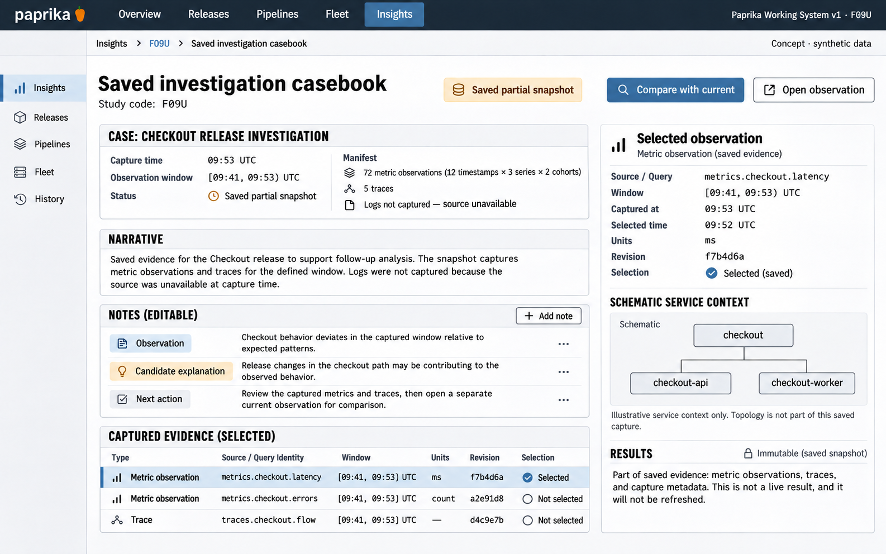

# F09 Saved investigation casebook

**Design system:** [Paprika Working System v1](../design-system.md) · **Surface:** Insights · **Status:** proposed feature design.

**Implementation backlog:** [#221](https://github.com/paprikacd/paprika/issues/221).

[Catalogue](../README.md) · [Exact fixture](../fixtures/f09.json) · [Space specification](https://chatgpt.com/space/page_f668ffb8b1248191beb2f63545ab091b)

## Canonical visual reference



Concept · synthetic data. The artboard describes the proposed interface. The fixture and acceptance criteria below define its meaning; this publication does not mark the feature implemented.

## Working surface

- A compact case index, readable investigation narrative, distinct note types, a capture-revision spine and an evidence manifest with selected captured detail.

## Synthetic fixture

Synthetic Checkout release investigation, captured at 09:53 UTC for [09:41, 09:53) UTC. Saved partial snapshot: 72 metric observations = 12 timestamps × 3 series × 2 cohorts; 5 traces; logs not captured because the source was unavailable.

```json
{
  "case": "Checkout release investigation",
  "capturedUTC": "09:53",
  "windowUTC": {
    "start": "09:41",
    "endExclusive": "09:53"
  },
  "captureState": "Saved partial snapshot",
  "metricObservations": 72,
  "timestamps": 12,
  "series": 3,
  "cohorts": 2,
  "traces": 5,
  "logs": {
    "state": "Not captured",
    "reason": "Source unavailable"
  }
}
```

## Interaction and state contract

- Observation, candidate explanation and next action are separate note types.
- Captured evidence is immutable; editable notes can evolve independently.
- Selecting captured evidence restores its recorded query identity, bounds, units, revision and selected observation.
- Compare with current creates a separate current observation and cannot overwrite the saved capture.
- Logs not captured is a source-unavailable state, not zero logs or no errors. Keep partial capture visibly partial.
- Sharing a case does not broaden source authorization; reopening preserves exact captured results and gaps.

## Backlog implementation specification

The following scope and unchecked acceptance criteria are preserved from the linked implementation issues, read on 2026-11-11. Existing foundations and proposed additions remain distinct.

### Problem and outcome

Retain the exact evidence behind an investigation so it can be reopened after live results or provider retention change. Reuse existing Resource Investigator findings and Insights evidence rather than creating another diagnosis engine.

### Proposed scope

- Define capture ownership, versioned bounded results, query/provider/document identity, units, time bounds, capture/arrival timestamps, truncation and authorization/redaction/retention behavior.
- Keep immutable captured evidence separate from editable notes and source reruns. Support explicit partial captures and incompatible historical schema fallback.
- Reuse Resource Investigator findings/evidence and canonical Insights results. Dashboard ETags alone do not capture telemetry.

### Acceptance criteria

- [ ] Fixture captures 72 metric observations (12 timestamps × 3 series × 2 cohorts), 5 traces and unavailable logs as Saved partial snapshot.
- [ ] Reopening returns captured results and missingness; Compare with current cannot silently rewrite them.
- [ ] Capture limits, schema migration, conflict recovery and source access boundaries are exercised; sharing a case does not grant broader provider access.

### Related integration work

- https://github.com/paprikacd/paprika/issues/216
- https://github.com/paprikacd/paprika/issues/217

The first capture slice may save metrics and existing findings with explicit unavailable logs. It does not wait for connected log inspection; later integrations reuse the same evidence reference contract.

### Implementation evidence

- [Investigator registry](https://github.com/paprikacd/paprika/blob/17a651ab8edf20337ac5319af93ae7fb2c389b47/internal/investigator/registry.go)
- [Existing investigation panel](https://github.com/paprikacd/paprika/blob/17a651ab8edf20337ac5319af93ae7fb2c389b47/ui/src/components/dashboard/investigation-panel.tsx)
- [Result schema](https://github.com/paprikacd/paprika/blob/17a651ab8edf20337ac5319af93ae7fb2c389b47/ui/src/features/insights/schema.ts)

Suggested order: **Next investigation slice**. Status: proposed feature; the synthetic wireframe is design evidence, not a deployed capability. Implementation sources were inspected at master `17a651ab8edf20337ac5319af93ae7fb2c389b47` on 10 November 2026.

## Related backlog

[#222](https://github.com/paprikacd/paprika/issues/222)

## Earlier creative explorations

These earlier studies retain the feature's exploration history. The canonical artboard above supplies the shared shell and visual direction.

[F09A](../assets/explorations/f09a.png) · [F09B](../assets/explorations/f09b.png) · [Archive index](../explorations/README.md#f09)

## Implementation alignment

Use the existing runtime owners identified in the [design-system contract](../design-system.md#runtime-ownership). Apply the common shell, type, spacing and state vocabulary without replacing this feature's work surface, authorization or data semantics.

The canonical fixture remains available as JSON for implementation and review. Keyboard, narrow-layout and live-data behavior require implementation-specific verification; generated artboards do not establish those results.
