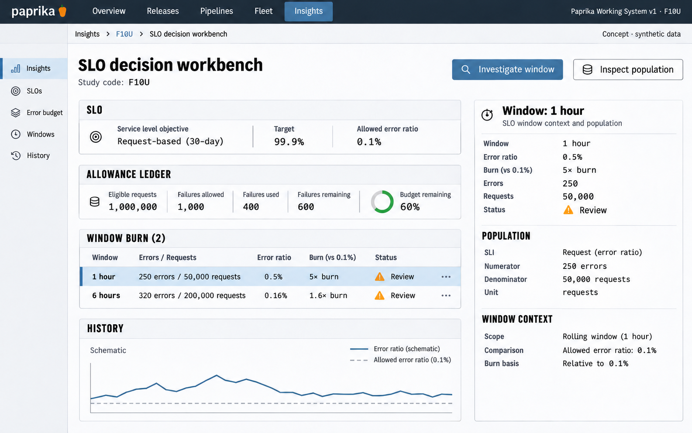

# F10 SLO decision workbench

**Design system:** [Paprika Working System v1](../design-system.md) · **Surface:** Insights · **Status:** proposed feature design.

**Implementation backlog:** [#226](https://github.com/paprikacd/paprika/issues/226).

[Catalogue](../README.md) · [Exact fixture](../fixtures/f10.json) · [Space specification](https://chatgpt.com/space/page_7201ecf2dcc48191b56b5e90cae4b652)

## Canonical visual reference



Concept · synthetic data. The artboard describes the proposed interface. The fixture and acceptance criteria below define its meaning; this publication does not mark the feature implemented.

## Working surface

- Broad error-budget ledger
- Aligned 1-hour and 6-hour burn rows
- Schematic history with exact selected-window population inspector

## Synthetic fixture

Request-based 30-day SLO, target 99.9%. Of 1,000,000 eligible requests, 1,000 failures are allowed; 400 have been used, leaving 600 failures, or 60% of the budget. One hour: 250 errors / 50,000 eligible requests = 0.5%, or 5× burn. Six hours: 320 errors / 200,000 eligible requests = 0.16%, or 1.6× burn.

```json
{
  "sloType": "request ratio",
  "targetPercent": 99.9,
  "period": "30 days",
  "eligibleRequests": 1000000,
  "allowedFailures": 1000,
  "usedFailures": 400,
  "remainingFailures": 600,
  "remainingBudgetPercent": 60,
  "windows": [
    {
      "window": "1 hour",
      "errors": 250,
      "eligibleRequests": 50000,
      "errorPercent": 0.5,
      "burnMultiple": 5
    },
    {
      "window": "6 hours",
      "errors": 320,
      "eligibleRequests": 200000,
      "errorPercent": 0.16,
      "burnMultiple": 1.6
    }
  ],
  "selectedWindow": "1 hour"
}
```

## Interaction and state contract

- Request-based and HTTP-probe-based SLIs remain distinct.
- Aggregate counts within the same population and bounds before computing ratios. The 1-hour population is contained in the 6-hour and 30-day populations.
- The historical 6-hour observations must be adequate; do not substitute coarsened display buckets.
- Missing, stale, zero-volume and insufficient-coverage states are distinct. Never infer a depletion date.
- Investigation retains the exact source, scope and bounds.

### Available actions

| Action state | Contract |
| --- | --- |
| Available in the illustrated state | Investigate window; Inspect population |
| Outside this slice | Activate alert policy; Dispatch notification |

## Backlog implementation specification

The following scope and unchecked acceptance criteria are preserved from the linked implementation issues, read on 2026-11-11. Existing foundations and proposed additions remain distinct.

### Problem

Are recent request failures consuming the error budget quickly enough to investigate?

Application HTTP-probe SLOs already show availability, error budget, burn and coverage for configured 1-hour, 24-hour, 7-day and 30-day windows. This proposal adds a query-backed request SLI and paired evaluation windows; probe observations and request populations remain distinct.

### Proposed first release

Define one request-ratio SLI with good and eligible counts, a target, query identity and a common scope. Compare 1-hour and 6-hour burn from retained, queryable observations. Reuse existing SLO presentation and query ownership; save a reviewed definition separately from any alert policy.

### Synthetic fixture

Synthetic 30-day request SLO of 99.9%: 1,000,000 eligible requests allow 1,000 failures; 400 used leaves 600, or 60%. One hour: 250 / 50,000 = 0.5% errors and 5× burn. Six hours: 320 / 200,000 = 0.16% errors and 1.6× burn. The 1-hour population is contained in the 6-hour and 30-day populations.

All example times are UTC.

### Acceptance criteria

- [ ] Request-based and HTTP-probe-based SLIs are explicitly identified and cannot be mixed.
- [ ] Numerators and denominators use the same population and bounds; aggregate counts before calculating the ratio.
- [ ] The 6-hour window uses adequate historical observations, not coarsened display buckets from existing SLO views.
- [ ] Missing, stale, zero-volume and insufficient-coverage states remain distinct; no automatic depletion date is inferred.
- [ ] Selection, exact values and drilldown remain available on keyboard, touch and narrow layouts.

### Integration and sequencing

Historical request counts and a typed SLI definition are prerequisites. Reuse coverage conventions from #216 without blocking the first slice on its full UI. Policy activation and notification delivery are separate work.

Suggested sequence: Next reliability slice. Related issue references are not automatic hard blockers.

### Current source owners

Source baseline: `17a651ab8edf20337ac5319af93ae7fb2c389b47`, reviewed 10 November 2026.

- [Existing probe SLO accounting](https://github.com/paprikacd/paprika/blob/17a651ab8edf20337ac5319af93ae7fb2c389b47/internal/health/slo.go)
- [Application SLO view](https://github.com/paprikacd/paprika/blob/17a651ab8edf20337ac5319af93ae7fb2c389b47/ui/src/components/dashboard/application-slos.tsx)
- [Insights query owner](https://github.com/paprikacd/paprika/blob/17a651ab8edf20337ac5319af93ae7fb2c389b47/ui/src/features/insights/query.ts)

### Technology reference

[Google SRE multiwindow alerting](https://sre.google/workbook/alerting-on-slos/). Multiwindow burn is a useful decision pattern; thresholds and low-volume treatment must be explicit product policy.

## Related backlog

[#216](https://github.com/paprikacd/paprika/issues/216)

## Earlier creative explorations

These earlier studies retain the feature's exploration history. The canonical artboard above supplies the shared shell and visual direction.

[F10A](../assets/explorations/f10a.png) · [F10B](../assets/explorations/f10b.png) · [Archive index](../explorations/README.md#f10)

## Implementation alignment

Use the existing runtime owners identified in the [design-system contract](../design-system.md#runtime-ownership). Apply the common shell, type, spacing and state vocabulary without replacing this feature's work surface, authorization or data semantics.

The canonical fixture remains available as JSON for implementation and review. Keyboard, narrow-layout and live-data behavior require implementation-specific verification; generated artboards do not establish those results.
