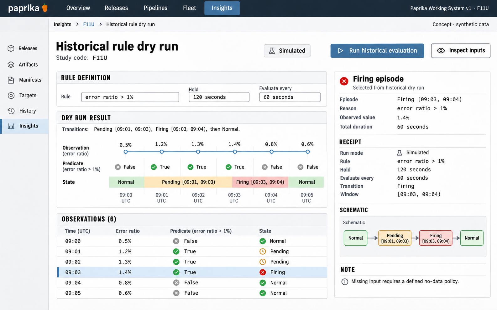

# F11 Historical rule dry run

**Design system:** [Paprika Working System v1](../design-system.md) · **Surface:** Insights · **Status:** proposed feature design.

**Implementation backlog:** [#227](https://github.com/paprikacd/paprika/issues/227).

[Catalogue](../README.md) · [Exact fixture](../fixtures/f11.json) · [Space specification](https://chatgpt.com/space/page_7201ecf2dcc48191b56b5e90cae4b652)

## Canonical visual reference



Concept · synthetic data. The artboard describes the proposed interface. The fixture and acceptance criteria below define its meaning; this publication does not mark the feature implemented.

## Working surface

- Compact rule editor
- Aligned observation, predicate and evaluation-state tracks
- Selected firing-episode receipt with exact intervals

## Synthetic fixture

At 09:00–09:05 UTC, observations are 0.5%, 1.2%, 1.3%, 1.4%, 0.8% and 0.6%. The rule is > 1% held for 120 seconds, evaluated every 60 seconds. Pending: [09:01, 09:03). Firing: [09:03, 09:04). Normal thereafter. There is one firing episode.

```json
{
  "timesUTC": [
    "09:00",
    "09:01",
    "09:02",
    "09:03",
    "09:04",
    "09:05"
  ],
  "errorPercent": [
    0.5,
    1.2,
    1.3,
    1.4,
    0.8,
    0.6
  ],
  "predicate": ">1%",
  "holdSeconds": 120,
  "cadenceSeconds": 60,
  "pendingInterval": "[09:01,09:03)",
  "firingInterval": "[09:03,09:04)",
  "firingEpisodes": 1,
  "selectedEpisode": "09:03–09:04UTC"
}
```

## Interaction and state contract

- A new versioned, bounded evaluator is proposed. Existing instant-query analysis is not a native alert-state engine.
- Persist the engine and version, cadence, warm-up, initial state, hold duration, recovery semantics, query and rule revisions, and input identity.
- Elapsed duration determines transitions. Two positive observations do not alone establish 120 seconds.
- An unknown 09:02 observation cannot imply firing at 09:03 when the no-data policy is unspecified.
- Missing, stale, invalid and counter-reset semantics are explicit. No external-engine parity is claimed.

### Available actions

| Action state | Contract |
| --- | --- |
| Available in the illustrated state | Run historical evaluation; Inspect episode; Compare rule revisions |
| Outside this slice | Enable policy; Send notifications; Invoke operational action |

## Backlog implementation specification

The following scope and unchecked acceptance criteria are preserved from the linked implementation issues, read on 2026-11-11. Existing foundations and proposed additions remain distinct.

### Problem

Which evaluations and state transitions would a proposed rule produce over a historical window?

Paprika's Prometheus analysis currently performs instant-query condition evaluation. It does not provide a native pending/firing/recovery alert-state engine. External Uptime alert events are observations, not a reproducible evaluator.

### Proposed first release

Introduce a versioned, bounded historical evaluator contract for a deliberately small rule subset: comparison, cadence, hold duration, initial state, warm-up, missing or invalid data, recovery and resets. Retain rule and query revisions and inputs. A later adapter for a matching engine may advertise verified compatibility; the first slice makes no external-engine parity claim.

### Synthetic fixture

At 09:00–09:05 UTC, the error ratios are 0.5%, 1.2%, 1.3%, 1.4%, 0.8% and 0.6%. With > 1% held for 120 seconds and evaluations every 60 seconds, pending is [09:01, 09:03), firing is [09:03, 09:04), then returns to normal. There is one firing episode. An unknown 09:02 observation cannot imply a 09:03 firing result while the no-data policy is unspecified.

All example times are UTC.

### Acceptance criteria

- [ ] The evaluation engine and version, cadence, warm-up, boundary initialization, hold duration and recovery are persisted with each run.
- [ ] Elapsed hold duration determines transition timing; two positive samples alone do not prove 120 seconds have elapsed.
- [ ] Missing, stale, invalid and counter-reset cases have explicit semantics and deterministic fixtures.
- [ ] Compare candidate revisions by changed evaluations, preserving unchanged input observations.
- [ ] Simulation cannot enable a policy, dispatch notifications or invoke operational actions.

### Integration and sequencing

Requires a new explicit evaluator and retained, bounded input series. Historical evidence replay #222 is related but not required. Prometheus rule-test fixtures are a candidate validation mechanism, not proof of existing compatibility.

Suggested sequence: After evaluator contract. Related issue references are not automatic hard blockers.

### Current source owners

Source baseline: `17a651ab8edf20337ac5319af93ae7fb2c389b47`, reviewed 10 November 2026.

- [Existing instant condition evaluator](https://github.com/paprikacd/paprika/blob/17a651ab8edf20337ac5319af93ae7fb2c389b47/internal/analysis/prometheus.go)
- [Analysis template types](https://github.com/paprikacd/paprika/blob/17a651ab8edf20337ac5319af93ae7fb2c389b47/api/pipelines/v1alpha1/analysis_template_types.go)
- [Execution budget](https://github.com/paprikacd/paprika/blob/17a651ab8edf20337ac5319af93ae7fb2c389b47/internal/observabilitygateway/budget.go)

### Technology reference

[Prometheus rule testing](https://prometheus.io/docs/prometheus/latest/configuration/unit_testing_rules/). Rule fixtures can encode cadence and missing/stale samples; notification-routing replay remains separate.

## Related backlog

[#222](https://github.com/paprikacd/paprika/issues/222)

## Earlier creative explorations

These earlier studies retain the feature's exploration history. The canonical artboard above supplies the shared shell and visual direction.

[F11A](../assets/explorations/f11a.png) · [F11B](../assets/explorations/f11b.png) · [Archive index](../explorations/README.md#f11)

## Implementation alignment

Use the existing runtime owners identified in the [design-system contract](../design-system.md#runtime-ownership). Apply the common shell, type, spacing and state vocabulary without replacing this feature's work surface, authorization or data semantics.

The canonical fixture remains available as JSON for implementation and review. Keyboard, narrow-layout and live-data behavior require implementation-specific verification; generated artboards do not establish those results.
