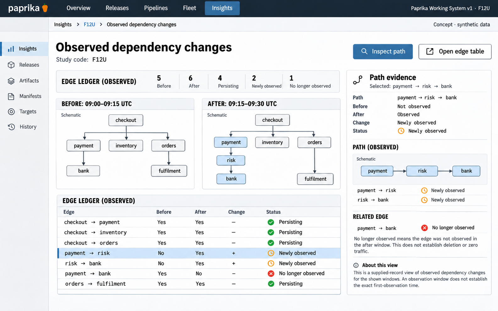

# F12 Observed dependency changes

**Design system:** [Paprika Working System v1](../design-system.md) · **Surface:** Insights · **Status:** proposed feature design.

**Implementation backlog:** [#228](https://github.com/paprikacd/paprika/issues/228).

[Catalogue](../README.md) · [Exact fixture](../fixtures/f12.json) · [Space specification](https://chatgpt.com/space/page_7201ecf2dcc48191b56b5e90cae4b652)

## Canonical visual reference



Concept · synthetic data. The artboard describes the proposed interface. The fixture and acceptance criteria below define its meaning; this publication does not mark the feature implemented.

## Working surface

- Before/after dependency graphs with identical node positions
- Exact change ledger
- Selected payment→risk→bank path inspector; edge-table alternative

## Synthetic fixture

Before, 09:00–09:15 UTC: 5 edges. After, 09:15–09:30 UTC: 6 edges. Four edges persist, two are newly observed, and one is no longer observed. The payment → bank edge is no longer observed; payment → risk and risk → bank are newly observed.

```json
{
  "beforeWindowUTC": "09:00–09:15",
  "afterWindowUTC": "09:15–09:30",
  "beforeEdges": [
    [
      "checkout",
      "payment"
    ],
    [
      "checkout",
      "inventory"
    ],
    [
      "checkout",
      "orders"
    ],
    [
      "payment",
      "bank"
    ],
    [
      "orders",
      "fulfilment"
    ]
  ],
  "afterEdges": [
    [
      "checkout",
      "payment"
    ],
    [
      "checkout",
      "inventory"
    ],
    [
      "checkout",
      "orders"
    ],
    [
      "orders",
      "fulfilment"
    ],
    [
      "payment",
      "risk"
    ],
    [
      "risk",
      "bank"
    ]
  ],
  "beforeCount": 5,
  "afterCount": 6,
  "newlyObserved": 2,
  "noLongerObserved": 1,
  "persisting": 4,
  "selectedPath": [
    "payment",
    "risk",
    "bank"
  ]
}
```

## Interaction and state contract

- Compare compatible supplied edge records. Automatic discovery is separate work.
- Canonical identity retains the service, environment and provider.
- Positions and camera remain stable. Graph limits and collapsed content are disclosed.
- The existing renderer limit is 64 nodes and 200 edges. Sampling, pairing failures and partial coverage remain inspectable.
- A missing edge means no longer observed, not deleted or zero traffic. Metric deltas require compatible definitions, units and populations.

### Available actions

| Action state | Contract |
| --- | --- |
| Available in the illustrated state | Inspect path; Open edge table |
| Outside this slice | Discover services automatically; Delete missing edge; Change routing |

## Backlog implementation specification

The following scope and unchecked acceptance criteria are preserved from the linked implementation issues, read on 2026-11-11. Existing foundations and proposed additions remain distinct.

### Problem

Which call paths became newly observed or stopped being observed between comparable intervals?

The `pipeline-topology` records renderer already normalizes supplied edges, handles cycles and bounds the graph to 64 nodes and 200 edges. It does not discover service dependencies.

### Proposed first release

Compare two compatible edge datasets with canonical service and environment identity. Classify newly observed, persisting, changed and no-longer-observed edges. Start with supplied records through an adapter; automatic dependency discovery is a later source capability.

### Synthetic fixture

Before, 09:00–09:15 UTC: `checkout → payment`, `checkout → inventory`, `checkout → orders`, `payment → bank` and `orders → fulfilment`. After, 09:15–09:30 UTC: `checkout → payment`, `checkout → inventory`, `checkout → orders`, `orders → fulfilment`, `payment → risk` and `risk → bank`. The `payment → bank` edge is no longer observed. Counts: 5 before, 6 after, 2 newly observed, 1 no longer observed and 4 persisting.

All example times are UTC.

### Acceptance criteria

- [ ] Node and edge identity includes relevant service, environment and provider identity.
- [ ] Node positions and camera remain stable across comparison; graph limits and collapsed content are visible.
- [ ] Sampling, pairing failures, partial coverage and window eligibility remain inspectable.
- [ ] A missing edge is labelled no longer observed, never automatically deleted or zero traffic.
- [ ] Metric deltas are shown only for compatible definitions, units and populations; exact table inspection survives narrow layouts.

### Integration and sequencing

Requires an observed-edge source contract; compatible supplied records can ship first. Coverage from #216 and release context from #218 are optional integrations.

Suggested sequence: Next investigation extension. Related issue references are not automatic hard blockers.

### Current source owners

Source baseline: `17a651ab8edf20337ac5319af93ae7fb2c389b47`, reviewed 10 November 2026.

- [Topology data and layout](https://github.com/paprikacd/paprika/blob/17a651ab8edf20337ac5319af93ae7fb2c389b47/ui/src/features/insights/plugins/operational-records-data.ts)
- [Operational records renderers](https://github.com/paprikacd/paprika/blob/17a651ab8edf20337ac5319af93ae7fb2c389b47/ui/src/features/insights/plugins/operational-records.tsx)

### Technology reference

[Tempo service graphs](https://grafana.com/docs/tempo/latest/metrics-from-traces/service_graphs/). Trace pairing and collection affect which dependency edges are observed.

## Related backlog

[#216](https://github.com/paprikacd/paprika/issues/216) · [#218](https://github.com/paprikacd/paprika/issues/218)

## Earlier creative explorations

These earlier studies retain the feature's exploration history. The canonical artboard above supplies the shared shell and visual direction.

[F12A](../assets/explorations/f12a.png) · [F12B](../assets/explorations/f12b.png) · [Archive index](../explorations/README.md#f12)

## Implementation alignment

Use the existing runtime owners identified in the [design-system contract](../design-system.md#runtime-ownership). Apply the common shell, type, spacing and state vocabulary without replacing this feature's work surface, authorization or data semantics.

The canonical fixture remains available as JSON for implementation and review. Keyboard, narrow-layout and live-data behavior require implementation-specific verification; generated artboards do not establish those results.
