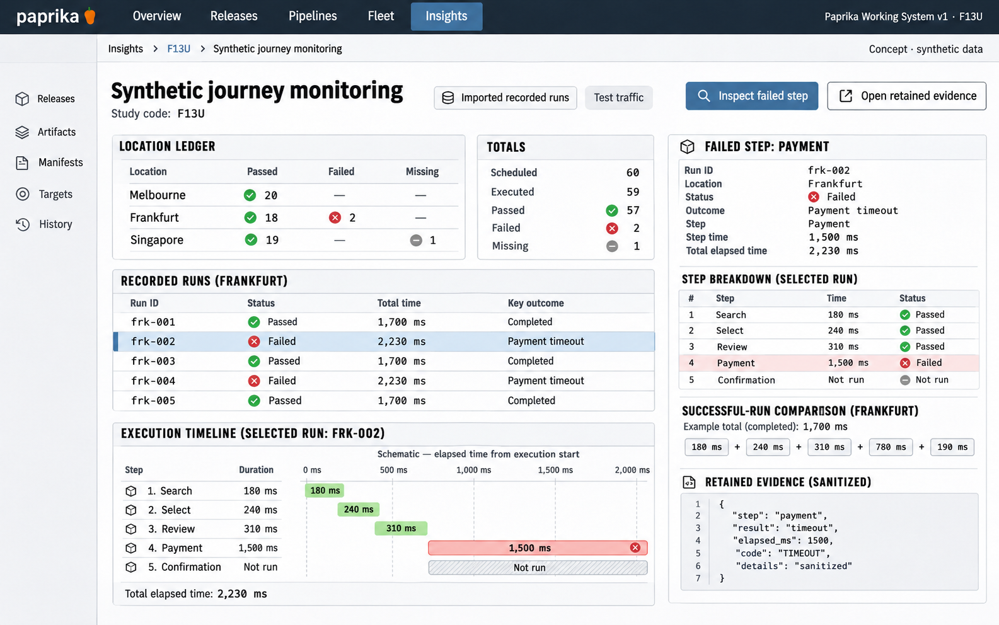

# F13 Synthetic journey monitoring

**Design system:** [Paprika Working System v1](../design-system.md) · **Surface:** Insights · **Status:** proposed feature design.

**Implementation backlog:** [#237](https://github.com/paprikacd/paprika/issues/237).

[Catalogue](../README.md) · [Exact fixture](../fixtures/f13.json) · [Space specification](https://chatgpt.com/space/page_7201ecf2dcc48191b56b5e90cae4b652)

## Canonical visual reference



Concept · synthetic data. The artboard describes the proposed interface. The fixture and acceptance criteria below define its meaning; this publication does not mark the feature implemented.

## Working surface

- Selected-run ordered step waterfall
- Location/run outcome ledger
- Retained failure-evidence viewport and selected-step inspector

## Synthetic fixture

Of 60 scheduled runs, Melbourne has 20 passes; Frankfurt has 18 passes and 2 failures; Singapore has 19 passes and 1 missing run. Totals: 57 passed, 2 failed, 1 missing and 59 executed. The selected failure completes its first 3 steps in 730 ms, then Payment times out after 1,500 ms: 2,230 ms elapsed. Confirmation is Not run.

```json
{
  "scheduledRuns": 60,
  "executedRuns": 59,
  "passed": 57,
  "failed": 2,
  "missing": 1,
  "locations": [
    {
      "name": "Melbourne",
      "passed": 20,
      "failed": 0,
      "missing": 0
    },
    {
      "name": "Frankfurt",
      "passed": 18,
      "failed": 2,
      "missing": 0
    },
    {
      "name": "Singapore",
      "passed": 19,
      "failed": 0,
      "missing": 1
    }
  ],
  "successfulStepDurationsMs": [
    180,
    240,
    310,
    780,
    190
  ],
  "successfulDurationMs": 1700,
  "selectedFailure": {
    "firstThreeStepDurationsMs": [
      180,
      240,
      310
    ],
    "firstThreeElapsedMs": 730,
    "paymentTimeoutMs": 1500,
    "totalElapsedMs": 2230,
    "confirmation": "Not run"
  }
}
```

## Interaction and state contract

- The first slice imports or exposes external recorded runs. Native execution, scheduling, retry and credentials are separate work.
- Runner, browser and journey versions, location, and assertion definitions govern compatibility.
- A missing run requires a schedule manifest. Without one, coverage is unknown.
- Not run is not a 0 ms pass. Step and elapsed intervals must reconcile.
- Artifacts are sanitized and authorized. Trace links require verified correlation. Label the observations as test traffic.

### Available actions

| Action state | Contract |
| --- | --- |
| Available in the illustrated state | Inspect failed step; Open retained evidence |
| Outside this slice | Provision runner; Execute journey; Schedule native browser run; Configure operational credentials |

## Backlog implementation specification

The following scope and unchecked acceptance criteria are preserved from the linked implementation issues, read on 2026-11-11. Existing foundations and proposed additions remain distinct.

### Problem

Which scheduled journey failed, at which step, and what evidence was retained?

HTTP probes already retain sanitized evidence, and Uptime supplies typed current/stored records. A browser journey has additional execution and step semantics that those current-state records do not establish.

### Proposed first release

Start with an adapter for imported or external recorded journey runs: journey and runner version, run identity, location, schedule identity, start and end times, ordered steps, assertions, outcome and sanitized artifact references. Native browser execution, scheduling, credentials and retries are separate backend work.

### Synthetic fixture

60 scheduled runs: Melbourne has 20 passes; Frankfurt has 18 passes and 2 failures; Singapore has 19 passes and 1 missing run. Totals: 57 passed, 2 failed, 1 missing and 59 executed. A successful run takes 180 + 240 + 310 + 780 + 190 = 1,700 ms. The selected failure finishes the first 3 steps in 730 ms, then times out at Payment after 1,500 ms: 2,230 ms elapsed; Confirmation is Not run.

All example times are UTC.

### Acceptance criteria

- [ ] Journey, runner and browser version, location and assertion definitions establish comparison eligibility.
- [ ] Missing scheduled runs require a schedule manifest; without a schedule, coverage is unknown.
- [ ] Not-run steps are distinct from zero-duration passes; elapsed intervals and nested steps reconcile.
- [ ] Artifacts are sanitized and authorized, and any trace link preserves verified correlation rather than guessed identity.
- [ ] Synthetic results are labelled test traffic, and first-slice inspection does not provision runners or execute journeys.

### Integration and sequencing

Requires a source or adapter for recorded runs and an optional schedule manifest. Provenance from #216 and selected-evidence retention from #221 are related but are not hard blockers. Native execution and operational credentials need separately scoped work.

Suggested sequence: After recorded-run adapter. Related issue references are not automatic hard blockers.

### Current source owners

Source baseline: `17a651ab8edf20337ac5319af93ae7fb2c389b47`, reviewed 10 November 2026.

- [HTTP probe evidence](https://github.com/paprikacd/paprika/blob/17a651ab8edf20337ac5319af93ae7fb2c389b47/internal/health/evidence.go)
- [Uptime records adapter](https://github.com/paprikacd/paprika/blob/17a651ab8edf20337ac5319af93ae7fb2c389b47/internal/observabilitygateway/connector/uptime/records.go)
- [Uptime source semantics](https://github.com/paprikacd/paprika/blob/17a651ab8edf20337ac5319af93ae7fb2c389b47/docs/guides/uptime-provider.md)
- [Recorded observation views](https://github.com/paprikacd/paprika/blob/17a651ab8edf20337ac5319af93ae7fb2c389b47/ui/src/features/insights/plugins/uptime-views.tsx)

### Technology reference

[k6 browser metrics](https://grafana.com/docs/k6/latest/using-k6-browser/metrics/). Versioned browser and action measurements are a possible recorded-run source; document navigation and step timing must retain their own definitions.

## Related backlog

[#216](https://github.com/paprikacd/paprika/issues/216) · [#221](https://github.com/paprikacd/paprika/issues/221)

## Earlier creative explorations

These earlier studies retain the feature's exploration history. The canonical artboard above supplies the shared shell and visual direction.

[F13A](../assets/explorations/f13a.png) · [F13B](../assets/explorations/f13b.png) · [Archive index](../explorations/README.md#f13)

## Implementation alignment

Use the existing runtime owners identified in the [design-system contract](../design-system.md#runtime-ownership). Apply the common shell, type, spacing and state vocabulary without replacing this feature's work surface, authorization or data semantics.

The canonical fixture remains available as JSON for implementation and review. Keyboard, narrow-layout and live-data behavior require implementation-specific verification; generated artboards do not establish those results.
