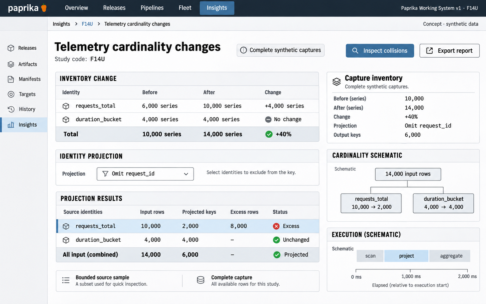

# F14 Telemetry cardinality changes

**Design system:** [Paprika Working System v1](../design-system.md) · **Surface:** Insights · **Status:** proposed feature design.

**Implementation backlog:** [#229](https://github.com/paprikacd/paprika/issues/229).

[Catalogue](../README.md) · [Exact fixture](../fixtures/f14.json) · [Space specification](https://chatgpt.com/space/page_7201ecf2dcc48191b56b5e90cae4b652)

## Canonical visual reference



Concept · synthetic data. The artboard describes the proposed interface. The fixture and acceptance criteria below define its meaning; this publication does not mark the feature implemented.

## Working surface

- Before/after complete-capture inventory ledger
- Selected request_id label inspector
- Expanded original-identity to projected-key collision detail

## Synthetic fixture

Complete captures contain 10,000 then 14,000 series: 40% growth. requests_total changes from 6,000 to 10,000; duration_bucket remains at 4,000. Projecting 10,000 request identities without request_id yields 2,000 keys and 8,000 excess rows. Including 4,000 unchanged histogram identities, 14,000 input rows yield 6,000 keys.

```json
{
  "captureCompleteness": "complete synthetic captures",
  "beforeSeries": 10000,
  "afterSeries": 14000,
  "growthPercent": 40,
  "metrics": [
    {
      "name": "requests_total",
      "beforeSeries": 6000,
      "afterSeries": 10000
    },
    {
      "name": "duration_bucket",
      "beforeSeries": 4000,
      "afterSeries": 4000
    }
  ],
  "projection": {
    "omittedLabel": "request_id",
    "requestInputIdentities": 10000,
    "requestProjectedKeys": 2000,
    "excessRows": 8000,
    "allInputRows": 14000,
    "allProjectedKeys": 6000
  }
}
```

## Interaction and state contract

- Series, distinct label values, projected keys, collision-group count and excess rows are different quantities.
- Two truncated lower bounds cannot yield exact growth. Unmatched scopes are ineligible.
- A complete or imported synthetic 14, 000-row capture does not bypass the existing 1, 000-series bounded reader.
- Retain the full original identities in collision groups.
- Projection does not change collection, prove semantic validity or predict savings.

### Available actions

| Action state | Contract |
| --- | --- |
| Available in the illustrated state | Inspect collisions; Inspect source identities |
| Outside this slice | Drop label; Mutate collector; Apply collection change; Claim cost savings |

## Backlog implementation specification

The following scope and unchecked acceptance criteria are preserved from the linked implementation issues, read on 2026-11-11. Existing foundations and proposed additions remain distinct.

### Problem

Which observed identities changed, and which collisions would a proposed label projection create?

Metric Inspector already reports sampled per-metric series and label counts from a bounded query capped at 1,000 returned series, with partial results treated as lower bounds. This adds temporal comparison and identity-collision analysis.

### Proposed first release

Persist or import compatible metadata observations, compare identities and label-value populations, and project a selected label omission within captured data. Distinguish exact backend head statistics, complete captures and sampled lower bounds. Never treat removal of a label as an automatically valid collection change.

### Synthetic fixture

A complete synthetic capture contains 10,000 then 14,000 series: `requests_total` changes from 6,000 to 10,000 and `duration_bucket` from 4,000 to 4,000, for growth of 40%. Projecting the 10,000 request identities without `request_id` yields 2,000 distinct keys: 8,000 rows beyond one representative per key. With unchanged histogram identities, 14,000 input rows yield 6,000 keys. These are captured identity counts, not predicted cost savings.

All example times are UTC.

### Acceptance criteria

- [ ] Series identity, distinct label values and projected keys are separate named quantities.
- [ ] Two truncated lower bounds cannot produce an exact growth percentage; unmatched capture scopes are ineligible.
- [ ] Collision groups retain full source identities and distinguish group count from excess duplicate rows.
- [ ] Storage and query budgets are explicit; a 14,000-row synthetic fixture does not bypass the current 1,000-series reader cap.
- [ ] No collector mutation, label dropping or savings claim occurs; aggregation or instrumentation changes require separate design.

### Integration and sequencing

Needs compatible persisted observations or historical metadata from the provider. An adapter for exact provider-wide statistics is separate from the current bounded per-metric metadata. Source compatibility in #220 does not own this temporal comparison.

Suggested sequence: Next diagnostics slice. Related issue references are not automatic hard blockers.

### Current source owners

Source baseline: `17a651ab8edf20337ac5319af93ae7fb2c389b47`, reviewed 10 November 2026.

- [Bounded metadata reader](https://github.com/paprikacd/paprika/blob/17a651ab8edf20337ac5319af93ae7fb2c389b47/internal/insights/provider_metric_series.go)
- [Metric Inspector](https://github.com/paprikacd/paprika/blob/17a651ab8edf20337ac5319af93ae7fb2c389b47/ui/src/features/insights/metric-inspector.tsx)

### Technology reference

[Prometheus TSDB statistics](https://prometheus.io/docs/prometheus/latest/querying/api/). TSDB head statistics, label-value lengths and returned top-N lists have narrower meanings than total retained history or total RAM.

## Related backlog

[#220](https://github.com/paprikacd/paprika/issues/220)

## Earlier creative explorations

These earlier studies retain the feature's exploration history. The canonical artboard above supplies the shared shell and visual direction.

[F14A](../assets/explorations/f14a.png) · [F14B](../assets/explorations/f14b.png) · [Archive index](../explorations/README.md#f14)

## Implementation alignment

Use the existing runtime owners identified in the [design-system contract](../design-system.md#runtime-ownership). Apply the common shell, type, spacing and state vocabulary without replacing this feature's work surface, authorization or data semantics.

The canonical fixture remains available as JSON for implementation and review. Keyboard, narrow-layout and live-data behavior require implementation-specific verification; generated artboards do not establish those results.
