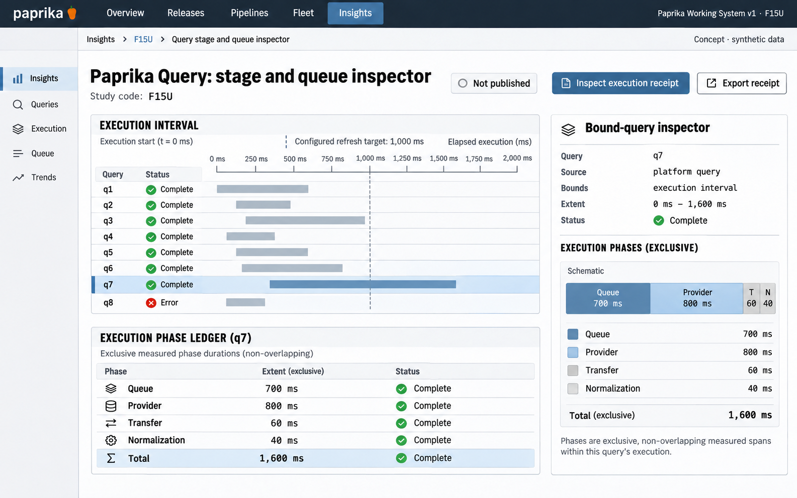

# F15 Query stage and queue inspector

**Design system:** [Paprika Working System v1](../design-system.md) · **Surface:** Insights · **Status:** proposed feature design.

**Implementation backlog:** [#230](https://github.com/paprikacd/paprika/issues/230).

[Catalogue](../README.md) · [Exact fixture](../fixtures/f15.json) · [Space specification](https://chatgpt.com/space/page_7201ecf2dcc48191b56b5e90cae4b652)

## Canonical visual reference



Concept · synthetic data. The artboard describes the proposed interface. The fixture and acceptance criteria below define its meaning; this publication does not mark the feature implemented.

## Working surface

- Shared execution-relative elapsed-time ruler
- Scheduler query swimlanes
- Selected query exclusive-phase ledger and bound-query inspector

## Synthetic fixture

Eight queries: 7 complete and 1 error. Selected query q7 takes 1,600 ms: 700 ms queued + 800 ms at the provider + 60 ms transfer + 40 ms normalization. The configured refresh reference is 1,000 ms, not a guarantee. Concurrent durations are not summed.

```json
{
  "queryCount": 8,
  "complete": 7,
  "error": 1,
  "selectedQuery": "q7",
  "selectedDurationMs": 1600,
  "exclusivePhases": [
    {
      "phase": "Queue",
      "durationMs": 700
    },
    {
      "phase": "Provider",
      "durationMs": 800
    },
    {
      "phase": "Transfer",
      "durationMs": 60
    },
    {
      "phase": "Normalization",
      "durationMs": 40
    }
  ],
  "configuredRefreshReferenceMs": 1000
}
```

## Interaction and state contract

- Execution receipts are proposed. The current scheduler's cache and deduplication behavior are an existing foundation.
- Each phase names its clock and measurement owner. Exclusive phases and nested spans are different.
- Unavailable provider timing remains unknown, not 0. Returned series count is not input cardinality or storage cost.
- Shared, deduplicated and cached work retains attributable identities without double charging.
- Cancellation, timeout, partial-result and error states remain distinct. Diagnostics use the canonical bounded scheduler.

### Available actions

| Action state | Contract |
| --- | --- |
| Available in the illustrated state | Inspect execution receipt; Inspect bound query |
| Outside this slice | Query on hover; Query on theme/layout change; Treat target as scheduler guarantee |

## Backlog implementation specification

The following scope and unchecked acceptance criteria are preserved from the linked implementation issues, read on 2026-11-11. Existing foundations and proposed additions remain distinct.

### Problem

Where did a dashboard refresh spend time, and which limits or reuse decisions affected its results?

The query scheduler already deduplicates and caches bounded requests, and the data inspector shows exact results. The normalized result contract does not yet carry a complete execution receipt.

### Proposed first release

Add sanitized receipts for the resolved query and variables, source identity, requested and effective bounds, queue wait, cache and shared-request reuse, measured backend phases, cancellation, result counts and truncation. Preserve timing ownership and distinguish client, gateway and provider clocks.

### Synthetic fixture

Eight synthetic queries: seven complete and one error. Query `q7` takes 1,600 ms: 700 ms queued + 800 ms at the provider + 60 ms for transfer + 40 ms for normalization. These are deliberately exclusive measured intervals. A 1,000 ms refresh target is a configured reference, not a claimed scheduler guarantee. Concurrent query durations are not summed into dashboard wall time.

All example times are UTC.

### Acceptance criteria

- [ ] Every timing names its clock and measurement owner; nested spans are not summed as exclusive phases.
- [ ] Unavailable provider phases remain unknown; the returned series count is not input cardinality or physical storage cost.
- [ ] Cache hits and shared or deduplicated requests retain attributable receipt identity without double charging.
- [ ] Cancellation, timeout, partial results and backend errors are distinguishable, sanitized and bounded.
- [ ] Diagnostics reuse the canonical scheduler and do not launch queries on hover or presentation edits.

### Integration and sequencing

Extend the scheduler and normalized diagnostics envelope. Reuse provenance from #216 and editor surfaces from #219 when useful; neither blocks basic measured receipts.

Suggested sequence: Next diagnostics slice. Related issue references are not automatic hard blockers.

### Current source owners

Source baseline: `17a651ab8edf20337ac5319af93ae7fb2c389b47`, reviewed 10 November 2026.

- [Scheduler](https://github.com/paprikacd/paprika/blob/17a651ab8edf20337ac5319af93ae7fb2c389b47/ui/src/features/insights/query.ts)
- [Data inspector](https://github.com/paprikacd/paprika/blob/17a651ab8edf20337ac5319af93ae7fb2c389b47/ui/src/features/insights/chart-data-inspector.tsx)
- [Query result types](https://github.com/paprikacd/paprika/blob/17a651ab8edf20337ac5319af93ae7fb2c389b47/internal/insights/types.go)
- [Gateway admission](https://github.com/paprikacd/paprika/blob/17a651ab8edf20337ac5319af93ae7fb2c389b47/internal/observabilitygateway/budget.go)

### Technology reference

[Prometheus query statistics](https://prometheus.io/docs/prometheus/latest/querying/api/). Backend statistics are capability-dependent; evaluator sample accounting is not physical storage I/O or billing cost.

## Related backlog

[#216](https://github.com/paprikacd/paprika/issues/216) · [#219](https://github.com/paprikacd/paprika/issues/219)

## Earlier creative explorations

These earlier studies retain the feature's exploration history. The canonical artboard above supplies the shared shell and visual direction.

[F15A](../assets/explorations/f15a.png) · [F15B](../assets/explorations/f15b.png) · [Archive index](../explorations/README.md#f15)

## Implementation alignment

Use the existing runtime owners identified in the [design-system contract](../design-system.md#runtime-ownership). Apply the common shell, type, spacing and state vocabulary without replacing this feature's work surface, authorization or data semantics.

The canonical fixture remains available as JSON for implementation and review. Keyboard, narrow-layout and live-data behavior require implementation-specific verification; generated artboards do not establish those results.
