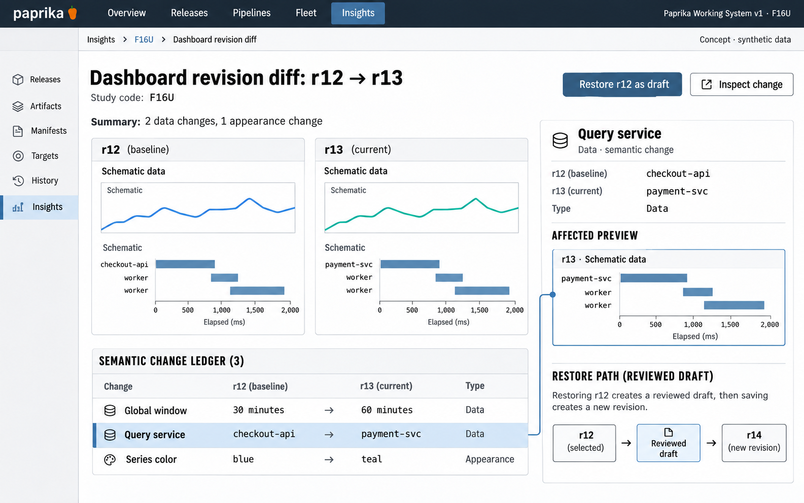

# F16 Dashboard revision diff

**Design system:** [Paprika Working System v1](../design-system.md) · **Surface:** Insights · **Status:** proposed feature design.

**Implementation backlog:** [#231](https://github.com/paprikacd/paprika/issues/231).

[Catalogue](../README.md) · [Exact fixture](../fixtures/f16.json) · [Space specification](https://chatgpt.com/space/page_7201ecf2dcc48191b56b5e90cae4b652)

## Canonical visual reference



Concept · synthetic data. The artboard describes the proposed interface. The fixture and acceptance criteria below define its meaning; this publication does not mark the feature implemented.

## Working surface

- Equal-size revision definition previews
- Version spine
- Semantic change ledger separating data from appearance
- Selected field linked to affected panel

## Synthetic fixture

Revision r12 → r13 has 3 changes: global window, 30 → 60 minutes; query service, checkout-api → payment-svc; series color, blue → teal. Two affect data and one affects appearance. Previews are schematic definitions, not historical telemetry.

```json
{
  "fromRevision": "r12",
  "toRevision": "r13",
  "changes": [
    {
      "field": "Global window",
      "before": "30 minutes",
      "after": "60 minutes",
      "category": "Data"
    },
    {
      "field": "Query service",
      "before": "checkout-api",
      "after": "payment-svc",
      "category": "Data"
    },
    {
      "field": "Series color",
      "before": "blue",
      "after": "teal",
      "category": "Appearance"
    }
  ],
  "changeCount": 3,
  "dataChanges": 2,
  "appearanceChanges": 1,
  "previewData": "schematic definition previews"
}
```

## Interaction and state contract

- Durable immutable saved revisions are proposed. Existing in-memory undo is not durable persistence.
- Restore creates a new guarded revision through a draft using the current ETag, retaining local work on conflicts.
- Keep saved-query dependency references separate. Restoring a dashboard does not mutate those definitions.
- Retention and migration are explicit.
- Missing providers, permissions and history remain explicit. An old definition is not an evidence capture.

### Available actions

| Action state | Contract |
| --- | --- |
| Available in the illustrated state | Inspect change; Restore r12 as draft |
| Outside this slice | Overwrite current revision directly; Restore historical telemetry; Silently restore referenced saved-query definitions |

## Backlog implementation specification

The following scope and unchecked acceptance criteria are preserved from the linked implementation issues, read on 2026-11-11. Existing foundations and proposed additions remain distinct.

### Problem

What changed in a saved dashboard, and can an earlier definition be restored without losing current work?

The backend atomically persists the current document with ETag preconditions. `history.ts` provides in-memory undo states; portable import already has a semantic diff. These do not constitute durable saved revision history.

### Proposed first release

Retain bounded immutable document revisions with actor, time, identity and saved-query dependency references. Compare semantic changes and restore a selected definition through a new draft and guarded new revision. Define retention and migration.

### Synthetic fixture

Revision 12 → 13 has three changes: the global window changes from 30 minutes to 60 minutes; the query service from `checkout-api` to `payment-svc`; and the series color from blue to teal. Two affect data and one affects appearance. Definition previews use schematic data and do not represent captured historical telemetry.

All example times are UTC.

### Acceptance criteria

- [ ] Saved revisions survive restart and remain bounded by explicit retention and migration rules.
- [ ] Semantic diff identifies changes to sources, queries, variables, bindings, units, thresholds, layout and presentation.
- [ ] Restore creates a new revision using the current ETag; conflicts preserve local work and require renewed review.
- [ ] Restoring a dashboard definition does not silently restore or mutate referenced saved-query definitions.
- [ ] Missing providers, permissions or historical results remain explicit; old definitions are not evidence snapshots.

### Integration and sequencing

Requires a durable revision model. Reuse import-review diff logic and conflict recovery from #219. This is distinct from immutable investigation evidence in #221 and session editing in PR #208.

Suggested sequence: Next persistence slice. Related issue references are not automatic hard blockers.

### Current source owners

Source baseline: `17a651ab8edf20337ac5319af93ae7fb2c389b47`, reviewed 10 November 2026.

- [Current document persistence](https://github.com/paprikacd/paprika/blob/17a651ab8edf20337ac5319af93ae7fb2c389b47/internal/insights/store.go)
- [Session history](https://github.com/paprikacd/paprika/blob/17a651ab8edf20337ac5319af93ae7fb2c389b47/ui/src/features/insights/history.ts)
- [Semantic import diff](https://github.com/paprikacd/paprika/blob/17a651ab8edf20337ac5319af93ae7fb2c389b47/ui/src/features/insights/import-review.ts)

### Technology reference

[Grafana dashboard version history](https://grafana.com/docs/grafana/latest/visualizations/dashboards/build-dashboards/manage-version-history/). Creating a new revision on restore is a useful product precedent; Paprika should retain its own canonical document and write guards.

## Related backlog

[#219](https://github.com/paprikacd/paprika/issues/219) · [#221](https://github.com/paprikacd/paprika/issues/221)

## Implementation alignment

Use the existing runtime owners identified in the [design-system contract](../design-system.md#runtime-ownership). Apply the common shell, type, spacing and state vocabulary without replacing this feature's work surface, authorization or data semantics.

The canonical fixture remains available as JSON for implementation and review. Keyboard, narrow-layout and live-data behavior require implementation-specific verification; generated artboards do not establish those results.
