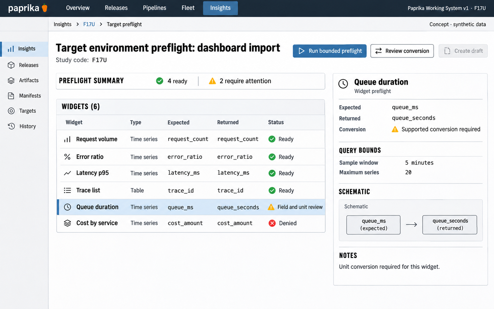

# F17 Target environment preflight

**Design system:** [Paprika Working System v1](../design-system.md) · **Surface:** Insights · **Status:** proposed feature design.

**Implementation backlog:** [#232](https://github.com/paprikacd/paprika/issues/232).

[Catalogue](../README.md) · [Exact fixture](../fixtures/f17.json) · [Space specification](https://chatgpt.com/space/page_7201ecf2dcc48191b56b5e90cae4b652)

## Canonical visual reference



Concept · synthetic data. The artboard describes the proposed interface. The fixture and acceptance criteria below define its meaning; this publication does not mark the feature implemented.

## Working surface

- Six-widget readiness ledger after portable-import provider mapping
- Distinct authorization, schema, unit and sample-result fields
- Selected Queue duration expected/returned inspector

## Synthetic fixture

Six widgets: Request volume, Error ratio, Latency p95 and Trace list are Ready; Queue duration needs field and unit review; Cost by service is Denied. Four are ready and two need attention. Expected field: queue_ms. Returned field: queue_seconds. Bounded sample: 5 minutes, maximum 20 series.

```json
{
  "widgetCount": 6,
  "ready": 4,
  "needsAttention": 2,
  "widgets": [
    {
      "name": "Request volume",
      "status": "Ready"
    },
    {
      "name": "Error ratio",
      "status": "Ready"
    },
    {
      "name": "Latency p95",
      "status": "Ready"
    },
    {
      "name": "Trace list",
      "status": "Ready"
    },
    {
      "name": "Queue duration",
      "status": "Field and unit review"
    },
    {
      "name": "Cost by service",
      "status": "Denied"
    }
  ],
  "selectedWidget": "Queue duration",
  "expectedField": "queue_ms",
  "returnedField": "queue_seconds",
  "sampleWindowMinutes": 5,
  "maxSeries": 20
}
```

## Interaction and state contract

- This is portable dashboard import target readiness, not deployment preflight.
- Static validity, provider authorization and sampled compatibility are separate results.
- Check tooltip queries and annotation sources as well as panel queries.
- A field or unit mismatch requires a supported conversion, not relabelling seconds as milliseconds.
- Use only explicit, bounded, cancellable host reads. Mapping, identity, authorization or query changes invalidate receipts.
- Preserve existing conditional import behavior, reviewed ETags and partial-retry semantics. Creation requires resolution or explicit reviewed exclusion.

### Available actions

| Action state | Contract |
| --- | --- |
| Available in the illustrated state | Run bounded preflight; Review field and unit conversion |
| Unavailable until resolved | Create unresolved draft without explicit resolution or exclusion |
| Outside this slice | Silently omit unresolved widgets; Include credentials in receipts; Execute foreign code; Deploy application |

## Backlog implementation specification

The following scope and unchecked acceptance criteria are preserved from the linked implementation issues, read on 2026-11-11. Existing foundations and proposed additions remain distinct.

### Problem

Will the reviewed portable dashboard actually work with the target environment's data, permissions and capabilities?

Portable import already validates bundles, maps providers, reviews typed diffs, supports Keep, Replace and Copy, checks reviewed ETags and safely retries partial progress. This adds runtime target-readiness evidence after that review.

### Proposed first release

Produce readiness receipts for each widget, tooltip query and annotation source. Check availability and capabilities, then run explicitly requested bounded sample queries to validate expected fields and units. Bind each receipt to the target identity, authorization, mappings and query and document revisions.

### Synthetic fixture

Six widgets: Request volume, Error ratio, Latency p95 and Trace list are ready; Queue duration needs a field and unit review; and the query for Cost by service is denied. Four are ready and two require attention. Expected `queue_ms` versus returned `queue_seconds` needs a supported conversion, not relabelling. Sample query bounds: 5 minutes, with a maximum of 20 series.

All example times are UTC.

### Acceptance criteria

- [ ] Static document validity, provider authorization and sampled field compatibility are separate results.
- [ ] Readiness covers tooltip queries and annotations as well as primary panel queries.
- [ ] Queries run only through explicit, bounded and cancellable host actions; credentials are never included in receipts.
- [ ] Relevant mapping, identity, authorization or query changes invalidate stale readiness receipts.
- [ ] Preserve existing conditional import and partial-retry semantics; importing cannot execute foreign code or silently omit unresolved items.

### Integration and sequencing

Reuse compatibility reasoning from #220 and repair semantics from #219 without blocking on their full UIs. No new file format or broad Grafana import parity is implied.

Suggested sequence: Next authoring slice. Related issue references are not automatic hard blockers.

### Current source owners

Source baseline: `17a651ab8edf20337ac5319af93ae7fb2c389b47`, reviewed 10 November 2026.

- [Portable import UI](https://github.com/paprikacd/paprika/blob/17a651ab8edf20337ac5319af93ae7fb2c389b47/ui/src/features/insights/portable-import-panel.tsx)
- [Import orchestration](https://github.com/paprikacd/paprika/blob/17a651ab8edf20337ac5319af93ae7fb2c389b47/ui/src/features/insights/bundle-import.ts)
- [Reviewed compatibility](https://github.com/paprikacd/paprika/blob/17a651ab8edf20337ac5319af93ae7fb2c389b47/ui/src/features/insights/import-review.ts)

## Related backlog

[#220](https://github.com/paprikacd/paprika/issues/220) · [#219](https://github.com/paprikacd/paprika/issues/219)

## Implementation alignment

Use the existing runtime owners identified in the [design-system contract](../design-system.md#runtime-ownership). Apply the common shell, type, spacing and state vocabulary without replacing this feature's work surface, authorization or data semantics.

The canonical fixture remains available as JSON for implementation and review. Keyboard, narrow-layout and live-data behavior require implementation-specific verification; generated artboards do not establish those results.
