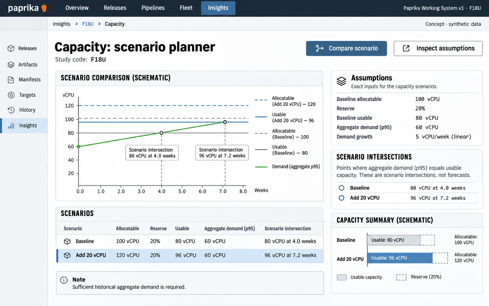

# F18 Capacity scenario planner

**Design system:** [Paprika Working System v1](../design-system.md) · **Surface:** Insights · **Status:** proposed feature design.

**Implementation backlog:** [#233](https://github.com/paprikacd/paprika/issues/233).

[Catalogue](../README.md) · [Exact fixture](../fixtures/f18.json) · [Space specification](https://chatgpt.com/space/page_7201ecf2dcc48191b56b5e90cae4b652)

## Canonical visual reference



Concept · synthetic data. The artboard describes the proposed interface. The fixture and acceptance criteria below define its meaning; this publication does not mark the feature implemented.

## Working surface

- One dominant demand/scenario plot
- Exact reserve and assumptions ledger
- Selected usable-capacity boundary inspector
- Missing-history state retains capacity without projecting

## Synthetic fixture

Capacity is 100 vCPU allocatable; a 20% reserve leaves 80 vCPU usable. Aggregate fleet p95 demand is 60 vCPU. Assumed linear growth of 5 vCPU/week reaches 80 vCPU at 4.0 weeks. Adding 20 vCPU gives 120 vCPU allocatable and 96 vCPU usable, reached at 7.2 weeks.

```json
{
  "allocatableVcpu": 100,
  "reservePercent": 20,
  "usableVcpu": 80,
  "aggregateP95DemandVcpu": 60,
  "assumedGrowthVcpuPerWeek": 5,
  "firstCrossingWeeks": 4,
  "addedCapacityVcpu": 20,
  "expandedAllocatableVcpu": 120,
  "expandedUsableVcpu": 96,
  "expandedCrossingWeeks": 7.2
}
```

## Interaction and state contract

- A historical aggregate-demand contract is proposed beyond the current snapshot sources.
- Compute p95 from the aggregate-demand time series, not from a sum of per-host p95 values.
- Recalculate reserve after changing allocatable capacity.
- Label growth as an assumption, not a forecast. Requested, used, allocatable and scenario demand remain separate.
- Insufficient or incompatible history disables projection; do not fill missing values with zero.
- Aggregate headroom cannot prove placement or schedulability. Future HPA assumptions remain separate. No scaling writes occur.

### Available actions

| Action state | Contract |
| --- | --- |
| Available in the illustrated state | Compare scenario; Inspect assumptions |
| Unavailable until resolved | Dependent projection when history insufficient |
| Outside this slice | Provision capacity; Scale workload; Promise autoscaling outcome; Claim schedulability |

## Backlog implementation specification

The following scope and unchecked acceptance criteria are preserved from the linked implementation issues, read on 2026-11-11. Existing foundations and proposed additions remain distinct.

### Problem

How does a declared demand scenario compare with capacity and the chosen reserve policy?

`KubernetesCapacity` provides requested and allocatable resources, and `MetricsServer` provides current usage. Historical saturation and scenario inputs need a real time-series contract beyond these snapshots.

### Proposed first release

Join selected cluster and node capacity with historical aggregate demand and explicit scenario assumptions. Keep requested, used, allocatable and scenario demand distinct. Start with read-only comparisons; neither provisioning nor autoscaling is invoked.

### Synthetic fixture

Synthetic allocatable capacity of 100 vCPU with a 20% reserve yields 80 usable vCPU. Aggregate fleet p95 demand of 60 vCPU and assumed linear growth of 5 vCPU/week reach that boundary at 4.0 weeks. Adding 20 vCPU gives 120 allocatable vCPU, 96 usable vCPU and 7.2 weeks. The p95 is computed from a time series of aggregate demand, not a sum of per-host percentiles.

All example times are UTC.

### Acceptance criteria

- [ ] Demand statistic, population, history interval, cadence and coverage are explicit.
- [ ] Reserve is recalculated for changed capacity; scenario results are labelled assumptions rather than forecasts.
- [ ] Insufficient or incompatible history disables dependent projections without converting missing values to zero.
- [ ] Aggregate headroom is not claimed to prove schedulability; node fragmentation and placement constraints remain separate.
- [ ] Any future HPA interpretation names readiness, missing-metric and stabilization assumptions; no scaling writes occur in this slice.

### Integration and sequencing

Requires historical utilization data and declared scenario semantics. Cost data from #225 is optional enrichment. The initial view may be a read-only Insights lens reached from Fleet, preserving each surface's theme.

Suggested sequence: After historical demand source. Related issue references are not automatic hard blockers.

### Current source owners

Source baseline: `17a651ab8edf20337ac5319af93ae7fb2c389b47`, reviewed 10 November 2026.

- [Capacity API](https://github.com/paprikacd/paprika/blob/17a651ab8edf20337ac5319af93ae7fb2c389b47/internal/api/cluster_capacity.go)
- [Requested and allocatable capacity](https://github.com/paprikacd/paprika/blob/17a651ab8edf20337ac5319af93ae7fb2c389b47/internal/dataprovider/kubernetescapacity.go)
- [Current usage](https://github.com/paprikacd/paprika/blob/17a651ab8edf20337ac5319af93ae7fb2c389b47/internal/dataprovider/metricsserver.go)
- [Existing capacity meter](https://github.com/paprikacd/paprika/blob/17a651ab8edf20337ac5319af93ae7fb2c389b47/ui/src/components/overview/capacity-meter.tsx)

### Technology reference

[Kubernetes HPA behavior](https://kubernetes.io/docs/concepts/workloads/autoscaling/horizontal-pod-autoscale/). Missing metrics, readiness and stabilization explain why a simple scenario cannot claim to predict actual autoscaling.

## Related backlog

[#225](https://github.com/paprikacd/paprika/issues/225)

## Implementation alignment

Use the existing runtime owners identified in the [design-system contract](../design-system.md#runtime-ownership). Apply the common shell, type, spacing and state vocabulary without replacing this feature's work surface, authorization or data semantics.

The canonical fixture remains available as JSON for implementation and review. Keyboard, narrow-layout and live-data behavior require implementation-specific verification; generated artboards do not establish those results.
