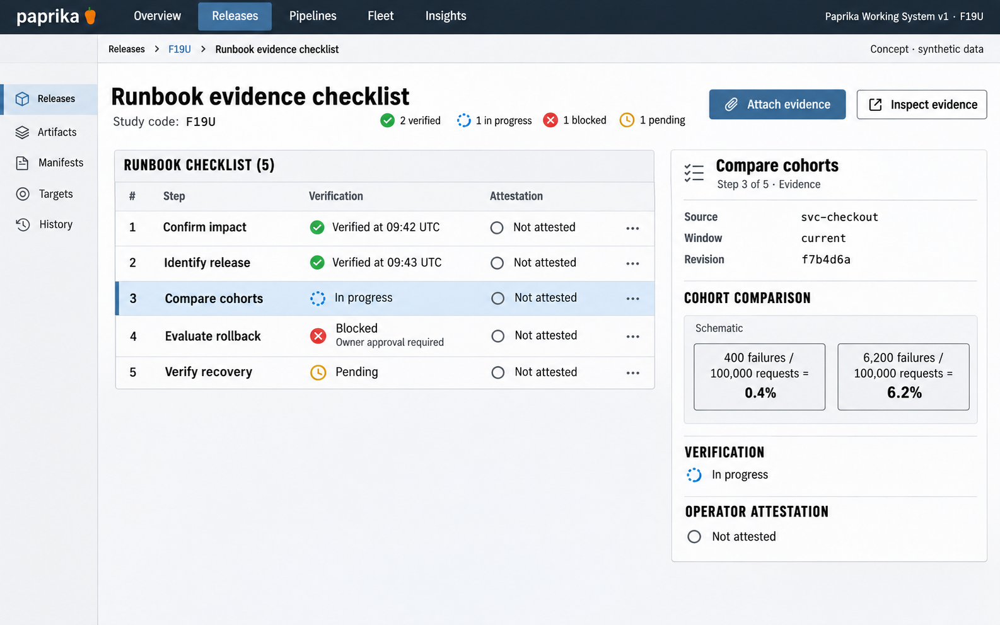

# F19 Runbook evidence checklist

**Design system:** [Paprika Working System v1](../design-system.md) · **Surface:** Main console · **Status:** proposed feature design.

**Implementation backlog:** [#234](https://github.com/paprikacd/paprika/issues/234).

[Catalogue](../README.md) · [Exact fixture](../fixtures/f19.json) · [Space specification](https://chatgpt.com/space/page_7201ecf2dcc48191b56b5e90cae4b652)

## Canonical visual reference



Concept · synthetic data. The artboard describes the proposed interface. The fixture and acceptance criteria below define its meaning; this publication does not mark the feature implemented.

## Working surface

- Ordered numbered procedure rows
- Stable selected-step evidence rail
- Source, capture time, revision and ownership margin

## Synthetic fixture

Five steps: Confirm impact — Verified at 09:42 UTC; Identify release — Verified at 09:43 UTC; Compare cohorts — In progress; Evaluate rollback — Blocked, owner approval required; Verify recovery — Pending. Counts: 2 verified, 1 in progress, 1 blocked, 1 pending. Cohort evidence: 400 / 100,000 = 0.4%; 6,200 / 100,000 = 6.2%.

```json
{
  "steps": [
    {
      "name": "Confirm impact",
      "status": "Verified",
      "timeUTC": "09:42"
    },
    {
      "name": "Identify release",
      "status": "Verified",
      "timeUTC": "09:43"
    },
    {
      "name": "Compare cohorts",
      "status": "In progress"
    },
    {
      "name": "Evaluate rollback",
      "status": "Blocked",
      "reason": "Owner approval required"
    },
    {
      "name": "Verify recovery",
      "status": "Pending"
    }
  ],
  "counts": {
    "verified": 2,
    "inProgress": 1,
    "blocked": 1,
    "pending": 1
  },
  "selectedStep": "Compare cohorts",
  "cohortEvidence": [
    {
      "failures": 400,
      "requests": 100000,
      "errorPercent": 0.4
    },
    {
      "failures": 6200,
      "requests": 100000,
      "errorPercent": 6.2
    }
  ]
}
```

## Interaction and state contract

- A durable versioned checklist is proposed beyond the existing finding and playbook strings.
- Checklist progress, observed condition and executed operation have separate states.
- Owner, actor, time and evidence identity persist. Operator attestation is distinct from observed proof.
- Attached proof retains its source, window and revision, and may become stale without silent refresh.
- Diagnostic reads are bounded and authorized. Future actions reuse maintained pipeline owners.

### Available actions

| Action state | Contract |
| --- | --- |
| Available in the illustrated state | Attach evidence; Inspect evidence; Open existing resource |
| Unavailable until resolved | Evaluate rollback while required owner approval is unresolved |
| Outside this slice | Run arbitrary command; Bypass approval; Automatic remediation |

## Backlog implementation specification

The following scope and unchecked acceptance criteria are preserved from the linked implementation issues, read on 2026-11-11. Existing foundations and proposed additions remain distinct.

### Problem

Which investigation steps have evidence, and which still require a diagnostic or human decision?

Investigator findings already carry evidence and `Playbook` strings. Executable pipeline DAGs are a separate maintained capability. This extends finding playbooks with durable verification state.

### Proposed first release

Introduce versioned checklist steps with owner, status, timestamps, verification notes and evidence references. Support explicit bounded diagnostic reads and navigation to existing resources. Keep operator attestation distinct from observed proof.

### Synthetic fixture

Five steps: Confirm impact is verified at 09:42; Identify release is verified at 09:43; Compare cohorts is in progress; Evaluate rollback is blocked pending owner approval; Verify recovery is pending. Counts: 2 verified + 1 in progress + 1 blocked + 1 pending. Selected cohort evidence: 400 / 100,000 = 0.4% and 6,200 / 100,000 = 6.2%.

All example times are UTC.

### Acceptance criteria

- [ ] Checklist progress, observed condition and executed operational action have separate states.
- [ ] Step definitions are versioned; durable status records actor, time and evidence identity.
- [ ] Attached evidence retains its source, window and revision and can become stale without silently refreshing the recorded proof.
- [ ] Explicit diagnostic reads reuse bounded host queries and source permissions.
- [ ] No second arbitrary command runner, approval bypass or automatic remediation is introduced.

### Integration and sequencing

Needs durable checklist storage and authorization. Integrates naturally with captures from #221; external evidence or source links can support a first slice before capture integration. Future actions reuse existing pipeline owners.

Suggested sequence: Next investigation workflow. Related issue references are not automatic hard blockers.

### Current source owners

Source baseline: `17a651ab8edf20337ac5319af93ae7fb2c389b47`, reviewed 10 November 2026.

- [Finding and playbook model](https://github.com/paprikacd/paprika/blob/17a651ab8edf20337ac5319af93ae7fb2c389b47/internal/investigator/registry.go)
- [Investigation UI](https://github.com/paprikacd/paprika/blob/17a651ab8edf20337ac5319af93ae7fb2c389b47/ui/src/components/dashboard/investigation-panel.tsx)
- [Existing execution model](https://github.com/paprikacd/paprika/blob/17a651ab8edf20337ac5319af93ae7fb2c389b47/api/pipelines/v1alpha1/pipeline_types.go)

## Related backlog

[#221](https://github.com/paprikacd/paprika/issues/221)

## Implementation alignment

Use the existing runtime owners identified in the [design-system contract](../design-system.md#runtime-ownership). Apply the common shell, type, spacing and state vocabulary without replacing this feature's work surface, authorization or data semantics.

The canonical fixture remains available as JSON for implementation and review. Keyboard, narrow-layout and live-data behavior require implementation-specific verification; generated artboards do not establish those results.
