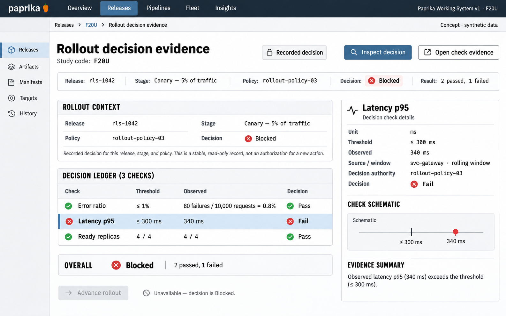

# F20 Rollout decision evidence

**Design system:** [Paprika Working System v1](../design-system.md) · **Surface:** Main console · **Status:** proposed feature design.

**Implementation backlog:** [#235](https://github.com/paprikacd/paprika/issues/235).

[Catalogue](../README.md) · [Exact fixture](../fixtures/f20.json) · [Space specification](https://chatgpt.com/space/page_7201ecf2dcc48191b56b5e90cae4b652)

## Canonical visual reference



Concept · synthetic data. The artboard describes the proposed interface. The fixture and acceptance criteria below define its meaning; this publication does not mark the feature implemented.

## Working surface

- Quiet rollout-stage strip
- Dominant decision receipt
- Open threshold/value/unit/outcome evidence ledger
- Selected failed-check inspector with freshness and authority

## Synthetic fixture

The canary receives 5% of traffic. Error ratio threshold ≤ 1%: 80 failures / 10,000 requests = 0.8%, Pass. Latency p95 threshold ≤ 300 ms: observed 340 ms, Fail. Ready replicas: 4 / 4, Pass. Overall: Blocked, with 2 passed and 1 failed.

```json
{
  "canaryTrafficPercent": 5,
  "checks": [
    {
      "name": "Error ratio",
      "threshold": "≤1%",
      "failures": 80,
      "requests": 10000,
      "value": 0.8,
      "unit": "%",
      "outcome": "Pass"
    },
    {
      "name": "Latency p95",
      "threshold": "≤300ms",
      "value": 340,
      "unit": "ms",
      "outcome": "Fail"
    },
    {
      "name": "Ready replicas",
      "value": 4,
      "total": 4,
      "unit": "replicas",
      "outcome": "Pass"
    }
  ],
  "overall": "Blocked",
  "passed": 2,
  "failed": 1,
  "selectedCheck": "Latency p95"
}
```

## Interaction and state contract

- The initial UI reads existing decisions. The typed evidence contract and durable history are proposed, not universally exposed today.
- Keep typed threshold, value, unit, bounds, freshness, sample and coverage eligibility, policy, release, stage and authority together.
- Missing, stale, partial, errored and inconclusive evidence cannot become Pass.
- Human approval, automated-check and dry-run authority are distinct.
- Existing actions revalidate the current release and policy. Historical evidence never authorizes a new action.
- Do not introduce unsupported Hold or Resume controls.

### Available actions

| Action state | Contract |
| --- | --- |
| Available in the illustrated state | Inspect decision; Open check evidence |
| Unavailable until resolved | Advance |
| Outside this slice | Hold; Resume; Treat historical receipt as new authorization |

## Backlog implementation specification

The following scope and unchecked acceptance criteria are preserved from the linked implementation issues, read on 2026-11-11. Existing foundations and proposed additions remain distinct.

### Problem

Which exact observations and policy revision explain a rollout decision?

Approval gates, analysis checks and the analysis board already exist. Baseline and canary values lack a complete typed API contract, and rollout history is still `NOT_CONFIGURED`. Hold and resume are separate unimplemented capabilities.

### Proposed first release

Add typed decision receipts with release, stage and policy identity, thresholds, observed values, evidence bounds, freshness, eligibility, actor or automation identity, and reason. Persist bounded history and expose a decision detail view. The initial UI reads existing decisions.

### Synthetic fixture

The canary receives 5% of traffic. Error threshold ≤ 1%: 80 failures / 10,000 requests = 0.8%, Pass. p95 threshold ≤ 300 ms: observed 340 ms, Fail. Ready replicas: 4 / 4, Pass. Overall: Blocked, with 2 passed and 1 failed. These are policy-specific synthetic observations, not a claim that all current analysis checks expose these fields.

All example times are UTC.

### Acceptance criteria

- [ ] Thresholds, values, units, windows and eligibility based on samples and coverage are typed rather than parsed from prose.
- [ ] Decision receipts survive restart with explicit retention and stable release and stage identity.
- [ ] Missing, stale, partial, errored and inconclusive evidence cannot silently become Pass.
- [ ] Human approvals, automated health checks and optional dry-run checks retain distinct authority.
- [ ] Any existing operational action revalidates the current release and policy identity; historical decisions do not authorize a new action.

### Integration and sequencing

Requires typed evidence and the history writer behind the existing API gap. Cohort evidence from #218 and captures from #221 are optional integrations; existing non-cohort checks can gain receipts independently.

Suggested sequence: Next operations evidence. Related issue references are not automatic hard blockers.

### Current source owners

Source baseline: `17a651ab8edf20337ac5319af93ae7fb2c389b47`, reviewed 10 November 2026.

- [Existing analysis board](https://github.com/paprikacd/paprika/blob/17a651ab8edf20337ac5319af93ae7fb2c389b47/ui/src/app/dashboard/rollouts/analysis-board.tsx)
- [Approval gates](https://github.com/paprikacd/paprika/blob/17a651ab8edf20337ac5319af93ae7fb2c389b47/internal/gates/approval.go)
- [History API gap](https://github.com/paprikacd/paprika/blob/17a651ab8edf20337ac5319af93ae7fb2c389b47/internal/api/history_handler.go)
- [Capability gates](https://github.com/paprikacd/paprika/blob/17a651ab8edf20337ac5319af93ae7fb2c389b47/internal/api/detail_handler.go)

### Technology reference

[Argo Rollouts analysis semantics](https://argoproj.github.io/argo-rollouts/features/analysis/). Dry-run analysis and authoritative rollout decisions have different effects; the Paprika adapter must declare its own corresponding semantics.

## Related backlog

[#218](https://github.com/paprikacd/paprika/issues/218) · [#221](https://github.com/paprikacd/paprika/issues/221)

## Implementation alignment

Use the existing runtime owners identified in the [design-system contract](../design-system.md#runtime-ownership). Apply the common shell, type, spacing and state vocabulary without replacing this feature's work surface, authorization or data semantics.

The canonical fixture remains available as JSON for implementation and review. Keyboard, narrow-layout and live-data behavior require implementation-specific verification; generated artboards do not establish those results.
