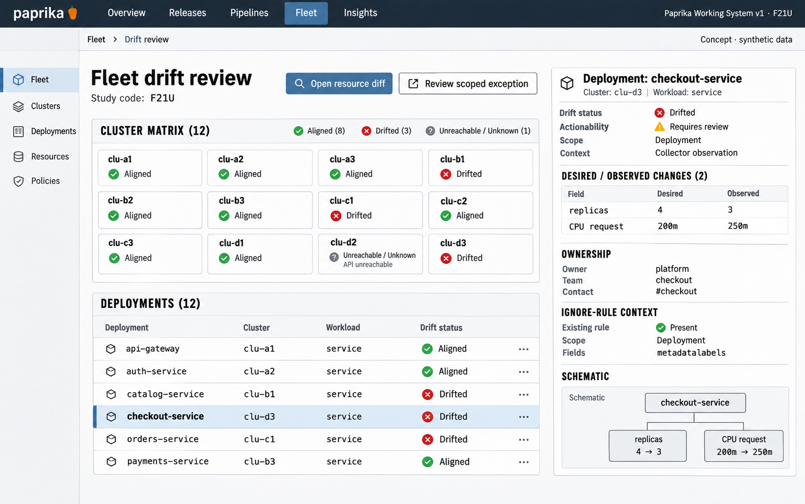

# F21 Fleet drift review

**Design system:** [Paprika Working System v1](../design-system.md) · **Surface:** Main console · **Status:** proposed feature design.

**Implementation backlog:** [#236](https://github.com/paprikacd/paprika/issues/236).

[Catalogue](../README.md) · [Exact fixture](../fixtures/f21.json) · [Space specification](https://chatgpt.com/space/page_7201ecf2dcc48191b56b5e90cae4b652)

## Canonical visual reference



Concept · synthetic data. The artboard describes the proposed interface. The fixture and acceptance criteria below define its meaning; this publication does not mark the feature implemented.

## Working surface

- Broad cluster-state matrix
- Selected deployment desired/observed semantic diff
- Field ownership and existing exception context
- Timestamped unknown/unreachable state

## Synthetic fixture

Twelve clusters: 8 aligned, 3 drifted and 1 unreachable. The selected Deployment has 4 desired replicas versus 3 observed, and a CPU request of 200m desired versus 250m observed. There are 2 changed fields; actionability depends on ownership and ignore rules.

```json
{
  "clusters": 12,
  "aligned": 8,
  "drifted": 3,
  "unreachable": 1,
  "selectedResourceKind": "Deployment",
  "changes": [
    {
      "field": "replicas",
      "desired": 4,
      "observed": 3,
      "unit": "replicas"
    },
    {
      "field": "CPU request",
      "desired": "200m",
      "observed": "250m",
      "unit": "millicores"
    }
  ],
  "changedFields": 2,
  "actionability": "Pending ownership and ignore-rule interpretation"
}
```

## Interaction and state contract

- The first read-only slice needs a bounded, authorized collector behind the currently NotConfigured fleet details.
- Stable identity includes cluster, namespace, API group, version, kind and resource. Retain desired revision, resource version and observation time.
- Unreachable or stale means Unknown, never Aligned.
- Normalization, field ownership and existing ignore rules decide actionability. Two changed fields do not imply two actionable fields.
- Show historical recurrence only when retained observations exist. Do not invent history.
- Exception review navigates to the maintained owner. Do not introduce a second ignore or reconciliation mechanism.

### Available actions

| Action state | Contract |
| --- | --- |
| Available in the illustrated state | Open resource diff; Review scoped exception |
| Outside this slice | Reconcile fleet; Mutate ignore rule in first slice; Automatically correct drift |

## Backlog implementation specification

The following scope and unchecked acceptance criteria are preserved from the linked implementation issues, read on 2026-11-11. Existing foundations and proposed additions remain distinct.

### Problem

Where are comparable desired and observed fields different, and which existing exceptions explain them?

Paprika already has live and desired resource diffs, a substantial workbench and scoped `ignoreDifferences` writes with identity and reason. `ListDriftDetails` remains `NOT_CONFIGURED`, so fleet-wide structured details need a collector.

### Proposed first release

Populate bounded, authorized drift details keyed by cluster, namespace, GVK and resource. Include desired revision, resource version, observation time, changed field paths and classification as ignored or actionable. Group recurring differences and inspect existing exceptions; start read-only.

### Synthetic fixture

Twelve clusters: 8 aligned, 3 drifted and 1 unreachable. A selected deployment shows 4 desired replicas versus 3 observed, and a CPU request of `200m` versus `250m`. Two changed fields are candidates for review; field ownership and ignore rules determine whether either is actionable.

All example times are UTC.

### Acceptance criteria

- [ ] Stable identity includes cluster, namespace, API group, version, kind and resource identity.
- [ ] Collection is bounded, authorized, timestamped and explicit about unreachable or stale resources.
- [ ] Normalization and existing ignore and ownership rules distinguish actionable differences from intentional controller-managed changes.
- [ ] Historical recurrence is shown only when retained observations exist; a current diff is not invented history.
- [ ] The first slice performs no reconciliation or ignore mutation; later writes reuse existing guarded owners and operator reasons.

### Integration and sequencing

Requires the collector and index behind `ListDriftDetails`. Reuse the existing `IgnoreDriftedField` owner for future exception changes; do not introduce another ignore mechanism or auto-reconciler.

Suggested sequence: Next collector integration. Related issue references are not automatic hard blockers.

### Current source owners

Source baseline: `17a651ab8edf20337ac5319af93ae7fb2c389b47`, reviewed 10 November 2026.

- [Diff workbench](https://github.com/paprikacd/paprika/blob/17a651ab8edf20337ac5319af93ae7fb2c389b47/ui/src/components/dashboard/sync-diff-workbench.tsx)
- [Detail API and existing ignore owner](https://github.com/paprikacd/paprika/blob/17a651ab8edf20337ac5319af93ae7fb2c389b47/internal/api/detail_handler.go)
- [Live and desired resources](https://github.com/paprikacd/paprika/blob/17a651ab8edf20337ac5319af93ae7fb2c389b47/internal/api/resource_handler.go)
- [Ignore semantics](https://github.com/paprikacd/paprika/blob/17a651ab8edf20337ac5319af93ae7fb2c389b47/internal/engine/diff_ignore.go)

### Technology reference

[Flux drift detection and ignore rules](https://fluxcd.io/flux/components/helm/helmreleases/#drift-detection). Detection, intentional field ownership and correction are distinct operational decisions.

## Implementation alignment

Use the existing runtime owners identified in the [design-system contract](../design-system.md#runtime-ownership). Apply the common shell, type, spacing and state vocabulary without replacing this feature's work surface, authorization or data semantics.

The canonical fixture remains available as JSON for implementation and review. Keyboard, narrow-layout and live-data behavior require implementation-specific verification; generated artboards do not establish those results.
