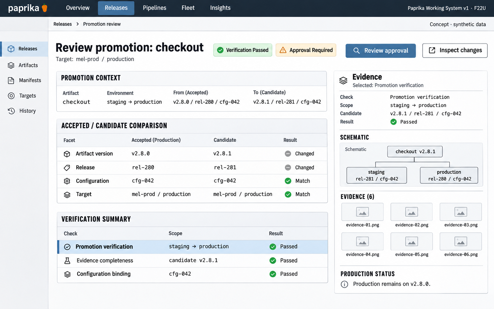

# F22 Promotion candidate workbench

**Design system:** [Paprika Working System v1](../design-system.md) · **Surface:** Main console · **Status:** proposed feature design.

**Implementation backlog:** [#239](https://github.com/paprikacd/paprika/issues/239).

[Catalogue](../README.md) · [Exact fixture](../fixtures/f22.json) · [Space specification](https://chatgpt.com/space/page_c1489ae2ec508191ab0dfa3188240ee0)

## Canonical visual reference



Concept · synthetic data. The artboard describes the proposed interface. The fixture and acceptance criteria below define its meaning; this publication does not mark the feature implemented.

## Working surface

- Accepted-versus-candidate comparison desk, fixed target identity, separate evidence/authorization inspector and explicit review action.

## Synthetic fixture

```json
{
  "source": "Exact shared scenario from the six-direction gallery.",
  "application": "checkout",
  "route": "staging → production",
  "target": "mel-prod / production",
  "accepted": {
    "version": "v2.8.0",
    "release": "rel-280",
    "configuration": "cfg-042"
  },
  "candidate": {
    "version": "v2.8.1",
    "release": "rel-281",
    "configuration": "cfg-042"
  },
  "verification": "Passed",
  "approval": "Required",
  "production": "v2.8.0",
  "imageText": [
    "Review promotion",
    "checkout · staging → production",
    "Accepted production",
    "v2.8.0 · rel-280 · cfg-042",
    "Candidate",
    "v2.8.1 · rel-281 · cfg-042",
    "mel-prod / production",
    "Verification Passed",
    "Approval Required",
    "Review approval",
    "Inspect changes",
    "Production remains on v2.8.0",
    "Concept · synthetic data"
  ]
}
```

## Interaction and state contract

- Verification passed is not approval or deployment. Production still runs the accepted release.
- Candidate review binds full release UID and desired target configuration; display aliases are synthetic.
- Review approval opens a deliberate candidate-specific review; generic stage approval is a different operation.

## Backlog implementation specification

The following scope and unchecked acceptance criteria are preserved from the linked implementation issues, read on 2026-11-11. Existing foundations and proposed additions remain distinct.

### Problem

An operator needs to know exactly which upstream release is being promoted, which target configuration is accepted, why verification is waiting, and what an approval would authorize.

### Existing foundation

Exact-release promotion, accepted deployment configuration, target-change re-verification, approval invalidation and bounded verification retry already exist. The console Application API does not project the complete contract; its generic stage approval is a different operation.

Audited against `17a651ab8edf20337ac5319af93ae7fb2c389b47` on 11 November 2026 (Australia/Melbourne).

### Proposed first useful slice

Add a typed read model and a comparison workbench for accepted deployment, candidate and proposed target intent. Add candidate-specific review/action contracts that revalidate the candidate UID and desired configuration through the existing promotion owner.

### Acceptance criteria

- [ ] Project full source Release UID, revision, component digests where applicable, target fingerprint, accepted versus pending intent, verification attempt, evidence observation time and blocked reason; shorten identifiers only for display.
- [ ] Distinguish verification running, health hold, approval required, approval expired, configuration re-verification and unsupported or missing evidence.
- [ ] Approval and verification retry bind to the exact reviewed candidate and desired configuration. A changed candidate or target invalidates the review and requires a refreshed plan.
- [ ] Keep accepted deployment visible while a different candidate is pending or fails verification; never present pending intent as deployed.
- [ ] Reuse candidate promotion controllers and existing authorization/status owners. Generic ApproveGate does not stand in for candidate approval.
- [ ] Link durable gate decisions to #235; do not recreate a second gate-evidence store.

### Maintained owners

- [Promotion controller](https://github.com/paprikacd/paprika/blob/17a651ab8edf20337ac5319af93ae7fb2c389b47/internal/controller/pipelines/application_promotion.go)
- [Application schema](https://github.com/paprikacd/paprika/blob/17a651ab8edf20337ac5319af93ae7fb2c389b47/api/pipelines/v1alpha1/application_types.go)
- [API projection](https://github.com/paprikacd/paprika/blob/17a651ab8edf20337ac5319af93ae7fb2c389b47/proto/paprika/v1/api.proto)
- [Application UI](https://github.com/paprikacd/paprika/blob/17a651ab8edf20337ac5319af93ae7fb2c389b47/ui/src/components/dashboard/application-card.tsx)

### Dependencies and scope

Builds on merged #107 and #115. Coordinate receipt links with #235; the workbench read model can ship before durable receipts.

Suggested sequence: 1 · first build. Size hypothesis: Medium · API projection and guarded review contract. These are planning estimates, not a delivery commitment.

## Earlier creative explorations

The [six promotion studies](https://chatgpt.com/space/page_d8c61d09ef2c8191a6b6c568855ce5f6) remain available in the existing Space gallery. The canonical artboard above applies the shared Working System direction.

## Implementation alignment

Use the existing runtime owners identified in the [design-system contract](../design-system.md#runtime-ownership). Apply the common shell, type, spacing and state vocabulary without replacing this feature's work surface, authorization or data semantics.

The canonical fixture remains available as JSON for implementation and review. Keyboard, narrow-layout and live-data behavior require implementation-specific verification; generated artboards do not establish those results.
