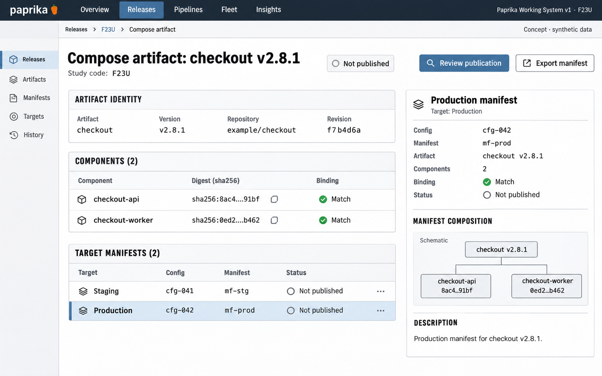

# F23 Versioned artifact release composer

**Design system:** [Paprika Working System v1](../design-system.md) · **Surface:** Main console · **Status:** proposed feature design.

**Implementation backlog:** [#240](https://github.com/paprikacd/paprika/issues/240).

[Catalogue](../README.md) · [Exact fixture](../fixtures/f23.json) · [Space specification](https://chatgpt.com/space/page_c1489ae2ec508191ab0dfa3188240ee0)

## Canonical visual reference



Concept · synthetic data. The artboard describes the proposed interface. The fixture and acceptance criteria below define its meaning; this publication does not mark the feature implemented.

## Working surface

- Shared artifact identity header; two-row component digest ledger; target-specific manifest rows; selected production manifest inspector; publication review rail.

## Synthetic fixture

```json
{
  "source": "Positive selected-target variation of the native composer fixture; manifest IDs are synthetic display aliases.",
  "application": "checkout",
  "version": "v2.8.1",
  "repository": "example/checkout",
  "revision": "f7b4d6a",
  "components": [
    {
      "name": "checkout-api",
      "digest": "sha256:8ac4…91bf",
      "binding": "Matches"
    },
    {
      "name": "checkout-worker",
      "digest": "sha256:0ed2…b462",
      "binding": "Matches"
    }
  ],
  "targets": [
    {
      "name": "staging",
      "configuration": "cfg-041",
      "manifestAlias": "mf-stg",
      "selected": false
    },
    {
      "name": "production",
      "configuration": "cfg-042",
      "manifestAlias": "mf-prod",
      "selected": true
    }
  ],
  "publication": "Not published",
  "imageText": [
    "Compose artifact",
    "checkout v2.8.1",
    "example/checkout · f7b4d6a",
    "Components",
    "checkout-api · sha256:8ac4…91bf",
    "checkout-worker · sha256:0ed2…b462",
    "Bindings match",
    "Staging · cfg-041 · mf-stg",
    "Production · cfg-042 · mf-prod",
    "Selected production manifest",
    "Not published",
    "Review publication",
    "Export manifest",
    "Concept · synthetic data"
  ]
}
```

## Interaction and state contract

- Shared artifact identity and target manifest identity remain distinct; staging and production have different immutable content.
- The proposed publication endpoint preserves the legacy ApplyBundle guard.
- Review/publication binds exact content, Application identity and expected current intent with revalidation.
- Publishing alone does not request deployment; do not show rollout progress or a deployed badge.
- Bindings match describes component correspondence only, not universal policy or deployment readiness.

## Backlog implementation specification

The following scope and unchecked acceptance criteria are preserved from the linked implementation issues, read on 2026-11-11. Existing foundations and proposed additions remain distinct.

### Problem

Immutable inline promotion is difficult to prepare and inspect through the console. Operators need to see shared artifact identity separately from each target's rendered manifest identity.

### Existing foundation

The controller already validates immutable ConfigMaps, manifest hashes, repository identity, full source revisions and digest-pinned component image maps. Legacy ApplyBundle deliberately rejects existing desired or accepted promotion/artifact intent.

Audited against `17a651ab8edf20337ac5319af93ae7fb2c389b47` on 11 November 2026 (Australia/Melbourne).

### Proposed first useful slice

Add a reviewable composer and a purpose-built versioned publication contract, or an initial full manifest export. Validate each target-specific immutable snapshot and its correspondence to the upstream candidate before an explicitly reviewed publication.

### Acceptance criteria

- [ ] Represent logical repository, full source revision, version, component image digests, immutable ConfigMap identity and exact manifest hash. Source revision and deployed image bytes remain distinct fields.
- [ ] Keep shared component artifact identity separate from target-specific manifests, namespace and target configuration; never copy upstream credentials or tenant manifests.
- [ ] Detect mutable snapshots, digest/component mismatches, incomplete identity, collisions and stale candidate bindings before publication.
- [ ] Preserve ApplyBundle's promotion/artifact guard. Do not silently repurpose the legacy endpoint or generic pipeline Artifact APIs.
- [ ] Publication binds a reviewed token to exact content, Application identity and expected current intent; it needs idempotency, concurrent-publisher protection and reconciliation for partial/uncertain writes. Cleanup may remove only resources created by that request. Publishing alone does not request deployment.
- [ ] Expose unavailable validation honestly and retain the draft after validation or publication failure.

### Maintained owners

- [Inline artifact validation](https://github.com/paprikacd/paprika/blob/17a651ab8edf20337ac5319af93ae7fb2c389b47/internal/controller/pipelines/application_inline_artifact.go)
- [Legacy apply boundary](https://github.com/paprikacd/paprika/blob/17a651ab8edf20337ac5319af93ae7fb2c389b47/internal/api/apply_bundle.go)
- [Environment promotion guide](https://github.com/paprikacd/paprika/blob/17a651ab8edf20337ac5319af93ae7fb2c389b47/docs/guides/environment-promotion.md)

### Dependencies and scope

Builds on merged #109. Shares identity projection with REL-01; no dependency on a new artifact engine.

Suggested sequence: 4 · next. Size hypothesis: Medium–large · publication contract plus composer. These are planning estimates, not a delivery commitment.

## Earlier creative explorations

These earlier studies retain the feature's exploration history. The canonical artboard above supplies the shared shell and visual direction.

[F23A](../assets/explorations/f23a.png) · [F23B](../assets/explorations/f23b.png) · [Archive index](../explorations/README.md#f23)

## Implementation alignment

Use the existing runtime owners identified in the [design-system contract](../design-system.md#runtime-ownership). Apply the common shell, type, spacing and state vocabulary without replacing this feature's work surface, authorization or data semantics.

The canonical fixture remains available as JSON for implementation and review. Keyboard, narrow-layout and live-data behavior require implementation-specific verification; generated artboards do not establish those results.
