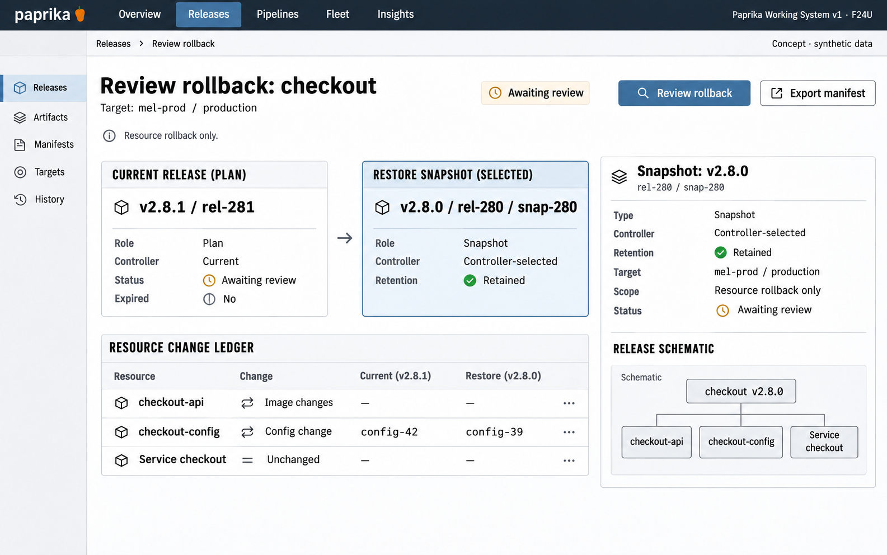

# F24 Rollback plan and target binding

**Design system:** [Paprika Working System v1](../design-system.md) · **Surface:** Main console · **Status:** proposed feature design.

**Implementation backlog:** [#241](https://github.com/paprikacd/paprika/issues/241).

[Catalogue](../README.md) · [Exact fixture](../fixtures/f24.json) · [Space specification](https://chatgpt.com/space/page_c1489ae2ec508191ab0dfa3188240ee0)

## Canonical visual reference



Concept · synthetic data. The artboard describes the proposed interface. The fixture and acceptance criteria below define its meaning; this publication does not mark the feature implemented.

## Working surface

- Current-versus-restore identity comparison, controller-selected retained snapshot, resource change ledger and selected snapshot review inspector.

## Synthetic fixture

```json
{
  "source": "Native primary fixture, shown as a current, retained, eligible plan before execution.",
  "application": "checkout",
  "target": "mel-prod / production",
  "plan": "rbp-042",
  "current": {
    "version": "v2.8.1",
    "release": "rel-281"
  },
  "restore": {
    "version": "v2.8.0",
    "release": "rel-280",
    "snapshot": "snap-280",
    "selection": "Controller-selected",
    "retained": true
  },
  "changes": [
    {
      "resource": "checkout-api",
      "field": "Image",
      "from": "8ac4…91bf",
      "to": "45b2…d120"
    },
    {
      "resource": "checkout-config",
      "field": "Config",
      "from": "config-42",
      "to": "config-39"
    },
    {
      "resource": "Service checkout",
      "field": "State",
      "result": "Unchanged"
    }
  ],
  "imageText": [
    "Review rollback",
    "Current release",
    "v2.8.1 · rel-281",
    "Restore snapshot",
    "v2.8.0 · rel-280 · snap-280",
    "Controller-selected · Retained",
    "mel-prod / production",
    "checkout-api · Image changes",
    "checkout-config · config-42 → config-39",
    "Service checkout · Unchanged",
    "Review rollback",
    "Resource rollback only",
    "Concept · synthetic data"
  ]
}
```

The image-change fixture binds the digest aliases 8ac4…91bf → 45b2…d120. A version tag shown in an earlier illustration is not a substitute for immutable target binding.

## Interaction and state contract

- First slice presents the controller-selected restore target; alternate snapshot selection requires the extended server contract.
- Reviewing or selecting a retained snapshot does not execute rollback.
- Execution must bind current release UID, snapshot UID/hash, target/configuration and plan version.
- Do not imply a new Release is necessarily created, Kubernetes changes are atomic, or migrations/external effects are reversed.
- Keep Current release and Restore snapshot labels explicit throughout.

## Backlog implementation specification

The following scope and unchecked acceptance criteria are preserved from the linked implementation issues, read on 2026-11-11. Existing foundations and proposed additions remain distinct.

### Problem

The current history-row action does not mean restore this row: it submits a source release and the controller selects an eligible snapshot. Operators need to inspect and bind the actual restore target before acting.

### Existing foundation

RollbackRelease accepts release name and namespace. The controller selects same-Application/same-target snapshots, preferring newest Complete then newest eligible; it excludes the source, Failed releases and missing snapshots. It does not take a selected restore-target UID/hash or explicitly restrict candidates to older releases.

Audited against `17a651ab8edf20337ac5319af93ae7fb2c389b47` on 11 November 2026 (Australia/Melbourne).

### Proposed first useful slice

Expose a rollback plan showing the controller-selected target and resource delta, then extend the API/controller to bind execution to that exact snapshot, current release and resolved target. Offer alternate target selection only after the server contract supports it.

### Acceptance criteria

- [ ] Keep Current release and Restore snapshot labels and full identities distinct in API, UI and audit records.
- [ ] Report eligibility, retained snapshot hash, Stage/Cluster target, resource changes and observation time using the controller's actual selection rules.
- [ ] Bind execution to current release UID, selected snapshot UID/hash, target/configuration and plan version; reject stale or deleted snapshots before applying.
- [ ] Unavailable snapshots and changed target routing explain the specific blocker. A refreshed plan requires a fresh review.
- [ ] Preserve existing rollback lifecycle and status behavior; do not assume a new Release is created or that Kubernetes updates are atomic.
- [ ] Explain resource-only scope and subsequent desired-state sync behavior. Database changes, external effects and migrations are not implicitly reversed.

### Maintained owners

- [Rollback API](https://github.com/paprikacd/paprika/blob/17a651ab8edf20337ac5319af93ae7fb2c389b47/internal/api/server.go)
- [Snapshot selection and execution](https://github.com/paprikacd/paprika/blob/17a651ab8edf20337ac5319af93ae7fb2c389b47/internal/controller/pipelines/release_controller.go)
- [Release history UI](https://github.com/paprikacd/paprika/blob/17a651ab8edf20337ac5319af93ae7fb2c389b47/ui/src/components/dashboard/application-release-history.tsx)

### Dependencies and scope

Can ship plan-only inspection before guarded execution. Reuse REL-04 target identity and resource-plan representation where useful without coupling delivery.

Suggested sequence: 3 · first build. Size hypothesis: Medium–large · target selection and execution contract. These are planning estimates, not a delivery commitment.

## Earlier creative explorations

These earlier studies retain the feature's exploration history. The canonical artboard above supplies the shared shell and visual direction.

[F24A](../assets/explorations/f24a.png) · [F24B](../assets/explorations/f24b.png) · [Archive index](../explorations/README.md#f24)

## Implementation alignment

Use the existing runtime owners identified in the [design-system contract](../design-system.md#runtime-ownership). Apply the common shell, type, spacing and state vocabulary without replacing this feature's work surface, authorization or data semantics.

The canonical fixture remains available as JSON for implementation and review. Keyboard, narrow-layout and live-data behavior require implementation-specific verification; generated artboards do not establish those results.
