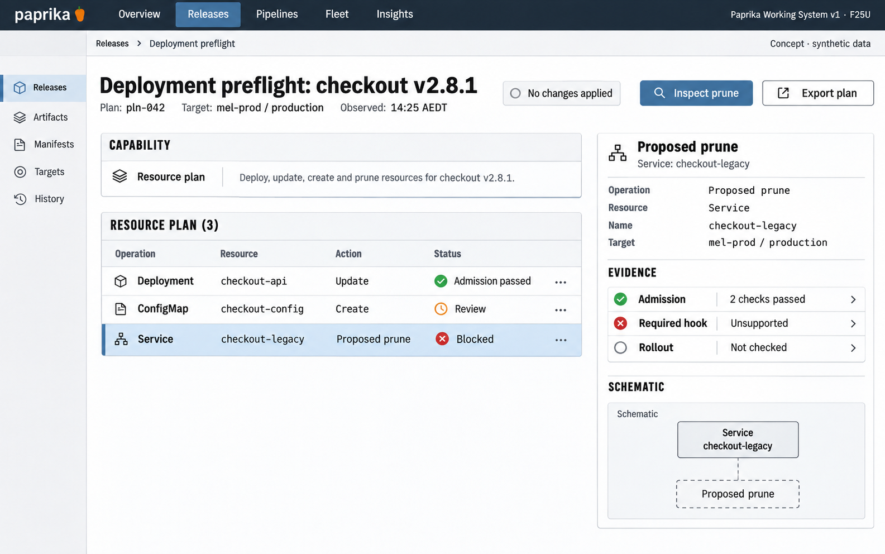

# F25 Target-aware deployment preflight

**Design system:** [Paprika Working System v1](../design-system.md) · **Surface:** Main console · **Status:** proposed feature design.

**Implementation backlog:** [#242](https://github.com/paprikacd/paprika/issues/242).

[Catalogue](../README.md) · [Exact fixture](../fixtures/f25.json) · [Space specification](https://chatgpt.com/space/page_c1489ae2ec508191ab0dfa3188240ee0)

## Canonical visual reference



Concept · synthetic data. The artboard describes the proposed interface. The fixture and acceptance criteria below define its meaning; this publication does not mark the feature implemented.

## Working surface

- Fixed target/plan identity band, operation capability strip, three-row resource plan and selected proposed-prune inspector.

## Synthetic fixture

```json
{
  "source": "Native primary mixed-evidence fixture.",
  "application": "checkout",
  "version": "v2.8.1",
  "plan": "pln-042",
  "target": "mel-prod / production",
  "observed": "14:25 AEDT",
  "resources": [
    {
      "kind": "Deployment",
      "name": "checkout-api",
      "operation": "Update"
    },
    {
      "kind": "ConfigMap",
      "name": "checkout-config",
      "operation": "Create"
    },
    {
      "kind": "Service",
      "name": "checkout-legacy",
      "operation": "Proposed prune",
      "selected": true
    }
  ],
  "capabilities": {
    "apply": "Supported",
    "read": "Supported",
    "verification": "Supported",
    "hooks": "Unsupported",
    "rollout": "Not checked"
  },
  "admission": "2 checks passed",
  "requiredHook": "Unsupported",
  "imageText": [
    "Deployment preflight",
    "checkout v2.8.1 · pln-042",
    "mel-prod / production",
    "Observed 14:25 AEDT",
    "Deployment checkout-api · Update",
    "ConfigMap checkout-config · Create",
    "Service checkout-legacy · Proposed prune",
    "Admission · 2 checks passed",
    "Required hook · Unsupported",
    "Rollout · Not checked",
    "Inspect prune",
    "No changes applied",
    "Concept · synthetic data"
  ]
}
```

Proposed prune means a proposed removal that has not been applied. Resource kinds do not establish transport or operation capabilities.

## Interaction and state contract

- The selected prune is proposed only; inspection performs no persistent mutation.
- Use the resolved target, not management-cluster observations or the legacy ApplyBundle dry-run path.
- Admission results require an authorized supported dryRun=All path; unsupported checks remain explicit.
- Two admission passes do not override the unsupported required hook or imply overall deployability.
- No Deploy now action, automatic namespace creation or claim of atomic apply/eventual health.

## Backlog implementation specification

The following scope and unchecked acceptance criteria are preserved from the linked implementation issues, read on 2026-11-11. Existing foundations and proposed additions remain distinct.

### Problem

Operators cannot review one release-wide plan joining immutable content, the resolved remote target, resource changes, policy, admission and operation-specific transport capabilities.

### Existing foundation

Target-aware resource reads/diffs and per-resource admission dry-run already exist. ApplyBundle DryRun parses and evaluates a bundle but ensureNamespace runs before its dry-run branch; it is not the non-mutating release-plan endpoint required here.

Audited against `17a651ab8edf20337ac5319af93ae7fb2c389b47` on 11 November 2026 (Australia/Melbourne).

### Proposed first useful slice

Define a non-mutating release-plan API and a resource-plan workbench. Start with pinned rendering, authorized target reads, diff and local policy. Add explicit server admission checks only through an authorized dryRun=All path whose capability is reported separately; unavailable checks remain unknown.

### Acceptance criteria

- [ ] Inspection performs no persistent mutation: no namespace creation, publication, hook execution, Release/Pipeline/Job creation or actual apply/patch/delete. Never use legacy ApplyBundle as the inspection endpoint.
- [ ] Resolve and display the actual target identity and namespace; do not substitute management-cluster observations for a remote target.
- [ ] Separate apply, live-read, verification, hook and rollout capability states. Distinguish unsupported, unreachable, not checked and failed.
- [ ] Join desired/live changes, ownership, prune protections and policy findings. Admission/field-conflict results are available only when authorized dryRun=All is supported; do not treat local validation as admission. Missing reads or unsupported checks remain unknown.
- [ ] Bind results to candidate content/hash, configuration, target identity and observation time. Later execution must revalidate relevant state and disclose expired plans.
- [ ] Treat preflight as evidence at a point in time. A passed check does not make multi-resource apply atomic or guarantee eventual health.

### Maintained owners

- [Target resolution](https://github.com/paprikacd/paprika/blob/17a651ab8edf20337ac5319af93ae7fb2c389b47/internal/api/target_cluster.go)
- [Admission dry-run and detail](https://github.com/paprikacd/paprika/blob/17a651ab8edf20337ac5319af93ae7fb2c389b47/internal/api/detail_handler.go)
- [Legacy bundle path](https://github.com/paprikacd/paprika/blob/17a651ab8edf20337ac5319af93ae7fb2c389b47/internal/api/apply_bundle.go)
- [Target execution owner](https://github.com/paprikacd/paprika/blob/17a651ab8edf20337ac5319af93ae7fb2c389b47/internal/controller/pipelines/release_controller.go)

### Dependencies and scope

Separate from #232 dashboard-import preflight and #236 drift collection. Reuse policy and target owners; connect to REL-01 and REL-03 as a shared plan representation.

Suggested sequence: 2 · first build. Size hypothesis: Large · read-only API and target capability coverage. These are planning estimates, not a delivery commitment.

## Earlier creative explorations

These earlier studies retain the feature's exploration history. The canonical artboard above supplies the shared shell and visual direction.

[F25A](../assets/explorations/f25a.png) · [F25B](../assets/explorations/f25b.png) · [Archive index](../explorations/README.md#f25)

## Implementation alignment

Use the existing runtime owners identified in the [design-system contract](../design-system.md#runtime-ownership). Apply the common shell, type, spacing and state vocabulary without replacing this feature's work surface, authorization or data semantics.

The canonical fixture remains available as JSON for implementation and review. Keyboard, narrow-layout and live-data behavior require implementation-specific verification; generated artboards do not establish those results.
