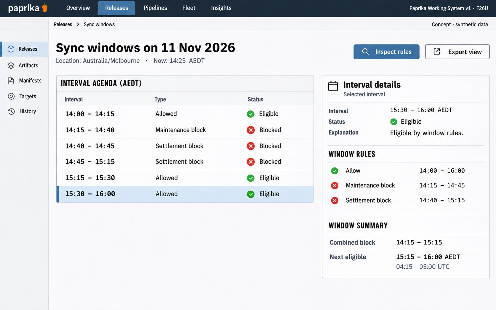

# F26 Sync-window calendar and explanations

**Design system:** [Paprika Working System v1](../design-system.md) · **Surface:** Main console · **Status:** proposed feature design.

**Implementation backlog:** [#243](https://github.com/paprikacd/paprika/issues/243).

[Catalogue](../README.md) · [Exact fixture](../fixtures/f26.json) · [Space specification](https://chatgpt.com/space/page_c1489ae2ec508191ab0dfa3188240ee0)

## Canonical visual reference



Concept · synthetic data. The artboard describes the proposed interface. The fixture and acceptance criteria below define its meaning; this publication does not mark the feature implemented.

## Working surface

- Selected-time context, non-scaled interval agenda, overlapping rule ledger and combined-decision inspector.

## Synthetic fixture

```json
{
  "source": "Native window fixture with the future 15:30 interval selected for explanation.",
  "date": "11 Nov 2026",
  "timezone": "Australia/Melbourne",
  "now": "14:25 AEDT",
  "nowUTC": "03:25 UTC",
  "selected": "15:30 AEDT",
  "rules": [
    {
      "name": "Allow",
      "interval": "14:00–16:00"
    },
    {
      "name": "Maintenance block",
      "interval": "14:15–14:45"
    },
    {
      "name": "Settlement block",
      "interval": "14:40–15:15"
    }
  ],
  "combinedBlock": "14:15–15:15",
  "nextEligible": "15:15–16:00 AEDT",
  "nextEligibleUTC": "04:15–05:00 UTC",
  "selectedDecision": "Eligible by window rules",
  "imageText": [
    "Sync windows",
    "11 Nov 2026 · Australia/Melbourne",
    "Now 14:25 AEDT",
    "Selected 15:30 AEDT",
    "Eligible by window rules",
    "Allow · 14:00–16:00",
    "Maintenance block · 14:15–14:45",
    "Settlement block · 14:40–15:15",
    "Combined block · 14:15–15:15",
    "Next eligible · 15:15–16:00 AEDT",
    "04:15–05:00 UTC",
    "Inspect rules",
    "Concept · synthetic data"
  ]
}
```

## Interaction and state contract

- Use the combined policy; 14:45 is not the next eligible time because the settlement block continues to 15:15.
- The selected future interval assumes unchanged rules and does not reserve or promise execution.
- Window eligibility is separate from overall release readiness.
- Use a non-scaled agenda with explicit interval labels; do not invent precise chart geometry.
- No Schedule deployment, queue position or automatic manual override action.

## Backlog implementation specification

The following scope and unchecked acceptance criteria are preserved from the linked implementation issues, read on 2026-11-11. Existing foundations and proposed additions remain distinct.

### Problem

A Window blocked badge does not tell an operator which policy applies, which overlaps matter, or when the window rules next permit automatic sync.

### Existing foundation

The evaluator already supports five-field cron, duration, IANA timezone and Stage scope. Manual override allows immediately; active applicable Block wins; active Allow permits if no Block; applicable inactive Allow windows block; no applicable windows allows; invalid applicable configuration blocks. NextTransition is only a transition hint.

Audited against `17a651ab8edf20337ac5319af93ae7fb2c389b47` on 11 November 2026 (Australia/Melbourne).

### Proposed first useful slice

Add a bounded authoritative forecast and decision explanation to the existing evaluator, then render a calendar and selected-time reason inspector using that output.

### Acceptance criteria

- [ ] Return applicable windows, effective timezone/Stage, parsed validity, decision reasons and all transitions considered within a bounded forecast horizon.
- [ ] Re-evaluate the combined policy at transition boundaries; do not rename NextTransition as the next eligible interval.
- [ ] Handle overlapping Blocks, inactive Allows, no matching scope, invalid cron/timezone/duration and DST gaps/repeated times deterministically.
- [ ] Distinguish window eligibility from release readiness, reservation, queue position or promised execution time.
- [ ] Keep manual override semantics explicit and route any requested manual sync through the existing separately reviewed, authorized action.
- [ ] Provide a non-calendar list view and accessible textual reasons for every interval.

### Maintained owners

- [Window evaluator](https://github.com/paprikacd/paprika/blob/17a651ab8edf20337ac5319af93ae7fb2c389b47/internal/syncwindow/evaluator.go)
- [Window schema](https://github.com/paprikacd/paprika/blob/17a651ab8edf20337ac5319af93ae7fb2c389b47/api/pipelines/v1alpha1/application_types.go)
- [Current blocked badge](https://github.com/paprikacd/paprika/blob/17a651ab8edf20337ac5319af93ae7fb2c389b47/ui/src/components/dashboard/application-card.tsx)

### Dependencies and scope

Extends the existing evaluator; no new scheduler. Can ship independently of the release-train plan.

Suggested sequence: 6 · next. Size hypothesis: Medium · evaluator explanation and bounded forecast. These are planning estimates, not a delivery commitment.

## Earlier creative explorations

These earlier studies retain the feature's exploration history. The canonical artboard above supplies the shared shell and visual direction.

[F26A](../assets/explorations/f26a.png) · [F26B](../assets/explorations/f26b.png) · [Archive index](../explorations/README.md#f26)

## Implementation alignment

Use the existing runtime owners identified in the [design-system contract](../design-system.md#runtime-ownership). Apply the common shell, type, spacing and state vocabulary without replacing this feature's work surface, authorization or data semantics.

The canonical fixture remains available as JSON for implementation and review. Keyboard, narrow-layout and live-data behavior require implementation-specific verification; generated artboards do not establish those results.
