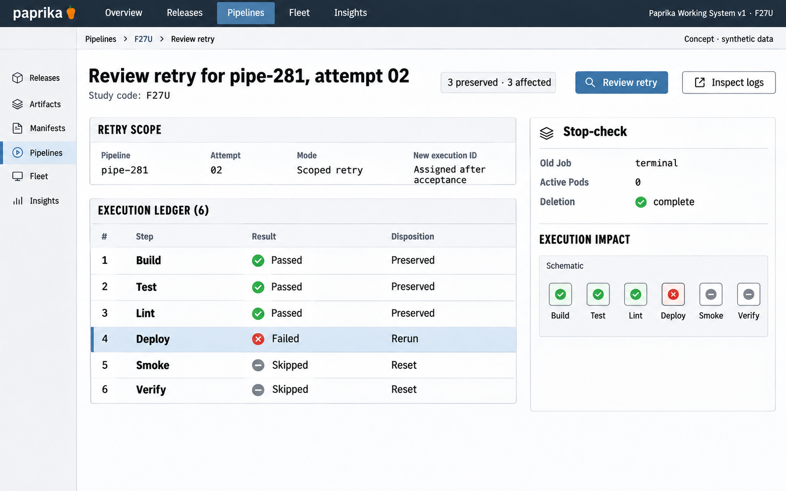

# F27 Pipeline retry-impact preview

**Design system:** [Paprika Working System v1](../design-system.md) · **Surface:** Main console · **Status:** proposed feature design.

**Implementation backlog:** [#244](https://github.com/paprikacd/paprika/issues/244).

[Catalogue](../README.md) · [Exact fixture](../fixtures/f27.json) · [Space specification](https://chatgpt.com/space/page_c1489ae2ec508191ab0dfa3188240ee0)

## Canonical visual reference



Concept · synthetic data. The artboard describes the proposed interface. The fixture and acceptance criteria below define its meaning; this publication does not mark the feature implemented.

## Working surface

- Selected Deploy step, six-step preserved/affected ledger, completed stop-check inspector and explicit scoped retry review.

## Synthetic fixture

```json
{
  "source": "Exact companion ready-for-review fixture.",
  "pipeline": "pipe-281",
  "attempt": "02",
  "selectedStep": "Deploy",
  "steps": [
    {
      "name": "Build",
      "result": "Passed",
      "retryEffect": "Preserved"
    },
    {
      "name": "Test",
      "result": "Passed",
      "retryEffect": "Preserved"
    },
    {
      "name": "Lint",
      "result": "Passed",
      "retryEffect": "Preserved"
    },
    {
      "name": "Deploy",
      "result": "Failed",
      "retryEffect": "Rerun",
      "selected": true
    },
    {
      "name": "Smoke",
      "result": "Skipped",
      "retryEffect": "Reset"
    },
    {
      "name": "Verify",
      "result": "Skipped",
      "retryEffect": "Reset"
    }
  ],
  "stopChecks": {
    "oldJob": "Terminal confirmed",
    "activePods": 0,
    "deletion": "Complete"
  },
  "nextExecutionUID": "Assigned after acceptance",
  "imageText": [
    "Review retry",
    "pipe-281 · attempt 02",
    "Build · Passed · Preserved",
    "Test · Passed · Preserved",
    "Lint · Passed · Preserved",
    "Deploy · Failed · Rerun",
    "Smoke · Skipped · Reset",
    "Verify · Skipped · Reset",
    "3 preserved · 3 affected",
    "Old Job terminal",
    "Active Pods 0",
    "Deletion complete",
    "Review retry",
    "New execution ID after acceptance",
    "Concept · synthetic data"
  ]
}
```

## Interaction and state contract

- Existing retry engine owns eligibility, prerequisites, descendant resets, retry budgets and stop checks.
- The preview is non-mutating; a review is available because stop checks are complete in this fixture.
- Do not assign a future execution UID before acceptance.
- Skipped Smoke and Verify have no Job references for this attempt; do not invent them.
- Do not imply all six steps rerun or broaden cancelled-execution retry semantics.

## Backlog implementation specification

The following scope and unchecked acceptance criteria are preserved from the linked implementation issues, read on 2026-11-11. Existing foundations and proposed additions remain distinct.

### Problem

The current selected-step retry action does not show which descendants reset, which successful work is preserved, or why previous execution cleanup prevents a retry.

### Existing foundation

RetryStep already validates Failed pipelines and selected Failed/Skipped steps, checks prerequisites and old Jobs, resets selected step/descendants and retry budgets, preserves unrelated successful work, and creates a fresh execution identity. Cancelled executions require a new Pipeline.

Audited against `17a651ab8edf20337ac5319af93ae7fb2c389b47` on 11 November 2026 (Australia/Melbourne).

### Proposed first useful slice

Add a read-only retry-impact projection from the existing validation logic, a selected-step review UI, specific mutation errors and guarded revalidation at execution.

### Acceptance criteria

- [ ] Return the exact selected step, transitive descendant reset set, preserved prerequisites/unrelated results and retry-budget effects. Explain fresh attempt identity without inventing a future execution UID; it is assigned when retry is accepted.
- [ ] Expose old Job terminal state, active Pod count, deletion/termination state and missing/uncertain evidence; running, deleting or uncertain execution blocks retry.
- [ ] Bind preview to pipeline UID and observed generation/status/attempt identity, using opaque resource versions correctly; revalidate against the current engine before execution.
- [ ] Retain current Failed/Skipped eligibility, prerequisite checks and cancellation semantics. Do not broaden retry authority through the preview.
- [ ] Separate ordinary pipeline step retry from candidate verification retry and its maximum-32-attempt contract.
- [ ] Display action-level errors, preserve the selected scope after failure and never show a retry as started without a confirmed result.

### Maintained owners

- [Retry validation and reset](https://github.com/paprikacd/paprika/blob/17a651ab8edf20337ac5319af93ae7fb2c389b47/internal/api/pipeline_handler.go)
- [Pipeline detail UI](https://github.com/paprikacd/paprika/blob/17a651ab8edf20337ac5319af93ae7fb2c389b47/ui/src/app/dashboard/pipelines/detail/page.tsx)
- [Distinct promotion retry owner](https://github.com/paprikacd/paprika/blob/17a651ab8edf20337ac5319af93ae7fb2c389b47/internal/controller/pipelines/application_promotion_retry.go)

### Dependencies and scope

Builds on merged #110. No new execution engine; reuse validation to prevent preview/execution drift.

Suggested sequence: 5 · next. Size hypothesis: Medium · shared preview/execute validation and UI. These are planning estimates, not a delivery commitment.

## Earlier creative explorations

These earlier studies retain the feature's exploration history. The canonical artboard above supplies the shared shell and visual direction.

[F27A](../assets/explorations/f27a.png) · [F27B](../assets/explorations/f27b.png) · [Archive index](../explorations/README.md#f27)

## Implementation alignment

Use the existing runtime owners identified in the [design-system contract](../design-system.md#runtime-ownership). Apply the common shell, type, spacing and state vocabulary without replacing this feature's work surface, authorization or data semantics.

The canonical fixture remains available as JSON for implementation and review. Keyboard, narrow-layout and live-data behavior require implementation-specific verification; generated artboards do not establish those results.
