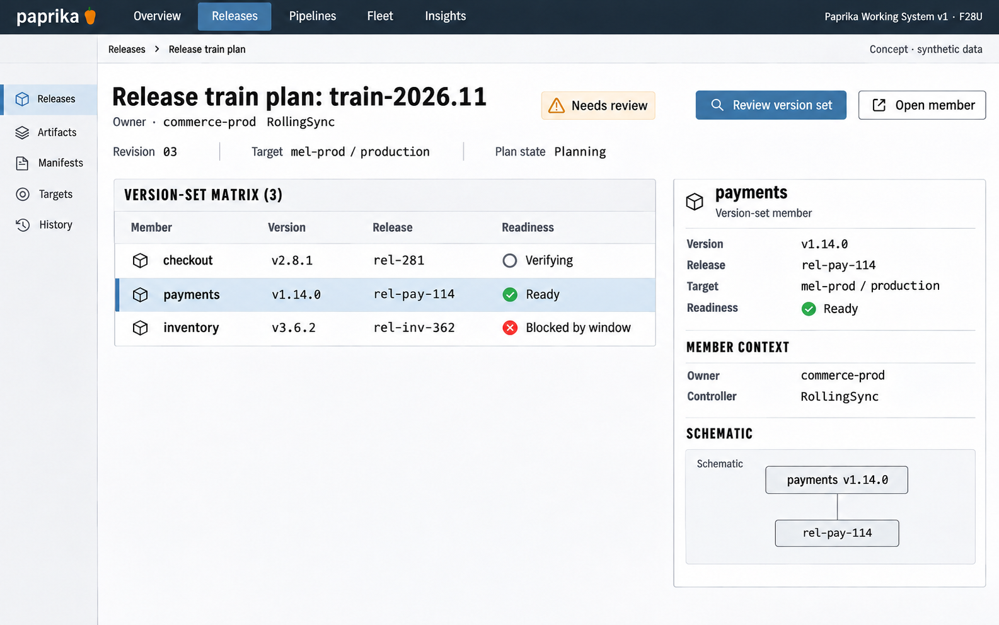

# F28 Multi-application release-train plan

**Design system:** [Paprika Working System v1](../design-system.md) · **Surface:** Main console · **Status:** proposed feature design.

**Implementation backlog:** [#245](https://github.com/paprikacd/paprika/issues/245).

[Catalogue](../README.md) · [Exact fixture](../fixtures/f28.json) · [Space specification](https://chatgpt.com/space/page_c1489ae2ec508191ab0dfa3188240ee0)

## Canonical visual reference



Concept · synthetic data. The artboard describes the proposed interface. The fixture and acceptance criteria below define its meaning; this publication does not mark the feature implemented.

## Working surface

- Versioned plan header, three-member pinned identity matrix, owner-supplied RollingSync context and selected member inspector.

## Synthetic fixture

```json
{
  "source": "Native primary mixed-readiness fixture.",
  "plan": "train-2026.11",
  "revision": "03",
  "target": "mel-prod / production",
  "owner": "commerce-prod · RollingSync",
  "members": [
    {
      "name": "checkout",
      "version": "v2.8.1",
      "release": "rel-281",
      "state": "Verifying"
    },
    {
      "name": "payments",
      "version": "v1.14.0",
      "release": "rel-pay-114",
      "state": "Ready",
      "selected": true
    },
    {
      "name": "inventory",
      "version": "v3.6.2",
      "release": "rel-inv-362",
      "state": "Blocked by window"
    }
  ],
  "planState": "Needs review",
  "imageText": [
    "Release train plan",
    "train-2026.11 · revision 03",
    "mel-prod / production",
    "checkout · v2.8.1 · rel-281 · Verifying",
    "payments · v1.14.0 · rel-pay-114 · Ready",
    "inventory · v3.6.2 · rel-inv-362 · Blocked by window",
    "Owner · commerce-prod RollingSync",
    "Needs review",
    "Review version set",
    "Open member",
    "Planning only",
    "Concept · synthetic data"
  ]
}
```

## Interaction and state contract

- Pin each member identity; refreshing changed membership or candidates creates a new review version.
- Show current RollingSync ownership as existing controller context; do not invent a wave engine or unsupported dependency graph.
- Ready applies only to payments in this fixture; the version set still needs review.
- Use save/review/export and existing member workflow links only.
- No Deploy all, group approval, atomic release or collective rollback in the first slice.

## Backlog implementation specification

The following scope and unchecked acceptance criteria are preserved from the linked implementation issues, read on 2026-11-11. Existing foundations and proposed additions remain distinct.

### Problem

Teams need a shared review of the exact candidate set across related Applications, including compatibility assumptions, owner relationships and constituent blockers.

### Existing foundation

ApplicationSet RollingSync already provides label-selected ordered batches, integer/percentage maxUpdate and earlier-step desired/Healthy gating, with unmatched Applications last. Promotion already supports a singular upstream dependency. There is no durable reviewed cross-Application version-set plan.

Audited against `17a651ab8edf20337ac5319af93ae7fb2c389b47` on 11 November 2026 (Australia/Melbourne).

### Proposed first useful slice

Create a read-only version-set plan with pinned member identities, explicit dependency evidence, ApplicationSet ownership and candidate drift detection. Every member links to its existing workflow; execution coordination is a later separate specification.

### Acceptance criteria

- [ ] Pin each member Application/Release UID, source revision and image identity, desired target configuration, owner and observation time in a versioned plan.
- [ ] Distinguish observed promotion/owner dependencies from manually declared compatibility assumptions; unresolved references, cycles and unknown compatibility never become Ready.
- [ ] Display current RollingSync batch/maxUpdate/readiness as owner-supplied inputs when applicable. Do not create a second wave engine or edit generated children behind their controller.
- [ ] Show candidate replacement, membership/configuration drift and every constituent blocker; changing membership or pins creates a new review version.
- [ ] Offer save/review/export and links into member workflows only. No Deploy all, group approval, atomic deployment or collective rollback in the first slice.
- [ ] Define project-scoped persistence and authorization for plans. A later coordinator requires its own partial-failure, cancellation, retry and owner-interaction contract.

### Maintained owners

- [ApplicationSet strategy schema](https://github.com/paprikacd/paprika/blob/17a651ab8edf20337ac5319af93ae7fb2c389b47/api/pipelines/v1alpha1/applicationset_types.go)
- [RollingSync owner](https://github.com/paprikacd/paprika/blob/17a651ab8edf20337ac5319af93ae7fb2c389b47/internal/controller/pipelines/applicationset_controller.go)
- [Promotion relationships](https://github.com/paprikacd/paprika/blob/17a651ab8edf20337ac5319af93ae7fb2c389b47/api/pipelines/v1alpha1/application_types.go)

### Dependencies and scope

Consumes REL-01 read model. Execution orchestration deliberately requires a later issue and separate design review.

Suggested sequence: 8 · later. Size hypothesis: Large · durable plan model; planning only. These are planning estimates, not a delivery commitment.

## Earlier creative explorations

These earlier studies retain the feature's exploration history. The canonical artboard above supplies the shared shell and visual direction.

[F28A](../assets/explorations/f28a.png) · [F28B](../assets/explorations/f28b.png) · [Archive index](../explorations/README.md#f28)

## Implementation alignment

Use the existing runtime owners identified in the [design-system contract](../design-system.md#runtime-ownership). Apply the common shell, type, spacing and state vocabulary without replacing this feature's work surface, authorization or data semantics.

The canonical fixture remains available as JSON for implementation and review. Keyboard, narrow-layout and live-data behavior require implementation-specific verification; generated artboards do not establish those results.
