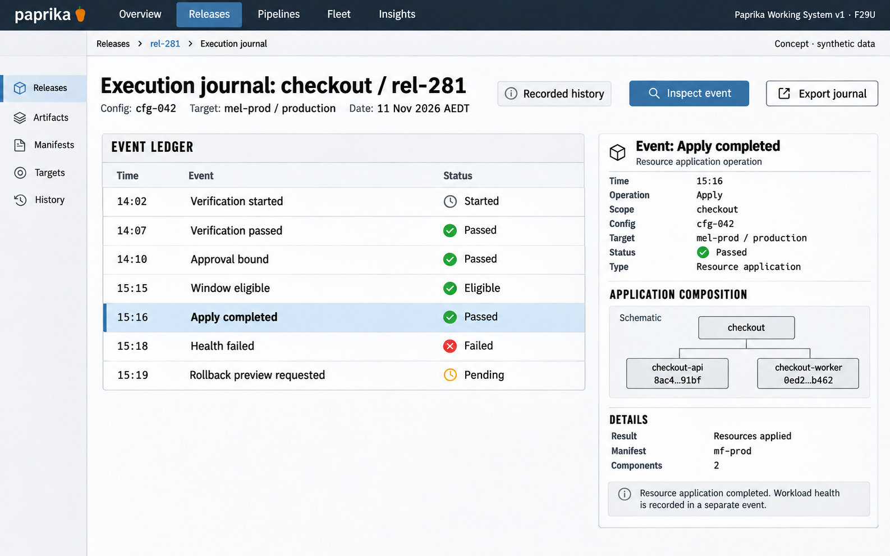

# F29 Deployment execution journal

**Design system:** [Paprika Working System v1](../design-system.md) · **Surface:** Main console · **Status:** proposed feature design.

**Implementation backlog:** [#246](https://github.com/paprikacd/paprika/issues/246).

[Catalogue](../README.md) · [Exact fixture](../fixtures/f29.json) · [Space specification](https://chatgpt.com/space/page_c1489ae2ec508191ab0dfa3188240ee0)

## Canonical visual reference



Concept · synthetic data. The artboard describes the proposed interface. The fixture and acceptance criteria below define its meaning; this publication does not mark the feature implemented.

## Working surface

- Vertical event ledger with distinct timestamps/causal identities, selected Apply completed event and typed fact inspector.

## Synthetic fixture

```json
{
  "source": "Exact companion fixture, selecting the positive apply outcome while keeping the later health failure visible.",
  "date": "11 Nov 2026",
  "timezone": "AEDT",
  "application": "checkout",
  "release": "rel-281",
  "configuration": "cfg-042",
  "target": "mel-prod / production",
  "events": [
    {
      "time": "14:02",
      "event": "Verification started"
    },
    {
      "time": "14:07",
      "event": "Verification passed"
    },
    {
      "time": "14:10",
      "event": "Approval bound"
    },
    {
      "time": "15:15",
      "event": "Window eligible"
    },
    {
      "time": "15:16",
      "event": "Apply completed",
      "selected": true
    },
    {
      "time": "15:18",
      "event": "Health failed"
    },
    {
      "time": "15:19",
      "event": "Rollback preview requested"
    }
  ],
  "rollbackCompletionRecorded": false,
  "imageText": [
    "Execution journal",
    "checkout · rel-281 · cfg-042",
    "11 Nov 2026 · AEDT",
    "mel-prod / production",
    "14:02 Verification started",
    "14:07 Verification passed",
    "14:10 Approval bound",
    "15:15 Window eligible",
    "15:16 Apply completed",
    "15:18 Health failed",
    "15:19 Rollback preview requested",
    "Selected event · Apply completed",
    "Inspect event",
    "Concept · synthetic data"
  ]
}
```

Retain the combined target mel-prod / production. Typed production records retain their actual cluster and namespace identities; generic illustration labels do not redefine those fields.

## Interaction and state contract

- Apply completed is an operation outcome, not proof of workload health; later Health failed remains visible.
- Rollback preview requested is not rollback execution or completion.
- Recorded chronology does not itself prove causality; retain real event/attempt links and do not invent them.
- The selected receipt is read-only; no event-derived action authority.
- Typed gate decision receipts remain owned by #235; do not create a second decision store or guess missing history.

## Backlog implementation specification

The following scope and unchecked acceptance criteria are preserved from the linked implementation issues, read on 2026-11-11. Existing foundations and proposed additions remain distinct.

### Problem

Operators cannot reconstruct durable source-to-release-to-attempt history after live Release/Job objects are retained or garbage-collected.

### Existing foundation

Release status carries snapshots, policies, hooks and verification data, and feed protobuf contracts exist. history_handler currently returns NOT_CONFIGURED because no recorder writes the feeds. A maintained durable storage implementation must be chosen and built.

Audited against `17a651ab8edf20337ac5319af93ae7fb2c389b47` on 11 November 2026 (Australia/Melbourne).

### Proposed first useful slice

Implement an append-oriented recorder and project-scoped paged journal for source events, candidate/verification attempts, Release execution and terminal outcomes. Preserve causal identities and completeness information independently of live-object retention.

### Acceptance criteria

- [ ] Record stable event/attempt identities, source causal links, server-assigned ingestion order, occurrence time and recorded time; handle duplicates, delayed and out-of-order delivery explicitly. Arrival order alone does not establish causality.
- [ ] Choose storage and document retention horizon, recorder recovery, partial writes, pagination and authorization. Do not assume record CRDs already exist.
- [ ] Keep terminal facts and identifiers after live resources disappear; distinguish a missing resource, missing evidence and recorded successful completion.
- [ ] Expose completeness ranges, recorder gaps and not-configured/unsupported states. A gap cannot be backfilled by guessing from current health.
- [ ] Link actual execution resource/log references when retained and show expired links honestly. Keep raw secrets and credentials out of durable event payloads.
- [ ] Link #235 typed gate decision receipts or share its storage contract; keep #221 user-selected evidence captures and #236 drift collection separately owned.

### Maintained owners

- [History feed stubs](https://github.com/paprikacd/paprika/blob/17a651ab8edf20337ac5319af93ae7fb2c389b47/internal/api/history_handler.go)
- [Feed contracts](https://github.com/paprikacd/paprika/blob/17a651ab8edf20337ac5319af93ae7fb2c389b47/proto/paprika/v1/api.proto)
- [Release status](https://github.com/paprikacd/paprika/blob/17a651ab8edf20337ac5319af93ae7fb2c389b47/api/pipelines/v1alpha1/release_types.go)

### Dependencies and scope

Coordinate with #235 typed decision receipts and retention work merged in #137/#182. Do not duplicate #221 evidence captures or #236 drift.

Suggested sequence: 7 · next foundation. Size hypothesis: Large · recorder and durable storage. These are planning estimates, not a delivery commitment.

## Earlier creative explorations

These earlier studies retain the feature's exploration history. The canonical artboard above supplies the shared shell and visual direction.

[F29A](../assets/explorations/f29a.png) · [F29B](../assets/explorations/f29b.png) · [Archive index](../explorations/README.md#f29)

## Implementation alignment

Use the existing runtime owners identified in the [design-system contract](../design-system.md#runtime-ownership). Apply the common shell, type, spacing and state vocabulary without replacing this feature's work surface, authorization or data semantics.

The canonical fixture remains available as JSON for implementation and review. Keyboard, narrow-layout and live-data behavior require implementation-specific verification; generated artboards do not establish those results.
