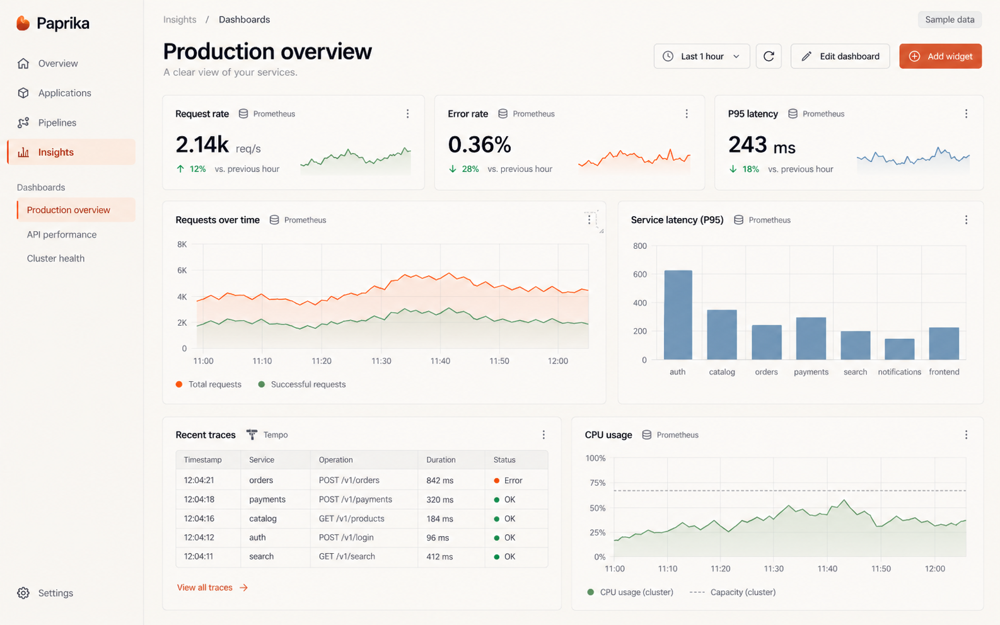
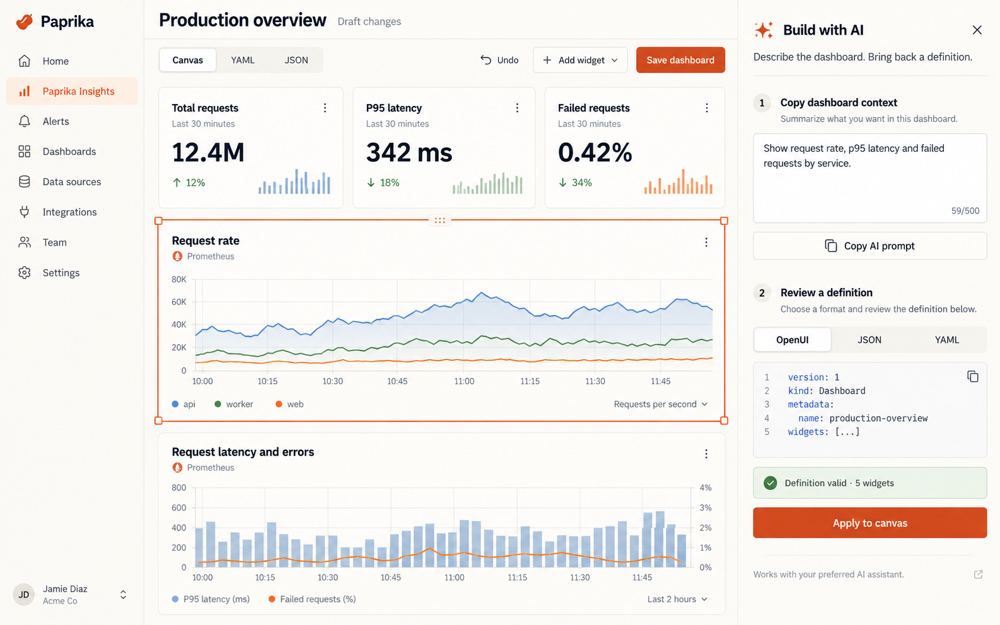

# Paprika Insights visual direction

Generated on 2026-10-23 using the built-in imagegen tool. These are creative direction wireframes, not screenshots of implemented behavior. Their source snippets and metric values are illustrative; the application validates the canonical schema and labels sample data.

## Dashboard canvas



```text
Use case: ui-mockup
Asset type: high fidelity wireframe, product design direction for Paprika Insights
Primary request: Design an exceptionally clean, smooth, high performance observability dashboard builder within Paprika, a Kubernetes deployment platform. This is a design wireframe of real desktop software, not a marketing page.
Scene/backdrop: Flat screenshot of full desktop application, landscape 16:10. Narrow warm offwhite sidebar, warm ivory work canvas, thin gray hairline separators, ample breathing room. Exact restrained professional editorial typography, compact controls.
Subject: Dashboard named "Production overview". Slim sidebar with Paprika wordmark and navigation "Overview", "Applications", "Pipelines", then selected "Insights". Inside Insights, small dashboard list "Production overview", "API performance", "Cluster health". Header breadcrumb "Insights / Dashboards"; page title "Production overview"; subtitle "A clear view of your services."; compact toolbar with "Last 1 hour", refresh icon, "Edit dashboard" and paprika orange "Add widget". Canvas uses asymmetrical resizable grid: small row of three calm stats "Request rate", "Error rate", "P95 latency"; below large real-looking requests time series with orange and sage lines, smaller service latency bar chart with dusty blue bars; bottom row a traces table and CPU time series. One widget displays subtle grip handle and resize corner to communicate flexible layout. Tiny honest label "Sample data" near top. Provider labels "Prometheus" and "Tempo".
Style/medium: Carefully typeset high fidelity UI wireframe. Sophisticated observability tool. Predominantly light, minimal and readable. Simple line icons, 1px borders, 8px corners. No heavy shadows.
Color palette: Warm ivory background, charcoal ink, paprika burnt orange active accents, muted sage and dusty blue data marks. Plenty of negative space.
Constraints: Crisp labels, realistic axes and subtle gridlines, no giant hero title, no 3D, no gradients, no glow, no decorative illustrations, no floating mockup frame, no annotation arrows, no watermark. Entire composition should resemble a polished implemented browser app.
```

## AI/source editor



```text
Use case: ui-mockup
Asset type: high fidelity wireframe, AI-assisted dashboard editor for Paprika Insights
Primary request: Design an exceptionally clean AI-friendly dashboard builder supporting a visual canvas and source documents in JSON, YAML and OpenUI. Show a practical editable product, not marketing.
Scene/backdrop: Flat desktop application screenshot, landscape 16:10. Paprika branded slim left sidebar, warm ivory canvas, charcoal text, fine gray dividers, purposeful white space. Paprika Insights is selected in navigation. This is the same coherent visual direction as a premium monitoring dashboard with muted sage, dusty blue and burnt orange charts.
Subject: Header "Production overview" with secondary "Draft changes". Compact segmented tabs "Canvas", "YAML", "JSON". Toolbar "Undo", "Add widget", paprika orange "Save dashboard". Main area 70 percent width: three compact statistic panels and two elegant line/bar chart widgets. One selected time-series widget is outlined in paprika orange with subtle resize handles and drag grip. Main panel titled "Request rate", tiny provider label "Prometheus", line chart with subdued gridlines and real axis ticks.
Right inspector 30 percent width titled "Build with AI", small tasteful sparkle icon, close button. Intro copy "Describe the dashboard. Bring back a definition." Two clear steps: "1  Copy dashboard context" with short textarea containing "Show request rate, p95 latency and failed requests by service." and button "Copy AI prompt"; then "2  Review a definition" with format tabs "OpenUI", "JSON", "YAML", a compact source editor showing 5 realistic code lines, a sage validation indicator "Definition valid · 5 widgets", and button "Apply to canvas". Footer small honest copy "Works with your preferred AI assistant." No chat bubbles implying a live connected model.
Style/medium: Meticulously aligned high fidelity interface wireframe, compact controls, fine strokes, 8px corners, restrained professional typography. Source code is small mono, all other UI clean humanist sans.
Color palette: Warm offwhite, charcoal, paprika orange used only for selected state and primary action; sage validation, dusty blue visualization.
Constraints: UI must be plausible and polished. No giant hero, no gradients, no glow, no 3D, no thick shadows, no decorative art, no annotation arrows, no watermarks, no floating device frame.
```

## Applied direction

Warm ivory canvas; charcoal type; fine borders; paprika selected states; sage and dusty blue data marks. Compact navigation and toolbar, flexible widget sizes, source editing beside the canvas, and an explicit AI handoff with validation before application. Both images were inspected after generation. Source-code labels in the AI wireframe are illustrative rather than a language grammar reference.
