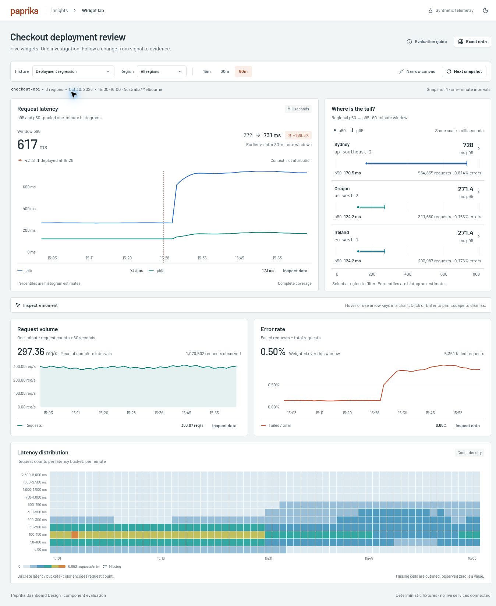

# Paprika Widget Lab — evaluation report

Evaluated 2026-10-30 using the `paprika-dashboard-design` skill. This is an isolated, synthetic-data component lab. It does not query production telemetry or modify Paprika's upstream repository.

## What was built

The dashboard follows a checkout-service deployment investigation across five widgets: request latency, regional latency ranges, request volume, error rate, and a latency distribution heatmap. Each panel answers a specific question within the same selected population and time window.

The line/area charts, distribution renderer, exact chart inspector, shared cursor and Gamma controls are Paprika's actual source at commit `bb52aed8ded8beb08534f6b190a3e7f37c1b19d8`. The new reusable `RegionalLatency` component adds a shared-scale p50-to-p95 comparison and region filtering. The surrounding composition, fixture adapter, summaries, coverage explanations and exact interval table are new lab code. See [source provenance](paprika-source.md).

## Verification evidence

| Area | Evidence | Status |
| --- | --- | --- |
| Numerical integrity | 14 fixture tests cover deterministic generation, histogram count conservation and pooled quantiles, weighted ratios, rate/unit conversion, missing versus zero, equal-duration comparisons, region/window selection and result replacement. | Verified by automated tests |
| Canonical chart integration | 4 adapter tests validate the real widget schema, percent conversion, common timestamp boundaries, and cumulative heatmap inputs. Copied Paprika files retain their recorded hashes. | Verified by automated tests and source checks |
| Build | TypeScript strict checking and production Vite compilation. | Verified in the packaged build |
| Light and dark appearance | Browser visual inspection; dark surfaces use the actual Gamma theme, not a CSS inversion. The wide layout and a 390px component canvas rendered without page overflow. | Verified in Chrome |
| Scope and data identity | Sydney filtering changed the latency summary from 617ms to 728ms, request rate from 297.36 to 154.13req/s and error ratio from 0.50% to 0.81%. Theme and narrow-canvas changes kept default measurements unchanged. | Verified in browser |
| Keyboard and inspection | Arrow keys select chart observations; Enter pins; the shared observation bar displays the selected timestamp and exact interval values. The native chart inspector opens and closes. | Verified in browser; not a full assistive-technology audit |
| Result replacement | A pinned 15:01 observation cleared after Next snapshot; the window advanced from 15:00–16:00 to 15:01–16:01, Australia/Melbourne in the test browser. | Verified in browser |
| Missingness and coverage | Missing samples showed 87% coverage, a three-minute stale tail, and explicit 83.3% versus 90.0% comparison coverage. The final three table rows contain unavailable values and 0/3 observed regions. | Verified in browser |
| Quiet traffic | The 15-minute quiet fixture showed 17 requests, 0.019req/s and no NaN or Infinity. Its comparison uses equal seven-minute halves and identifies the excluded first minute. | Verified in browser; zero/undefined distinction also unit-tested |
| Loading, error and empty | All three states render meaningful content, hide the latency summary, and preserve a 296.33px chart container in the tested desktop layout. Data restores the real chart. | Verified in browser |
| Reduced motion | Plot geometry uses Paprika's disabled SVG animation setting. Owned CSS contains reduced-motion rules; regional geometry updates immediately. | Source reviewed; OS preference switching not exercised |
| Performance | Bounded fixture: 60 intervals, 3 regions, 11 histogram bins. Production bundle size recorded by Vite. | Build verified; no performance benchmark or large-dashboard claim |

The browser's logged errors were from its metadata extension (`chrome-extension://…`); no application error was observed during these checks. This does not constitute a claim of exhaustive runtime coverage.

## Issues found and resolved

1. **Widget color contract:** a CSS variable in `widget.color` failed Paprika's hex-color schema. Styling moved to the existing Gamma theme slots; widget configurations now pass the real schema.
2. **Partial comparisons:** equal wall-clock windows had different observation coverage. The missing-data fixture now labels the comparison as partial, shows 83.3% → 90.0% coverage, and identifies the observed-request population instead of presenting an unqualified percentage-change badge.
3. **Heatmap wording:** the inherited multihue palette is not monotonically brighter as counts rise. The explanatory text now says that color encodes request count; the legend provides the scale.
4. **Scrollbar standards:** paired the owned scoped scrollbar styling with standard `scrollbar-width` and `scrollbar-color` declarations.

## Strict static audit

The Frontend Design Premium auditor scanned all `src`, including the unchanged vendor closure, with an explicit product-admin contract and no exclusions or waivers. The final run has **zero findings in owned lab code**, but **exits 1 overall** for one inherited `GammaTextarea` finding. That component is not rendered here. Its CSS Module already declares `resize: none`, `field-sizing: content`, a maximum height and scrolling; the auditor's literal-attribute check cannot resolve that stylesheet evidence. The raw result is retained rather than relabelled as a pass.

See [audit notes](premium-audit-notes.md), [raw report](premium-audit.json) and [reproducible configuration](premium-audit.config.json).

## Design conclusions

- The skill produced a coherent investigation flow: see the overall change, isolate the affected region, compare traffic and errors, then inspect the distribution.
- A strong visual hierarchy did not require decorative chart effects. Restrained surfaces, consistent typography, exact aligned values, stable color assignments and useful selection states carry the presentation.
- The most useful guardrails were semantic: pooled histograms rather than averaged percentiles, weighted ratios, explicit stale and missing data, common scope, and ownership of cursor/inspection state.
- The new regional range component demonstrates a useful extension point while retaining Paprika's control and theme system. Existing canonical chart capabilities should be preferred before adding another renderer.

## Limits of this evaluation

This is not a benchmark comparing D3, visx and TanStack. It exercises Paprika's current TanStack/D3-backed implementation and one new component. All data is deterministic synthetic telemetry, with no provider latency, authentication, streaming transport or backend failure path.

The 390px test constrains the component canvas within a desktop browser; it is not a physical mobile-device test. Full screen-reader testing, touch gestures, cross-browser validation, operating-system reduced-motion changes and high-cardinality rendering benchmarks remain unverified.

