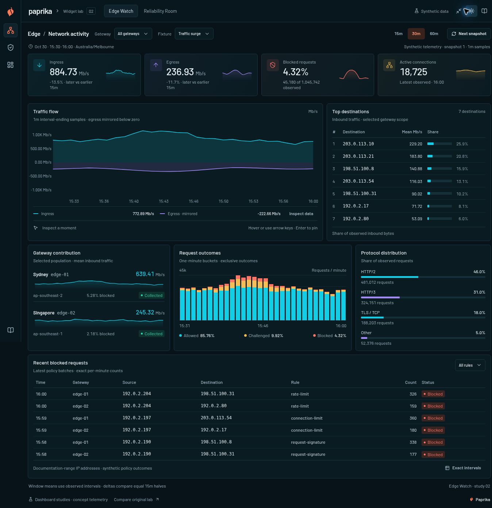
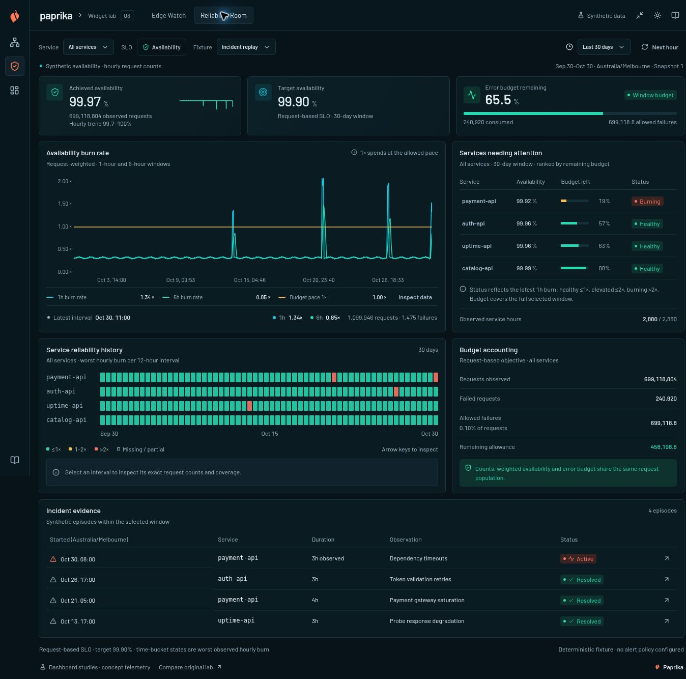
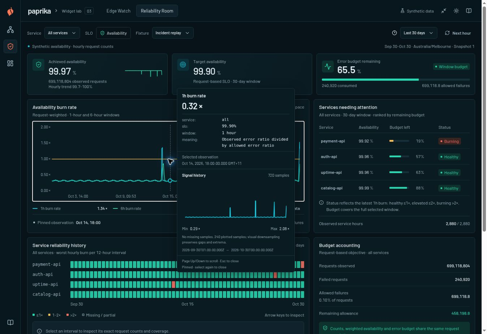

# Paprika Widget Lab — iteration 02

Recorded 2026-10-30. This iteration develops the supplied **Edge Watch** and **Reliability Room** references into interactive dashboard studies using the `paprika-dashboard-design` skill. Edge Watch is the default view; Reliability Room is available at `#reliability`. The original checkout-service investigation remains available at `#baseline`.

All observations, addresses, incidents and policy outcomes are deterministic synthetic fixtures. There is no live telemetry connection, provider authentication, query backend or dashboard persistence. Incident annotations describe the fixture; they do not establish real-world causality.

## Design direction

The studies bring the references' compact composition into working components: a slim navigation rail, scope controls, compact KPI cards with sparklines, a dominant investigation plot, aligned quantitative tables, and a second row of supporting evidence. Dark surfaces, fine borders, restrained area fills and stable series colors carry the hierarchy. The light theme uses the same measurements and Gamma theme contract.

The references guide visual relationships rather than supplying authoritative measurements. Edge Watch uses gateway contribution and protocol distribution as its supporting breakdowns. Reliability Room uses interval history and explicit request-based budget accounting. Each panel has a defined population, time basis and denominator.

## Edge Watch

Route: `#edge` (also the default route).

| Component | Behavior and data meaning |
| --- | --- |
| Scope controls | Select all gateways, Sydney `edge-01`, or Singapore `edge-02`; choose 15, 30 or 60 minutes and a fixture. Next snapshot advances one minute. |
| Ingress and egress cards | Mean traffic rate across observed one-minute intervals, calculated from bytes using decimal megabits per second. Deltas compare equal earlier/later halves only when coverage is complete. The 15-minute comparison uses two seven-minute halves and identifies the excluded first minute. |
| Blocked requests card | Total blocked requests divided by total observed requests. It is a population-weighted ratio rather than an average of interval percentages. |
| Active connections card | The latest observed gauge, with its observation time. A missing tail does not become zero or silently become a current reading. |
| Traffic flow | Canonical Paprika area/line renderer. Ingress is above zero; egress is mirrored below zero for direction. The source magnitude, summary and exact-data table retain nonnegative egress. |
| Top destinations | Ranked inbound byte totals, mean Mb/s and share of the same observed inbound-byte population. Addresses use documentation ranges. |
| Gateway contribution | Selected gateways' inbound histories, rates, block ratios and collection coverage. |
| Request outcomes | One-minute stacked allowed, challenged and blocked counts. Outcomes are mutually exclusive and sum exactly to requests. Keyboard and pointer inspection publish into the canonical shared cursor store. |
| Protocol distribution | Each protocol's request count and share of the selected observed request population. |
| Recent blocked requests | Synthetic per-minute policy batches, with a local rule filter. The rule filter changes this table; it does not redefine the dashboard-wide traffic population. |
| Exact intervals | Accessible table of interval timestamps, positive ingress/egress magnitudes, requests and every outcome count. Missing observations remain unavailable. |

The fixtures are **Traffic surge**, **Steady traffic**, and **Missing samples**. Gateway and time-window changes recalculate cards, charts, breakdowns and exact intervals from the same selected population. Coverage and the last observed timestamp are explicit when observations are missing.

The custom outcomes component owns its interaction source, not a second shared-cursor store. Focus and hover publish transient observations; click or Enter pins. Arrow keys move between buckets. Leaving keyboard focus clears a transient observation. An outcomes pin has an explicit **Clear pin** control; native chart pins remain owned by the canonical inspector. Changing the fixture, gateway, window or snapshot replaces the provider scope and clears obsolete inspection.

## Reliability Room

Route: `#reliability`.

| Component | Behavior and data meaning |
| --- | --- |
| Scope controls | All services or one of four services; 24 hours, seven days or 30 days; fixture selection; Next hour advances one hour. |
| Achieved availability | `1 − failed requests / observed requests`, weighted by the request population. Its sparkline shows hourly availability. |
| Target availability | A request-based 99.90% SLO. The allowance is 0.10% of observed requests. |
| Error budget remaining | `1 − failures / allowed failures`. A negative result remains negative and is labeled exhausted; the visual bar is bounded without clamping the numeric result. |
| Availability burn rate | One-hour and pooled six-hour error ratios divided by the allowed error ratio. The real constant 1× series denotes the allowed spending pace. Incomplete rolling windows remain unavailable. |
| Services needing attention | Fleet comparison ranked by remaining window budget. Selecting a service changes the investigation scope; the comparison remains available for navigation. Latest-hour status is separately explained as healthy ≤1×, elevated ≤2×, or burning >2×. |
| Service reliability history | Fleet rows with the worst observed hourly burn in each 12-hour, three-hour or one-hour cell for the 30-day, seven-day or 24-hour view respectively. Any incomplete cell is missing/partial. Selecting a cell exposes its exact interval, counts, worst burn and coverage. |
| Budget accounting | Observed requests, failures, allowed failures and remaining allowance for the selected scope, all derived from the same counts. |
| Incident evidence | Synthetic episodes overlapping the selected window and service scope. An inspect action selects the service and corresponding history interval. |

The fixtures are **Incident replay**, **Steady service**, and **Missing samples**. Five hours of lookback before the first visible observation support a complete first six-hour rate. Six-hour rates pool counts; they do not average hourly ratios. Summary coverage counts service-hours, while the burn plot requires the complete selected population for each interval and rolling window.

The timeline's selected interval is an aggregate with explicit start and end times. The burn plot's observation readout uses the canonical exact timestamp cursor. These are separate data questions, and the interface labels each accordingly.

## Integration boundaries

The main time-series plots, native exact inspector, selected-series mini-history, keyboard chart navigation, shared-cursor store, Gamma controls and Gamma theme scope come from the pinned Paprika source described in [source provenance](paprika-source.md). This iteration adds no chart library or other dependency, edits no vendor files, and does not modify the upstream Paprika repository.

Owned lab code provides the shell, panel composition, metric cards, sparklines, outcome bars, tables, timeline, deterministic models and adapters. The shell offers dark/light themes and a narrow mode with **390px of dashboard content** inside a padded desktop canvas. It lazy-loads each study and the original baseline.

| Source | Responsibility |
| --- | --- |
| `src/App.tsx`, `src/observatory.css` | Study navigation, theme scope, content canvas, reference links and evaluation notes. |
| `src/components/lab/StudyPrimitives.tsx` | Shared panel, metric-card, sparkline, status and empty-state composition. |
| `src/studies/EdgeWatch.tsx` and its CSS Module | Edge dashboard, controls, tables and shared-cursor outcomes interaction. |
| `src/data/edge-telemetry.ts` | Gateway observations, conserved byte/request partitions, summaries, policy batches and chart adaptation. |
| `src/studies/ReliabilityRoom.tsx` and its CSS Module | Reliability dashboard, burn inspection, timeline selection and budget presentation. |
| `src/data/reliability.ts` | Request-based SLO calculations, rolling rates, history cells, missingness and incident identity. |
| `src/BaselineApp.tsx` | Original iteration-01 investigation, retained at `#baseline`. |

## Findings that changed the implementation

### Snapshot progression must preserve history

The first fixture implementation tied incident and gap positions to the moving window. Advancing a snapshot consequently changed values at existing timestamps and moved resolved incidents. The corrected generators anchor episodes and gaps to fixed absolute timestamps. Overlapping samples retain their identity; resolved incident times stay fixed. An active reliability episode can accumulate additional observed hours without moving its start.

The data tests now check overlapping observations for every scenario, both individual gateways and their aggregate, plus resolved incident timestamp identity. A moving chart should not rewrite history merely to keep a visually convenient incident in the same screen position.

### Domain anchors are not missing observations

A fabricated null point at the requested window boundary initially provided a convenient plot extent. The canonical selected-series mini-history correctly counted that point as a missing sample, so a fully collected fixture misleadingly reported missing data.

The supported correction is to remove invented observations. Reliability's genuine 1× reference spans the full requested window and can establish the plot extent while the measured series contain only observed interval ends. Edge's measured series begin at their first actual one-minute interval end. Actual missing observations stay null. If boundary context is needed in a future adapter, it must be a genuine lookback observation and identified separately from the selected-window accounting.

There is no supported `tooltipView` point filter or missing-footer toggle. Adding an undocumented option, hiding the footer, copying a value backward or replacing the anchor with zero would conceal the modeling problem.

### Tooltip precision is explicit

The mini-history's Min/Max formatter reads `tooltipView.decimals`; it does not inherit `widget.options.decimals`. Both levels require an explicit `decimals: 2` where that display precision is intended. Formatting rounds labels while the data and calculations retain precision.

### Transient and pinned observations need different lifecycles

An outcomes observation initially remained active after keyboard focus left its bar. Blur cleanup now removes transient state. A persistent outcomes pin is discoverably dismissible through **Clear pin**; clearing it does not require finding the original bar. Scope/result changes clear obsolete pins through the canonical provider boundary.

## Verification record

The final combined run passed **40 data and adapter tests**: 18 retained baseline checks, 11 Edge checks, and 11 Reliability checks. They cover conservation, units, aggregation, window filtering, missingness, rolling-rate completeness, negative budget values, snapshot identity and mapping real observations into the chart. The production build includes TypeScript checking and also passed.

| Browser check | Observed result |
| --- | --- |
| Dark and light themes | Both new studies inspected in both themes. |
| Narrow content canvas | Final browser recheck passed: Edge KPI cards use one column at 390px and values no longer overlap their sparklines. Both studies have a 420px padded canvas with equal client/scroll width, including 390px of content. This is a constrained canvas in a desktop browser. |
| Reliability service and 24-hour scope | Selecting the affected service and 24-hour window produced a negative remaining budget with the exhausted state. |
| Missingness | Partial-coverage notices and unavailable observations were visible in the missing-samples fixtures. |
| Reliability timeline keyboard selection | End selected the final cell and exposed its exact interval details. |
| Canonical chart keyboard inspection | ArrowRight selected an observation, Enter pinned it, and Escape closed the native inspector. |
| Result replacement | Advancing the snapshot cleared the obsolete pinned chart observation. |
| Custom outcomes inspection | Pinning and the explicit Clear pin action exercised. |
| Edge scope and exact data | Gateway selection, the 15-minute view, missing samples and the exact-interval table exercised together. |
| Event filtering | Selecting Request signature left only request-signature batches in the local event table. |
| Final miniature history | A measured burn-rate observation reported 720 samples, 240 plotted samples, no missing observations and Min/Max rounded to two decimals. |
| Original study | The original checkout dashboard rendered through Compare original lab and returned through Back to new studies. |

### Final release check

- Combined automated test rerun: **40/40 passed** across four files.
- TypeScript and production build: **passed** through the Sites build helper; no additional dependencies were introduced.
- Static design audit: **zero findings in owned lab code**. The strict audit exits nonzero for the same unused vendored textarea flagged in iteration 01. Its CSS Module supplies the resize/sizing behavior; the literal-attribute scanner does not resolve it. The unmodified source and [raw audit result](premium-audit-iteration-02.json) are retained. This is not an overall strict-audit pass.
- Narrow layout after the final Edge KPI-column fix: **visually rechecked**, with each metric card measuring 390px and no canvas overflow.
- Screenshot review: **completed** for both full dashboard studies and the pinned miniature-history inspector below.
- Runtime log sample: browser-extension metadata errors were present; no application error appeared in the inspected sample. This does not establish a cross-browser runtime guarantee.

## Limits and follow-up evaluation

The narrow-canvas check is not an actual browser viewport resize, physical-device test or touch test. Screen-reader behavior, cross-browser rendering, operating-system reduced-motion switching and performance under real telemetry or high cardinality were not tested in this iteration. Keyboard checks establish the exercised interactions, not a complete accessibility audit.

The fixtures do not exercise streaming transport, provider latency, authentication, backend failures, time-zone transitions or persistence. The study is also not a renderer benchmark comparing D3, visx and TanStack. It demonstrates how much of the requested dashboard direction can be composed around Paprika's existing renderer and theme APIs.

## Screenshots

### Edge Watch

### Reliability Room

### Pinned inspector

The original [iteration-01 evaluation report](evaluation-report.md), [data contract](data-contract.md), [audit notes](premium-audit-notes.md) and [baseline screenshot](screenshots/paprika-widget-lab-light.jpg) remain available as historical evidence.
