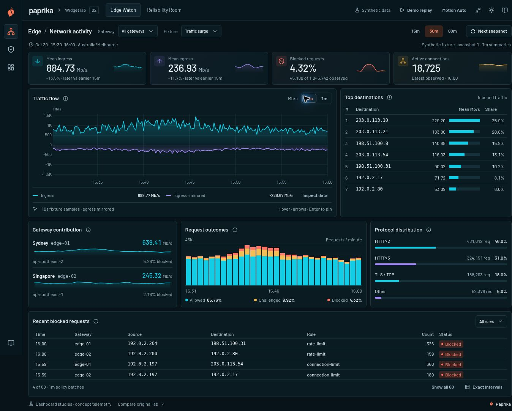
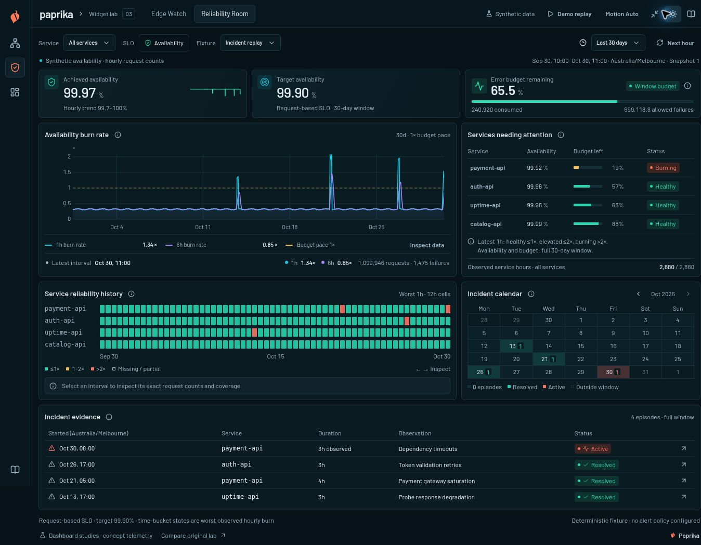
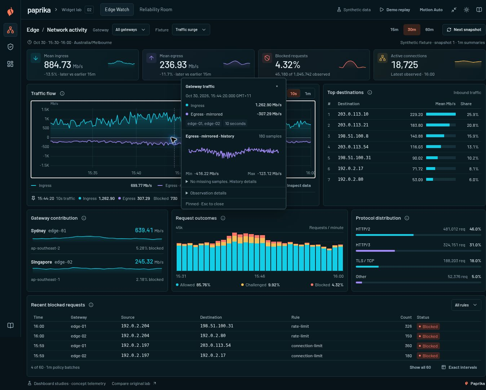

# Paprika Widget Lab — iteration 03

Recorded 2026-10-30. This pass brings the Edge Watch and Reliability Room studies closer to the supplied dashboard references through denser composition, richer chart rendering, compact exact inspection and purposeful motion. The deployed evaluation lab uses deterministic synthetic telemetry without a live provider, backend query service or dashboard persistence.

This report records the current implementation and observed evaluation. [Iteration 02](iteration-02.md) remains historical: its unchanged-vendor and no-new-dependency statements describe that earlier version, not this one.

## What changed

The shared shell now uses compact metric cards, shorter panel headers and accessible information disclosures. Essential units, cadence and missingness stay visible. Seven destination rows remain; their bars compare mean Mb/s on a common zero-to-highest domain, while percentage share appears separately. Event tables show a compact recent set with explicit expansion. Reliability adds a real incident calendar and a disclosure for exact request-based budget accounting.

The locally copied Paprika renderer and strict schema now support opt-in vertical grids, calendar time scales, unit captions, signed gradient areas, a zero line, labelled reference rules and a compact inspector with an 80px selected-series history. These are local owner extensions, not claimed upstream features. Date channels are used only for temporal rendering; original numeric timestamps remain the basis for exact inspection and cursor identity. Signed fills fade toward zero, including mirrored egress. See [source provenance](paprika-source.md).

Edge defaults to explicitly labelled 10s synthetic observations, with a 1m switch. Six integer-count buckets preserve each original minute's bytes, requests and exclusive outcomes exactly. Gateway aggregation, null gaps and overlapping snapshot identity are retained. Summaries, protocol/destination accounting and minute outcome bars keep their original source population. The readout distinguishes 10s traffic from 1m outcome inspection. This is a fixture construction, not interpolation of provider measurements.

## Measured composition

The following measurements came from the current browser evaluation at a **1363 × 936px viewport**. They describe that run, not a cross-device benchmark.

| Surface | Observed result |
| --- | --- |
| Edge full page | 1083px tall; iteration 02 was approximately 1391px at the same width. |
| Reliability full page | 1049px tall. |
| KPI cards | 87px tall. |
| Compact inspector | 290 × 362.8px after cleanup; previously 408.8px tall. |
| Page overflow | No horizontal page overflow observed in the reviewed wide view. |

Removing duplicated inspector titles and redundant disclosure rows reclaimed space while retaining 12px operational text. The final inspector showed the exact timestamp and both traffic series. Its selected egress history contained **180 observations**, with **−416.22 Mb/s minimum**, **−123.12 Mb/s maximum**, and **zero invented missing samples**. Those are mirrored plotted values; source and accounting egress remain positive.







## Runtime interaction and accounting checks

Switching Edge from 1m to 10s retained **884.73 Mb/s mean ingress**, **236.93 Mb/s mean egress**, **4.32% blocked requests**, and **18,725 active connections** in the tested scope. The finer texture therefore changed the displayed observation cadence without changing the summary population. Keyboard inspection and pinning, explicit close, Escape, and snapshot replacement were exercised; advancing the snapshot cleared obsolete selection.

The Reliability calendar was evaluated in **Australia/Melbourne**. Selecting **October 30** filtered the evidence to **one active incident**. Selecting **October 28** showed no episodes. Clearing the date restored **four incidents**. Availability/budget accounting stayed on its full query population throughout that local evidence filter:

| Accounting checkpoint | Unchanged value |
| --- | ---: |
| Displayed remaining budget | 65.5% |
| Observed requests | 699,118,804 |
| Failed requests | 240,920 |
| Allowed failures | 699,118.804 |
| Remaining failure allowance | 458,198.804 |

The allowance equals 0.001 times observed requests; remaining allowance subtracts actual failures. Opening exact budget accounting and pressing Escape closed the disclosure and returned focus to its trigger. Calendar state describes episode presence and active/resolved status; it does not infer incident severity.

Light mode and the **390px content canvas** were visually reviewed, with unchanged values. This was the lab's narrow composition control inside a desktop browser, not an actual mobile viewport or touch test.

## Motion and replay

Motion Auto produced an observable intermediate KPI border/text emphasis after a real value change, then settled. Numeric values updated immediately. Motion Reduced advanced the values without that emphasis. The implemented durations are **360ms for KPI emphasis** and **150ms for compact inspector appearance**, with no count tween or path morph.

Demo replay advanced actual synthetic snapshots and could be explicitly paused. Switching to Reliability stopped the previous replay. Its configured cadence is **1.8 seconds per snapshot**, advancing **one minute in Edge** or **one hour in Reliability**. Reduced motion does not change that cadence. Hidden-document pause and live operating-system preference handling were source-reviewed; they were not runtime-tested in this evaluation.

## Automated validation and provenance

The final automated run passed **57/57 tests across five files**: 18 baseline, 18 Edge, 17 Reliability, and four chart-presentation tests. The official production build, including TypeScript checking, succeeded. These checks cover numerical and adapter behavior; they do not replace browser evaluation.

The strict premium design audit found **zero owned-app findings** and retained one pre-existing unused vendor `GammaTextarea` scanner false positive. This is **not an overall strict-audit pass**.

The upstream base is `bb52aed8ded8beb08534f6b190a3e7f37c1b19d8`. Provenance records **42 unchanged files, six modified owners and one new helper**, with upstream/local SHA-256 values. The direct additions are `d3-scale` 4.0.2 and `@types/d3-scale` 4.0.9. License and Gamma attribution remain preserved. After the final TypeScript branch correction, the [renderer patch](paprika-reference-renderer.patch) was regenerated with SHA-256:

```text
43a54f7886df236e42aa57e07543cf0f2825aacbadcd5f8288e01a9adfe394eb
```

Provenance `--check`, reverse patch applicability and documentation whitespace checks passed. The [regeneration helper](regenerate-paprika-provenance.py) makes subsequent owner changes reviewable without rewriting upstream history.

## Skill feedback and remaining boundaries

A fresh-context forward review using the updated skill caught duplicate inspector titles, a rounded bar-axis/domain mismatch, and inaccurate provenance wording. All three were corrected. The skill now includes the clearer **1592 × 988px primary references**, also retained in the dashboard design Space. Skill commit `2d2551bf107557485988202a98106f734edae864` was pushed and remotely reconciled. This review exercises the skill against the current lab; it does not establish that every future generation will reproduce the same result.

Not runtime-checked: operating-system reduced-motion changes, hidden-tab pause, actual mobile viewport/touch behavior, screen readers, other browsers, live providers or high-cardinality performance. The lab remains a bounded evaluation surface. Future integration should retain the [behavior contract](../UX-CONTRACT.md), measure those outstanding cases explicitly, and review the local owner patch before proposing it upstream.
