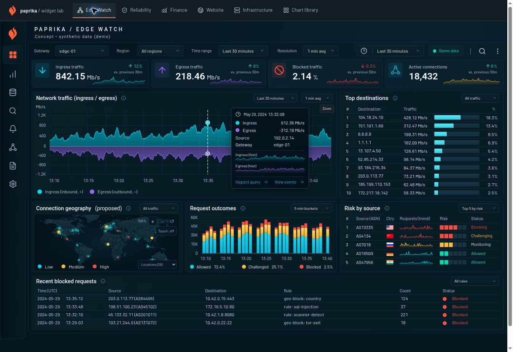

# Iteration 06 — lenses, chart authoring and investigation

## Outcome

This iteration adds three synthetic dashboard lenses at `#finance`, `#website` and `#infrastructure`, a shared live chart editor, richer exact-value inspection, local time-window selection, responsive reflow and ordinary wheel zoom on maps. The Edge Watch and Reliability Room reference studies remain available with their original 1592 × 988 authored fixtures. Earlier iteration reports retain their historical evidence.

The implementation continues to use React, the copied Paprika widget host/registry, TanStack Charts 1.1.0, D3 primitives and native SVG. D3 Hierarchy, already installed for the record-chart dependency closure, now also computes the financial allocation layout. No additional rendering or animation library was introduced. See the [framework inventory](framework-stack.md), [capability coverage](chart-capabilities.md) and [reference register](reference-register.md).

## Navigation correction — 31 October 2026

The user could not find Finance or Infrastructure from the default reference dashboard: their entry points were hidden in View settings. The lab now has one visible primary navigation above every routed view, linking Edge Watch, Reliability, Finance, Website, Infrastructure and Chart library. The former lens-only navigation was reduced to local canvas controls, and dashboard search includes explicit destinations for all new lenses.

The navigation is outside the scaled reference artboard. Browser measurement confirmed the reference remains 1592 × 988 internally. All five other destinations were opened from the default view and showed the expected heading and active link; keyboard Tab/Enter and searching for Infrastructure also worked. TypeScript and the production build passed. The desktop page had no horizontal overflow; the narrow wrapping rule is implemented but was not separately exercised at a physical mobile viewport in this fix.

## The three lenses

**Finance** pairs current portfolio value with a dominant sector/holding treemap, sector exposure, period performance against a synthetic reference, signed sector contribution and an exact holdings ledger. Market value supplies nonnegative area. Daily percentage change supplies a stable, zero-centred color scale. Sector headers drill into the hierarchy; the Portfolio breadcrumb resets it. Holding inspection names the value, currency, change, sector and weight in the whole portfolio. The fixed closing snapshot and all histories are synthetic.

Portfolio and sector returns pool current and previous position values instead of averaging percentage changes. The period headline matches the history endpoint, and the final daily historical change reconciles to the closing snapshot. Current cash/allocation use snapshot meters rather than invented histories. The local `allocation-treemap` plugin has strict mapping/configuration, stable identity, exact keyboard/pointer inspection and explicit missing/zero-area handling.

**Website** adapts the supplied website dashboard's compact event summaries, resource plots, request stacks and full-width traffic comparison. Its one-hour/three-hour selector changes the population represented by every headline and plot. Logins, sign-ups and sign-outs remain separate event populations. Page-load stacks represent exclusive duration buckets; they are not labelled as cumulative percentile measurements.

**Infrastructure** adapts the supplied overview's health, map, capacity and time-series hierarchy. It composes two independent connection maps, compact operational summaries, host trends, storage records and network traffic. One map classifies supplied blocked-source counts; the other classifies probe round-trip time. Geographic location does not itself determine risk. All positions, counts and system measurements are synthetic.

The additional Grafana screenshots inform the new layouts and editor work regions. This iteration does not claim that the new lenses are completed pixel reproductions of those images.

## Scope of interactions

| Action | What changes | What remains the source of truth |
| --- | --- | --- |
| Drag a time-series interval or enter UTC bounds | One chart's displayed **Chart window**, with Undo and Reset. | Complete loaded observations; dashboard KPIs and provider query bounds are unchanged. |
| Select the Website one-hour/three-hour Window | Loaded fixture population, three event totals and associated plots together. | The deterministic synthetic event model; no provider request executes. |
| Select a Finance history period | Rebased performance history and its period-return headline. | The fixed closing valuation snapshot and whole-portfolio allocation. |
| Drill a treemap sector | Local hierarchical view and its breadcrumb. | Market values, whole-portfolio weights and the declared change-color scale. |
| Zoom or pan a map | That map's bounded camera. | Coordinates, identity, values and classifications; the other map's camera is independent. |
| Edit and Apply a widget | The host's session-local panel configuration. | The same normalized result; no durable save or query execution is implied. |

Time selection uses actual timestamp inversion and distinguishes a click from a deliberate horizontal drag. The shared controls support exact UTC bounds, reverse selection, nested windows, Undo and Reset. This is chart-local exploration; connecting it to a shared dashboard query owner remains a separate integration step.

Ordinary map wheel input zooms around the pointer. Outward input at a zoom limit returns to page scrolling; Ctrl/Command, Shift and horizontal-dominant gestures pass through. Existing pan/zoom buttons, reset and keyboard controls provide non-drag access. Touch navigation retains its explicit opt-in. Camera changes do not manufacture observations.

Rich inspectors show exact same-timestamp observations, gap-preserving history, source labels and window summaries. The canonical and literal-reference inspectors retain their respective data contracts. Reference artwork values are not promoted into measured analytical observations.

## Chart editing

The editor opens from a lens panel's Edit action or the catalogue's Edit chart action. A large live preview sits beside grouped visual options, with Data, Query and Configuration below. The preview renders the same registered widget and normalized result as the dashboard. The exact-data view preserves nulls and discloses its bounded/paged presentation.

Guided options and JSON use the shared schema and plugin parser. Invalid input remains available for correction, retains the last valid preview and blocks Apply. The editor provides Undo/Redo, Apply and Discard. The original custom renderer and its mapping remain reachable after switching to a compatible table; unsupported field mappings are not fabricated from default strings.

Apply updates the current lab session and can be checked by reopening the editor. It is not a durable dashboard Save. Query is read-only fixture context because this lab has no query execution host. Presentation changes reuse the same observations. Backend persistence, conflict handling and executable query editing remain unimplemented.

## Verification record

The following records executed checks from the closing workflow. Automated tests, browser interaction, constrained layouts and source provenance establish different properties.

| Check | Recorded result |
| --- | --- |
| Automated suite | **168/168 tests passed across 14 files.** Coverage includes numerical fixtures, schemas, registry/adapters, map state, time-window math, finance conservation and editor state/compatibility. |
| Compilation and packaging | TypeScript checking and the Vite production build passed. The exact upstream-to-local renderer patch and 65-file provenance manifest were regenerated and verified. |
| Finance drilldown | Technology showed **3 holdings** with **$787.8k** allocated. Reset returned to the whole-portfolio hierarchy. |
| Finance exact inspection | Pinned MSFT showed **$269,766**, **10.72% of the whole portfolio**, and **+0.82%** daily change. |
| Finance presentation invariance | Applying a treemap color limit change from **3 to 4** changed the encoding scale while exact financial values remained unchanged. |
| Website population selection | One hour showed **66 / 94 / 90** logins/sign-ups/sign-outs; three hours showed **190 / 269 / 273**. |
| Independent map cameras | Zooming one infrastructure map produced **2.014×** while the other remained at **1×**. |
| Editor workflow | Guided Apply, reopen and Discard were exercised. Invalid JSON retained the valid preview and blocked acceptance until corrected. |
| Canonical chart window | Reverse and nested brushing, Undo, Reset and exact UTC input were exercised in the browser. |
| Reference reflow | The 390px reference layout was checked without panel overlap. This is constrained browser-layout evidence, not physical-device testing. |
| New-lens narrow layouts | At a **390px container preview**, Infrastructure stacked its map panels at **370px**, Website stacked its cards/plots at **370px**, and Finance recomputed readable treemap geometry with two-column KPIs. The desktop document's client and scroll widths both measured **1348px**, with no horizontal page overflow in the checked layouts. These are constrained desktop containers, not physical mobile viewports. |
| Skill transfer exercise | A fresh financial/editor brief transferred pooled returns, missing-change handling, area/color separation, valid mappings, last-valid preview and the session boundary. This was a proposal exercise, not another implemented or browser-verified dashboard. |

### Captured views

- [Rich inspection](screenshots/iteration-06-rich-inspector.jpg)
- [Ordinary map wheel zoom](screenshots/iteration-06-map-wheel.jpg)
- [Responsive reference and chart window](screenshots/iteration-06-responsive-window.jpg)
- [Shared chart editor](screenshots/iteration-06-editor.jpg)
- [Finance lens](screenshots/iteration-06-finance.jpg)
- [Website lens](screenshots/iteration-06-website.jpg)
- [Infrastructure lens](screenshots/iteration-06-infrastructure.jpg)
- [Finance at a 390px container preview](screenshots/iteration-06-finance-mobile.jpg)

These are implementation captures. The original design screenshots are registered separately and are not used as dashboard backgrounds.

## Remaining limits

- All new lens data are deterministic synthetic fixtures. There is no market feed, live telemetry provider, executable query backend or durable dashboard persistence.
- New-reference pixel parity has not been established. The original Edge Watch/Reliability reproduction workflow and its stated source inconsistencies remain separate.
- Desktop canvas previews and browser pointer/keyboard checks do not establish physical touch behavior or complete mobile-device compatibility.
- The new local allocation plugin and editor are lab extensions. This work does not establish their integration into upstream Paprika.
- Reusable irregular elapsed-duration timelines, general incident/unknown interval annotations and typed trend/flag record cells retain the previously documented gaps.
- No new production workload benchmark was established by these functional checks.

The Paprika design skill now records financial accounting/treemap rules and the shared authoring workflow alongside its existing pixel-reproduction, chart-family, geographic and interaction guidance. Skill validation and persistence are tracked by the owning workflow.
