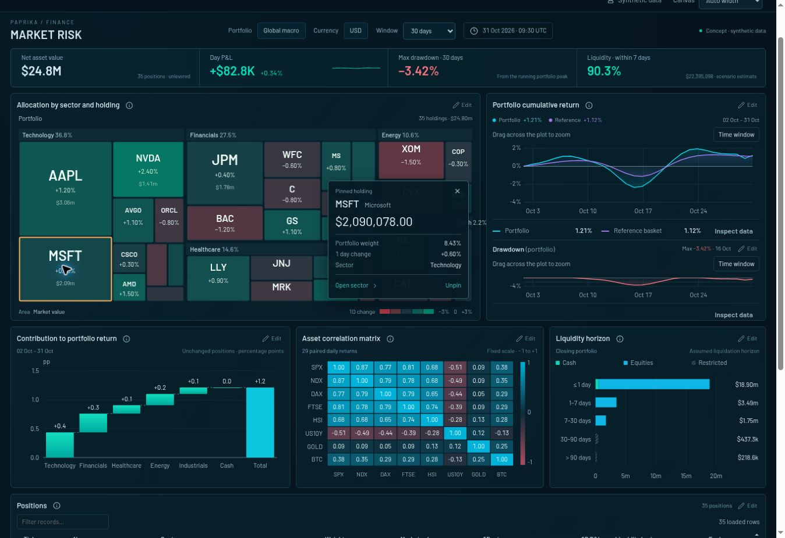

# Iteration 07 — complex dashboard lenses

**Status: implemented and validated in the Widget Lab; production package prepared through the existing Site workflow.**

This iteration implements the four generated Paprika concepts with the lab's existing components and trusted renderer extension path. It adds Market Risk, Inference Fleet, Incident Room and Grid Operations, together with 11 new registered chart families. The new examples use real interactive components over deterministic synthetic data. Generated PNGs are retained as design references; none is used as a dashboard background or presented as a measured rendering result.

The original Edge Watch and Reliability Room reference studies, earlier analytical studies, Finance, Website and Infrastructure remain reachable. Global navigation exposes all four new lenses. The chart library also exposes the eleven complex families alongside its eleven earlier examples, using the same preview/editor lifecycle.

## Brief and implementation mode

The user requested more complex generated dashboards as a test of the Paprika design skill, then authorized implementation using the existing components. This pass uses **component-based adaptation**: preserve the defining composition, dense evidence, quiet structure, restrained color and selected-state detail, while replacing contradictory generated numbers with accountable synthetic fixtures. Equal-size pixel reproduction of these four images is not an acceptance claim for this pass.

| Lens | Audience and decision | Composition to preserve | Authoritative scope |
| --- | --- | --- | --- |
| Market Risk | Portfolio analyst identifying concentration, contributors, drawdown and liquidity exposure. | Dominant sector/holding treemap; return and aligned drawdown; contribution waterfall, correlation matrix and liquidity horizon; exact positions ledger. | Fixed USD closing portfolio at 31 Oct 2026, 09:30 UTC; 14/30/90-day historical views. Position valuation is distinct from historical window selection. |
| Inference Fleet | Platform engineer identifying unavailable devices, latency pressure, model routing and workload concentration. | Rack × GPU matrix with detailed selected device; latency histogram and queue; conserved routing flow; paired log scatter; exact workload table. | Fixed synthetic snapshot at 31 Oct 2026, 16:00 UTC. Region/model selectors define the population; one/six-hour windows select loaded histories at five-minute cadence. |
| Incident Room | On-call engineer following service impact through telemetry, dependencies, one request trace and source evidence. | Context sidebar; three aligned telemetry lanes; dependency graph and regional evidence; nested parallel trace waterfall; evidence timeline. | 31 Oct 2026, 09:30–10:00 UTC, ten-second observations. Service selection changes telemetry. Dependency population, sampled trace and incident evidence each retain explicit scope. |
| Grid Operations | Grid operator comparing demand, generation, constrained corridors, battery energy and forecast uncertainty in a hypothetical network. | Dominant regional network map; compact system summary; generation stack, signed battery bars and SOC; observed/forecast plot, asset states and constraints. | Synthetic model day 31 Oct 2026, observed through 16:00 UTC with forecast through 24:00. Five-minute power observations; fifteen-minute state observations. Scenario and loaded-history controls are distinct from map/plot zoom. |

All examples disclose synthetic data. None connects to a live market feed, GPU fleet, incident provider or utility control system.

## Reference evidence

The four retained images are **1586 × 992 pixels**. Actual file dimensions and SHA-256 identities are recorded in [the reference register](reference-register.md). Originals remain in the generated-image directory; the unchanged copies live at:

- [Market Risk concept](references/market-risk-concept.png)
- [Inference Fleet concept](references/inference-fleet-concept.png)
- [Incident Room concept](references/incident-room-concept.png)
- [Grid Operations concept](references/grid-operations-concept.png)

### Explicit semantic deviations from the generated art

| Concept | Generated-art risk | Implemented analytical decision |
| --- | --- | --- |
| Market Risk | Repeated sector groups, irreconcilable position weights, contribution totals that do not match the return interval, unverified correlation symmetry. | Build valuations from a declared holdings population. Use nonnegative market value for area and fixed signed-return color. Pool returns and compute contribution in percentage points against the same period-start denominator. Compute symmetric Pearson correlations from paired synthetic returns. Label liquidity as an assumed liquidation horizon. |
| Inference Fleet | Decorative device counts and flow widths, unknown histogram population, possible confusion between a heatmap's bucket bands and a continuously logarithmic axis. | Derive installed/reporting counts from device records. Derive both stages of routing from the same original-request rows. Exclude retries explicitly. Difference compatible cumulative buckets once and derive fleet p95 from their pooled distribution. Paired scatter inputs must be positive on both log axes. |
| Incident Room | Illustrative event relationships and span shapes can imply causation or a total duration equal to the sum of overlapping spans. | Use actual source timestamps for every telemetry lane and annotation. Preserve null/missing intervals. Validate parent-child containment, stable IDs, one trace and parallel overlap. Elapsed trace duration is derived from time bounds; a graph edge or nearby deployment is evidence, not causal proof. |
| Grid Operations | Generated terrain, geographic labels and utility corridors are not reliable geographic evidence; power, stored energy and future bands can be conflated. | Reuse public-domain Natural Earth land geometry with approximate city coordinates and explicitly hypothetical corridors. Reconcile generation + battery power = demand + exports for each observation. Integrate signed MW across five-minute intervals into MWh. Keep forecast median and nested intervals separate from observed values and telemetry gaps. |

The graphic styling of an uncertainty band does not establish forecast calibration. The electrical network is not a power-flow solver. The financial scenario does not establish market risk limits, liquidity guarantees or investment advice.

## Owners and family coverage

Every new family is registered as `type: 'plugin'` under the existing widget schema. No new built-in type or alternate dashboard document model was added. The central composition owner is `src/charts/register-concept-charts.ts`; direct lens entry also installs the required local bundle. Full semantics and bounds are in [chart capabilities](chart-capabilities.md), and framework ownership is in [the framework inventory](framework-stack.md).

| Family ID | Renderer | Pure transformation/config owner | Evidence role |
| --- | --- | --- | --- |
| `contribution-waterfall` | `src/charts/market-risk/MarketCharts.tsx::ContributionWaterfall` | `market-chart-data.ts::waterfallSteps`, `waterfallConfig` | Signed interval contribution and reconciled cumulative total. |
| `correlation-matrix` | `MarketCharts.tsx::CorrelationMatrix` | `correlationCells`, `correlationConfig` | Paired asset relationship on a fixed −1 to +1 scale. |
| `liquidity-ladder` | `MarketCharts.tsx::LiquidityLadder` | `liquiditySegments`, `liquidityConfig` | Current absolute value by assumed horizon and restriction category. |
| `rack-matrix` | `src/charts/inference/InferenceCharts.tsx::RackMatrix` | `data.ts::buildRackMatrix`, `rackMatrixConfig` | Device utilization, coverage and exact metadata/history. |
| `request-flow` | `InferenceCharts.tsx::RequestFlow` | `buildRequestFlow`, `requestFlowConfig` | Conserved region → model → outcome request rates. |
| `log-scatter` | `InferenceCharts.tsx::LogScatter` | `buildLogScatter`, `logScatterConfig` | Paired throughput and TTFT observations. |
| `aligned-telemetry` | `src/charts/incident/IncidentCharts.tsx::AlignedTelemetry` | `incident-model.ts::telemetryAt`, `alignedTelemetryConfig` | Separate-unit metrics with exact shared time and annotation geometry. |
| `trace-waterfall` | `IncidentCharts.tsx::TraceWaterfall` | `buildTraceSpans`, `visibleTraceSpans`, `traceWaterfallConfig` | One request's nested and parallel elapsed spans. |
| `service-dependency` | `IncidentCharts.tsx::ServiceDependency` | `buildDependencyGraph`, `dependencyConfig` | Observed call relationships, latency and pooled error ratios. |
| `grid-network-map` | `src/charts/grid/GridNetworkMap.tsx` | `grid-model.ts::networkRecords`, `gridNetworkConfig`; existing `geo-viewport.ts` | Located substations and directed links, local camera and exact node history. |
| `forecast-bands` | `src/charts/grid/ForecastBands.tsx` | `forecastRecords`, `forecastBandConfig`; existing time-window primitives | Observations, median prediction and nested interval uncertainty. |

The four lens owners are `src/lenses/MarketRiskLens.tsx`, `InferenceFleetLens.tsx`, `IncidentRoomLens.tsx` and `GridOperationsLens.tsx`. Their `*-data.ts` modules own deterministic fixtures and summaries.

### Existing components retained

The allocation treemap continues to use D3 Hierarchy through its existing trusted plugin. Performance, drawdown and queue plots reuse canonical time series. Generation/battery charts reuse canonical stacked time series, including signed bar stacking. Latency uses the existing histogram adapter and renderer. Workload, position and constraint evidence reuse the existing record table. Asset states reuse `status-history`; Incident's geographic overview reuses `GeoMap`.

Shared Gamma/Panel/MetricCard styling, normalized `QueryResult`, registry validation, cursor context, `WidgetVisualization`, `WidgetEditor`, time-window math/controls and geographic viewport math remain the foundation. The new SVG families own only the geometry and interaction details that differ by family. The Grid SOC ring and Incident evidence/notes are scoped lens compositions; they are not additional independently registered widgets.

## Numerical and state contracts

The following invariants are part of the implementation and require the executed checks below. They are independent of visual resemblance.

| Area | Required invariant |
| --- | --- |
| Financial valuation | Position market values and daily P&L sum to the portfolio; weight denominators include cash. Area never encodes signed gain/loss. |
| Historical finance | A period's contributions sum to the same portfolio return in percentage points; drawdown uses the running peak; changing the period does not silently change closing allocation. |
| Correlation and liquidity | Observed diagonal is one; pair values and unknowns are symmetric. Liquidity categories/horizons are exclusive and sum to the closing portfolio; missing categories are not silently zero. |
| Device coverage | Reporting devices exclude unavailable telemetry; installed capacity still includes those devices. Filtering preserves stable IDs, rack/slot identity and fixed utilization colors. |
| Requests and latency | Request-flow nodes conserve the original-request population. Retry attempts are excluded. Quantiles come from compatible pooled buckets, never an average of instance quantiles. |
| Incident ratios | Request/error summaries pool source counts. Zero denominator and missing telemetry stay unknown. All lanes share actual time bounds, including sparse/missing observations. |
| Trace timing | Span identity and ancestry are stable under reordered source records. Parallel children can overlap; each lies inside its parent. Invalid parents, cycles, negative/overflowing timing and mixed traces fail validation. |
| Grid power/energy | Exclusive generation sources sum to total generation; generation + signed battery = demand + exports. Stored energy changes by signed MW × elapsed hours and remains inside usable capacity. |
| Map and forecasts | Camera changes do not alter coordinates/values. Histories position observations by timestamp; current history endpoints reconcile to snapshots. Forecast bounds enclose the median in the declared order; missing observations are not forecasts or zeros. |
| Normalized records | Column declarations match actual cell types. The Grid map/forecast records declare their epoch-millisecond timestamps as `type: 'number', unit: 'ms'`, preserving numeric adapter inputs; the canonical `timestamp` cell type expects a valid timestamp string, not a numeric epoch. A visually correct chart does not waive `RecordFrame` validation. |

Source tests reside in the four new family suites, the existing relevant shared-owner suites, and `tests/concept-catalog.test.ts`. The final aggregate run passed 238 tests across 19 files; command evidence appears below.

## Interaction and authoring contract

| Interaction | Scope, next state and reset path |
| --- | --- |
| Lens navigation | All four labels are visible in global navigation and support direct URL entry. Changing routes must not require visiting another lens to install plugins. |
| Treemap and matrix inspection | Exact entity/pair details derive from stable IDs, not display index. Hover/focus is transient; deliberate selection pins where supported; Escape/close dismisses without losing reachable focus. |
| Request flow and scatter | Link/node values retain their population; scatter legend filtering is local and resettable. Positive-domain omissions are disclosed. No fabricated query action accompanies selection. |
| Linked inference window | Histogram and queue share one accepted interval and actual 110px/12px plot gutters. Drags on either plot and exact UTC input snap outwards to five-minute observations with a ten-minute minimum. Undo/Reset change the paired view; snapshot summaries and immutable source results retain their scope. |
| Compound telemetry brush | One selected timestamp window controls every lane and event in the compound widget. Source observations and full-population incident summary remain intact. Reverse drag, cancellation, exact UTC input, Undo and Reset share the established owner. |
| Trace inspection | Search and collapse change visible spans, not source timing. Selected-span focus changes the elapsed-time view; Reset returns to the full trace. Exact start, duration, parent/service identity remain available. |
| Regional map | Ordinary wheel zoom is pointer-centered and bounded; outward input at a limit returns to page scrolling. Ctrl/Meta gestures retain browser behavior. Drag/pinch, buttons, keyboard, reset and location picker are alternative camera/inspection paths. |
| Forecast window | Drag or exact controls narrow this plot only. Observed/forecast boundary, bands, gaps and selected timestamp use the same actual time scale. Undo/Reset retain original data. |
| Editing | A panel's Edit action opens the shared editor over its current normalized result. Guided and structured drafts use the same validators. Invalid drafts retain the last valid preview; Apply changes the open session only, Discard keeps the previous configuration. |
| Narrow layout | Panels reflow at measured container width. Tables scroll locally. Rich details stay inside their owning panel or move beneath the plot; readable labels/controls take priority over shrinking a full desktop canvas. |
| Motion | Direct inspection is immediate. Optional inspector opacity respects reduced motion. No looping ambient effect, count-up value animation or inferred live connection is introduced. |

Incident notes are deliberately labelled session-only. Evidence inspection opens retained fixture details; it does not pretend to navigate to live logs, execute a query, acknowledge an alert or change external infrastructure.

## Validation record — executed 31 October 2026

Numerical tests, actual browser interactions and visual inspection are separate evidence. No pixel-fidelity score or production-scale performance result is claimed.

| Gate | Executed evidence | Limits |
| --- | --- | --- |
| Analytical truth | `npm test`: **238 tests passed across 19 files** after final source edits. Coverage includes portfolio reconciliation, contribution/correlation, request conservation, pooled latency, shared-window exact observations, trace containment, zero-call missingness, grid power/energy, forecast bands, normalized records and independent plugin inputs. | Synthetic fixtures and bounded adapters; no live provider validation. |
| Rendering and navigation | All four global lens links opened successfully. A clean `#charts` entry exposed 22 examples. Every one of the eleven new families was clicked and rendered actual SVG/component output without renderer alerts. | Generated concepts guide composition; no equal-size pixel-reproduction claim. |
| Narrow reflow | All four lenses measured exactly **390px** canvas width with **390px** scroll width. The document remained **1348px** wide. Rack/trace/evidence overflow is contained locally; panels did not overlap in measured layouts. Incident notes and map remain reachable. | Desktop container previews, not physical-device, browser-zoom or screen-reader certification. |
| Editing | New forecast records family opened in the shared editor. Guided title edits updated live preview, Apply persisted within the open catalogue, reopening recovered that title, and Discard retained it. Invalid boolean configuration blocked Apply while preserving the last valid preview. Normalized record values appeared in the data table. | Session configuration only. Concise field-error formatting was subsequently covered by the editor tests; it was not re-observed after the browser capture failure. |
| Provenance and source checks | `npm run typecheck` passed. `git diff --check` passed for authored files. Owner provenance check passed for 65 copied files. Patch SHA-256: `cf6f9c953f68d686503ac8c063eb325cdadff718d8cf028fd9087498a1084e80`. | Generated patch context lines are retained unchanged by the provenance generator. |
| Performance | Renderer bounds, finite geometry, cancellation and cleanup are covered by source review and targeted tests. No new charting dependency was introduced. | No measured frame-time, memory workload or production telemetry profile. |

### Observed browser behavior

**Market Risk.** Selected MSFT in the treemap: $2,090,078.00, 8.43% whole-portfolio weight and +0.60% daily change. Changing 30 days to 14 days retained the $24.8M closing valuation and +$82.8K daily P&L while changing period drawdown from −3.42% to −1.05%. Inspected Technology contribution at +0.9961 percentage points and SPX/NDX correlation 0.9880 from 13 paired returns. Verified the selected-inspector layout at 390px.

**Inference Fleet.** Inspected gpu-073 at 94% utilization, 70.9/80GB, 76°C and queue 263. Unavailable gpu-014 displayed Unknown/Unavailable rather than zeros. EU-CENTRAL filtering changed reporting capacity to 31/32 and original requests to 12.6K/s; Reset restored the full scope. A histogram drag changed both plot domains to 10:55–13:55 UTC; a queue drag narrowed both to 11:30–12:50. Undo recovered the earlier accepted interval. Exact UTC input selected 13:20–13:40, retained five missing samples and did not alter snapshot KPIs. A click pinned an exact queue observation of 27,390 requests at 12:50; it did not brush. Inspected an 8,132req/s routing link and a paired scatter observation of 2,206.84tokens/s and 101.38ms at 10:00 UTC. Keyboard selection and Escape worked on scatter inspection.

**Incident Room.** Switched checkout to payment telemetry; summaries changed to 2.09M observed requests and 11.55% pooled error ratio. Exact window 09:41–09:53 and a direct horizontal drag updated all three lanes together while the full-source summary stayed unchanged. Undo/Reset restored the domain. Clicking `payments.authorize` opened 482ms span details; Timing showed 420–902ms and 25.48% of elapsed time. Focus selected narrowed to 348–974ms; Undo restored 0–1,892ms. Escape from the inspector restored focus to its span. US East → EU West → AP Southeast selection kept bars, map picker and details consistent; closing cleared the shared selection. Added a labelled session note at 390px. Search/collapse and invalid trace cases have contract coverage but were not all re-exercised in the browser.

**Grid Operations.** Selected Eastern hub at 184MW, 220kV and 26MW reserve. Ordinary wheel input changed the camera from 1× to approximately 2.014×; Reset returned the overview. Balanced dispatch updated generation to 4,440MW and reserve to 511MW, with a reconciled zero supply imbalance. Inspected the 20:00 forecast: median 4,635.7MW, 68% interval 4,215.7–5,055.7MW and 95% interval 3,879.7–5,391.7MW. Escape dismissed the forecast detail. A source hot reload occurred during map testing, so persistence of a selected pin through the final stable wheel gesture is not claimed from that browser pass. Forecast brush, camera bounds, invalidation and energy contracts have automated coverage; physical pinch remains untested.

**Standalone resilience.** Switched through all eleven added families on a clean chart-library route. Exercised forecast Empty result and Query failure, then recovered Observed data. The empty preview exposed repeated fallback epoch ticks; the renderer was corrected to return only its empty status and omission note. Focused tests now distinguish no records from real timestamped missing rows, including single-timestamp geometry. The final empty-state correction was typechecked/tested after browser capture became unavailable.

### Problems found and corrected

- Auto-height incident visualizations inherited full size containment and overlapped sibling panels. Their hosts now use inline-size containment and content height; measured panel bounds were checked after the fix.
- Histogram ticks used browser-local time while the queue used UTC. Both now honor UTC calendar formatting and share physical plot margins. Scene-coordinate and rendered-mark regression tests cover resize, clipping, irregular timestamps and null observations.
- Pointer capture retargeted trace clicks to the SVG. The trace owner now resolves clicked rows and reserves a full-width hit region; actual click selection and brush/focus behavior were exercised.
- Controlled regional selection had competing owners. One reconciliation step now resolves external requests and observation invalidation, with six additional geographic ownership cases.
- Compact dependency labels shrank with the fixed SVG viewBox. Measured graph geometry now retains 10–10.5px labels and a generic connectivity-derived layout. This final graph-density refinement passed typechecking; no final screenshot was obtained after the capture failure.
- Grid epoch-millisecond cells were declared as timestamp strings. Their normalized fields now explicitly use numeric milliseconds.
- Unknown dependency ratios no longer become healthy zeroes. Missing p95 values no longer format as 0ms. Editor plugin errors now identify fields rather than presenting a raw serialized diagnostic array.

### Rendered evidence and capture limit



Actual browser capture, **1348 × 926**, 30-day Market Risk with MSFT selected. The page is slightly scrolled, so primary navigation is above the captured viewport. This is component output, not the generated reference.

Desktop screenshots of Inference Fleet, Incident Room and Grid Operations were visually inspected during this turn. Later full-page export stalled the browser tool; both the documentation recovery call and reset also timed out. No final downloadable capture for those three views is claimed, and no browser-console audit was possible after that failure. Their earlier navigation, mark rendering and interaction observations above remain valid. Source checks and deployment continued independently.

### Final commands and deployment

```text
npm test
19 files passed · 238 tests passed

npm run typecheck
Passed

python3 docs/regenerate-paprika-provenance.py --upstream ../paprika-source
Regenerated owner patch and provenance

python3 docs/regenerate-paprika-provenance.py --upstream ../paprika-source --check
Current: 65 files

git diff --check -- . ':!docs/paprika-reference-renderer.patch'
Passed
```

The existing owner-private Site is packaged and published through its supported source workflow. The source commit and deployment result are retained in that workflow, outside this pre-package report; successful publication is reported in the accompanying delivery message. The exact deployed archive is built from the synchronized source commit. This report does not treat packaging as a substitute for the runtime checks above.

## Production boundary and remaining limits

This work changes the independently hosted Paprika Widget Lab. It does **not** merge code into the upstream production Paprika repository, add a live query scheduler, implement durable dashboard persistence, or establish Grafana import parity. The chart IDs are trusted local registry extensions; transfer requires explicit upstream integration, retained provenance and production validation.

The complex concepts retain their reference dark theme. Alternate-theme parity, screen-reader behavior, physical mobile/touch behavior and performance at production telemetry scale remain separate validation work unless the final execution record supplies direct evidence. A desktop source-size screenshot or responsive container preview does not establish those claims.

The next transfer decision should use three separate results: analytical invariants, rendered/interaction evidence and the cost of integrating the owner into production. A strong visual resemblance cannot compensate for a failed data or interaction contract.
