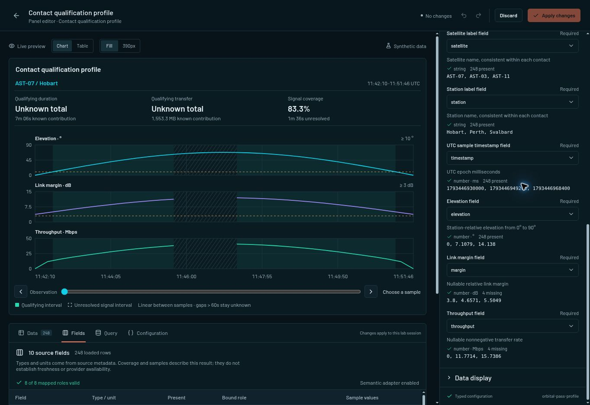
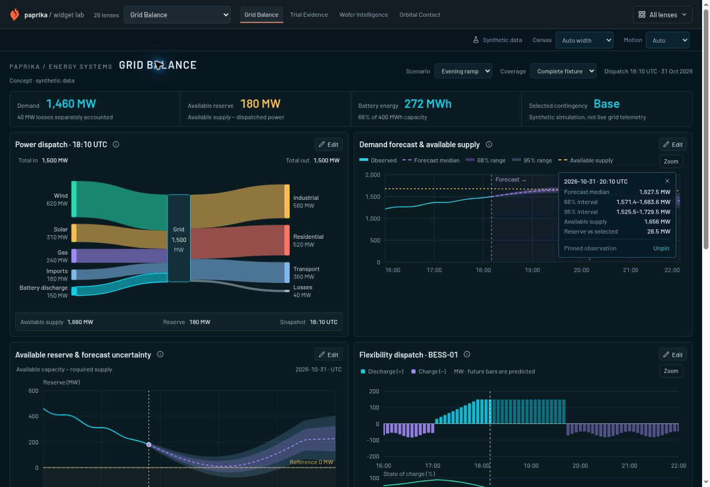
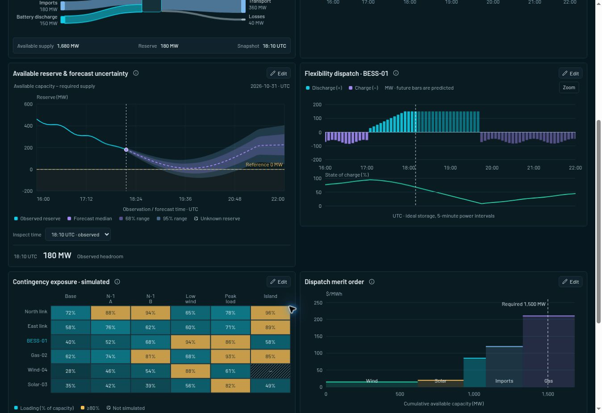

# Iteration 10 — reusable domain widgets and source-aware authoring

## Outcome

Extended the existing Grid Balance, Trial Evidence, Wafer Intelligence and Orbital Contact studies with one reusable chart family each. The catalogue now exposes **85 working examples**; the shared navigation retains **26 lenses**. These are registered renderers using the existing Paprika `Widget` / `QueryResult` host, with real configurations and deterministic synthetic source records.

The starting Site source was `70651a78e70972721a785158dc9c87cb55ac4919` (iteration 09). It already contained the four domain dashboards and three SRE studies. This iteration extends that source instead of recreating the earlier concepts.

## New widgets

| Renderer | Question | Source and mathematical contract | Main configuration |
|---|---|---|---|
| `followup-distribution` | How long were participants observed, and how do endpoints and right-censoring contribute? | The same participant endpoint records drive the clinical cohort. Bins are left-closed/right-open, with the final endpoint included; each participant contributes once. Counts and within-arm percentages retain their respective denominators. | Duration, event, arm and identity bindings; month bin width; stacked/grouped; count/percentage; exact bin selection and linked participant marker. |
| `reserve-envelope` | How much available supply remains above observed or forecast required supply? | Reserve = capacity − required supply, in MW. Demand uncertainty reverses when subtracted: lower reserve = capacity − upper demand, and upper reserve = capacity − lower demand. Observed values, forecast medians, measured zero and missing observations remain distinct. | Eight typed source roles; optional paired 68% bounds; 68%/95% visibility; reference threshold; exact UTC inspection; legend, grid and tooltip controls. |
| `wafer-transect` | How does leakage change along the selected physical row or column? | Supplied X/Y millimetres define position. Null measurements and absent grid slots break connections. Untested, tested-without-measurement and edge-excluded positions remain distinct in a separate lane. The reference does not reclassify final test bins. | X/Y/leakage bindings; row/column; follow selected die or fixed physical index; linear/log scale; adjacent connections; reference value and visibility. |
| `orbital-pass-profile` | Which contact intervals meet elevation and margin thresholds, and what transfer do those intervals support? | Elevation, margin and throughput use separate aligned scales on exact UTC timestamps. Qualification crossings use piecewise-linear interpolation only between usable adjacent samples. Throughput integration uses decimal MB = Mbps × seconds / 8. Unknown eligibility and missing transfer data prevent an invented complete total. | Eight typed source roles; minimum elevation/margin; maximum allowed sample gap; sample markers; qualification shading; threshold rules; contact selection and linked observation inspection. |

The clinical distribution and reserve widgets have labelled finite inspection selectors. The wafer section adds a roving plot tab stop, a die selector and a twelve-row exact-value table. The contact profile supports previous/next sample controls, a range control and keyboard inspection. Embedded versions remain passive.

## Shared authoring improvements

### Source fields and bindings

The new **Fields** workspace describes the actual loaded record frame: declared field type and unit, present/missing counts, small source samples and mapped roles. It explicitly describes loaded evidence rather than claiming provider discovery, freshness or completeness.

Renderer-owned `WidgetConfigField.binding` metadata declares accepted source types, unit aliases, semantic roles and optionality. The searchable GammaSelect binding controls disable incompatible choices with a reason. A missing current mapping remains visible so the user can repair it. Mapping is not unit conversion; a source transformation is required for different physical units.

An optional role uses the explicit empty-string sentinel for **Not mapped**. Deleting the key would reinstate a schema default, so the editor retains the blank value. The reserve model accepts both 68% roles being blank and rejects a partially mapped pair. No narrower confidence interval is invented.

Generic binding validation runs before each renderer's semantic adapter. Type/unit compatibility is necessary but not sufficient: wafer coordinate consistency, participant identity, interval nesting and contact timestamp ordering remain domain responsibilities.

### Draft integrity and conversion

Invalid guided input or invalid validated JSON retains the previous valid preview and disables Apply. The invalid value and actionable diagnostic remain visible. The Fields workspace uses the same draft and source as the controls.

Switching visualizations retains the most recently edited options and configuration for each renderer during that editor session. Common title/source/layout properties come from the current draft. Record alternatives require a real semantic input validator, except for the deliberately generic records table.

The shared domain panel now isolates renderer-specific configuration after conversion. Current source identity, provider and query remain authoritative; a source chart's selection/configuration cannot leak into an applied records table. Core chart registration happens in the common lens host, so opening a domain route directly offers the same records-table alternative as visiting the catalogue first. Domain chunks remain lazy.

Clearing option search returns focus to the search input. Generic axis minimum/maximum controls appear only for the built-in renderers that implement them; supporting grid visibility alone no longer exposes ineffective axis controls.

### Visual composition

The editor uses a readable title/subtitle, a 348px options rail, clearer field labels and sample metadata, independent scroll regions and the existing Gamma popup and theme owners. No parallel dropdown system or new visual dependency was introduced.

Grid Balance now pairs flow/forecast, reserve/storage and contingency/merit panels in two useful columns, followed by the evidence table. It stacks at narrow canvas sizes. Orbital Contact pairs the qualification profile with its link budget and places the overview timeline below, avoiding duplicate signal tracks by default. The clinical and wafer additions retain the existing domain colours, evidence inspectors and compact panel rhythm.

## Browser verification

The following were exercised against the running implementation, rather than inferred from component source:

- Clinical: the 480 participant records reconciled with the follow-up bins. A nonexistent duration mapping blocked Apply and preserved the chart. Repairing it and changing the bin width to two months/grouped presentation produced nine bins totalling 480; reopening retained the applied configuration. The Fields workspace exposed the source schema and missing response values.
- Orbital: exact observation inspection updated linked evidence. The missing-signal fixture showed 83.3% coverage and 1m 36s unresolved, with an unknown complete total and known contributions disclosed. Changing minimum elevation to 30°, switching to the skyplot and returning retained 30°. Clearing search restored focus correctly.
- Wafer: map selection changed the section and process history. Changing to a fixed column, entering index 999, and repairing it demonstrated blocked Apply plus last-valid preview. Selecting column 0 / row 4 in the section updated the map selector and process history to the same die and 1.809 nA value.
- Reserve: clearing just one optional 68% bound produced a paired-binding error. Clearing both produced a valid chart, and Apply/reopen retained both explicit blank values in JSON. Records-table conversion applied successfully with the current source records and no original-chart configuration leakage.
- Layout: all four domain canvases were exercised at **390px and 768px**. No page or domain-panel horizontal overflow was measured. These are canvas-width checks in a desktop browser, not a claim of exhaustive physical-device coverage.
- Catalogue: all four new entries were reachable; each displayed its explicit empty-result message and the shared query-failure message, then recovered to observed data. The live catalogue displayed 85 examples.
- Captured browser error logs contained no application-origin errors. The browser extension emitted its own metadata-delivery errors; those are not application errors.

### Actual rendered evidence

The screenshots below were captured from the implementation with synthetic data:

## Executed checks

| Check | Result |
|---|---|
| Integrated Vitest run | **560 passed, 0 failed, 0 pending; 39 test files**. |
| Whole-project TypeScript | Passed. |
| Production build | Passed: TypeScript and Vite; 2,789 modules transformed. Rollup reported removable annotation warnings in Zod dependency comments. |
| Official DESIGN.md lint | Passed: 0 errors, 0 warnings. |
| Scoped strict editor audit | Passed: 0 findings in `src/editor`, with authored Select/Listbox ownership. |
| Scoped strict domain audit | Passed: 0 findings in the four domain chart directories, with explicitly native finite-inspection ownership. |
| Preserved full-source audit | **Not clean: 50 findings.** The old global authored-only policy conflicts with the project's mixed selection ownership. Existing form, date and textarea findings also remain. See the audit notes for the exact triage; scoped results are not a global pass. |
| Vendor provenance | Regenerated and checked against the pinned upstream source; 65 files. Reverse-patch validation passed. |
| Source/document whitespace | Passed, excluding the generated exact patch artifact. Its final blank context line is valid unified-diff content and is flagged by ordinary whitespace scanning. |

The test coverage includes independent renamed source fields, wrong types/units, optional mappings, zero/null distinctions, mathematical accounting, linked identity, ordering, gaps, invalid configuration, renderer restoration and cold direct-route registration. The final integrated run includes the new regression for loading LensStudio without prior catalogue imports.

The provenance patch SHA-256 is `66e2736d5d452541c57723685dca81f41551f84b700898462f9626c83bb229e6`. Original upstream attribution and licence files remain intact. The copied registry addition is tracked as a local extension.

## Boundaries and continuation

All domain records remain deterministic synthetic fixtures. This iteration does not connect an energy provider, clinical database, fab system or orbital ephemeris service. Editor changes apply within the current lab session; durable dashboard persistence and production provider authoring are separate capabilities. No new runtime dependency was added.

The maintained contracts are in `DESIGN.md`, `UX-CONTRACT.md` and `docs/chart-capabilities.md`. Detailed wafer semantics are in `docs/iteration-10-wafer-transect.md`; orbital semantics are alongside the renderer in `src/charts/orbital/README.md`. Static-audit interpretation is recorded in `docs/premium-audit-iteration-10-notes.md`, with the unmodified full-source report and the two explicitly scoped reports retained.

The supported Sites workflow packages the verified static build, commits and pushes this exact source, and publishes it to the existing owner-private Widget Lab. Sharing remains a separate existing Site setting.
