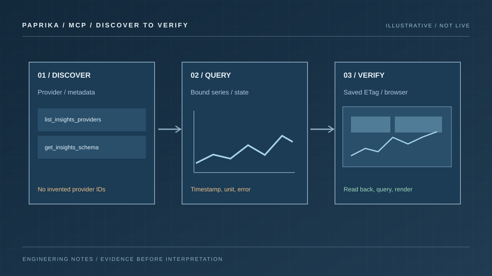

# Build and verify observability dashboards through MCP

A dashboard created by an agent is useful when its queries return the right
signals and its panels make those signals readable. Saving valid JSON proves
neither on its own.

Paprika Observe exposes provider discovery, bounded telemetry reads and
Insights document authoring through MCP. You can ask an agent to reuse real
saved queries, compose a dashboard and inspect the result. The reliable
sequence is to discover, query, save, read back and render. The
[Observe plugin guide](../../../plugins/paprika-observe/README.md) documents
the tools and permissions behind that sequence.

## Connect the observability surface

Paprika's fleet MCP endpoint is `/mcp`; Observe uses `/observe/mcp` with a
separate token audience. Reading telemetry and dashboards requires
`paprika:observe` plus the applicable Insights and provider permissions.
Creating or changing Insights documents additionally requires explicit
`paprika:insights:write` consent and the user's Insights write permission.
Refreshing an existing read-only token does not add authoring access.

Complete the connection through the client's native OAuth flow. The
[packaged Observe plugin](../../../plugins/paprika-observe/README.md) targets
the project-hosted endpoint; a self-hosted installation needs its own
verified server URL. Installation and authentication are separate steps.
Provider credentials remain configured at the server; they do not belong in
a dashboard or an agent prompt.

## Discover real providers and measurements

Begin with `list_observability_providers` to inspect the available telemetry
providers. For document authoring, also call `list_insights_providers` and
use its returned provider IDs. Do not construct an Insights ID from a
`namespace/name` reference: the two APIs expose different identities.

For a new metrics query, discover the metric names, labels and metadata before
writing the expression. Query languages are provider-specific: Prometheus
uses PromQL, Loki uses LogQL, and Tempo uses TraceQL. Test a small query over
an explicit interval and inspect the actual samples. A provider reporting
`OK` establishes a reachability observation, not that a particular metric
exists or that a service meets its SLO. The
[observability gateway guide](../../../docs/guides/observability-gateway.md)
and [Observe workflow](../../../plugins/paprika-observe/skills/paprika-observe/SKILL.md)
cover discovery and result interpretation.

A useful request to an agent is specific about the decision the dashboard
should support:

> Build a service overview using my existing providers and saved queries.
> Show request rate, error ratio and latency for a selectable service.
> Discover the available signals first. Keep missing data visible, and
> tell me if a requested measurement is unavailable.

That prompt defines an investigation. It does not assume metric names or
ask the agent to fill missing measurements with plausible values.

## Reuse saved queries before creating new ones

Inspect existing dashboards with `list_dashboards` and `get_dashboard`, then
use `list_saved_queries` and `get_saved_query` where needed. Reusing a known
query preserves its provider, units, parameter definitions and existing
interpretation.

Before authoring, call `get_insights_schema` for `saved_query`, `widget` and
`dashboard`. The deployed schema supplies the current fields and constraints.
Create any new saved query with `create_saved_query` before creating the
dashboard that references it through `create_dashboard`.

Bind dashboard variables explicitly to the saved query's parameters. A
service selector has no effect merely because its label resembles a query
parameter. For imported examples, map each placeholder to a compatible
provider and review the data requirements. The
[dashboard examples guide](../../../docs/guides/dashboard-repository-examples.md)
describes this mapping; live query failures do not fall back to its sample
fixtures.

## Protect edits made by other people

Read an existing document and retain its exact ETag before updating it.
`patch_dashboard` supports targeted widget edits by stable ID, so a colour
or layout change need not replace the entire document. `patch_saved_query`
provides the corresponding query edit path.

Patch semantics matter: nested objects merge, `null` removes a field, and
arrays replace in full. A stale ETag means the document changed after your
read. The authoring API rejects wildcard ETags; read the document again,
resolve the conflict and submit the exact new ETag with your intended edit. See the
[targeted authoring contract](../../../docs/design/insights/targeted-authoring.md)
for examples and immutable fields.

The illustrative workbench below is a clickable explanation of the discovery → query → verify loop. These are **fixed sample states**, not responses from a connected Paprika MCP server.

```paprika-dashboard mcp
```

## Execute the saved dashboard

After saving, call `query_dashboard`. It resolves saved queries and parameter
bindings, applies the selected interval and executes identical bound queries
once. This illustrative call uses placeholder dashboard, widget and service
identities; replace them with values discovered in your workspace:

```json
{
  "name": "query_dashboard",
  "arguments": {
    "id": "service-overview",
    "widget_ids": ["request-rate"],
    "variables": { "service": "checkout" },
    "history_points": 12,
    "max_series": 3
  }
}
```

Inspect `structuredContent`, including widget errors, signal states,
timestamps, missing samples and truncation. Compare the number of planned
queries with those executed and deduplicated. The returned dashboard and
saved-query ETags identify the document revisions used for that observation.

The result's `state: "ok"` describes data availability. It is not a health
verdict. An older finite reading is still old, an empty signal is not zero
traffic, and a bounded trace sample is not a total request count. The
[dashboard query contract](../../../docs/design/insights/dashboard-query.md)
defines those distinctions and the available response limits.



*Discovery, execution and verification must each succeed. The sample diagram does not claim that a live provider or private render worker is available.*

## Inspect the rendered dashboard

When the deployment advertises `render_dashboard`, use it after querying to
capture the actual Insights interface. The capability requires an optional
private browser worker; installing the plugin alone does not enable it.
The [renderer guide](../../../docs/guides/observe-browser-renderer.md)
explains deployment and the revision checks attached to each capture.

Check desktop and mobile layouts, both supported themes, and a focused
widget's tooltip. Look for clipped units, unreadable legends, overflowing
inspectors and compact stat cards with internal scrollbars. A short KPI card
usually needs a clear value and, if useful, one trend. Adding a percentage
bar, a long description and a sparkline can crowd out the measurement.

To explore Paprika's **working chart renderers** on synthetic data, open this embedded public gallery, then follow the authorization steps above for a genuine saved dashboard.

```paprika-gallery charts
```

Keep query verification and visual verification as separate results. If the
renderer is unavailable, open the saved dashboard in the browser and inspect
it there. After a targeted presentation fix, read back the document, query
again and inspect the new rendering. This leaves you with both usable
telemetry and a dashboard someone can comfortably read.
