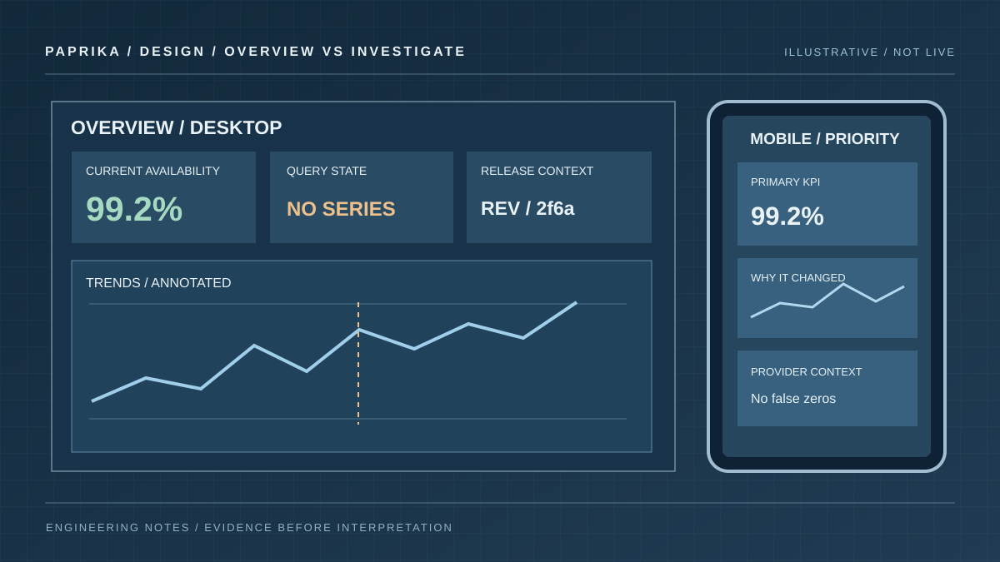

# Observability dashboard design: layout, charts and readable KPIs

Dashboards are interfaces for making decisions under uncertainty. That makes layout a functional choice, not decoration. A giant number without a label is ambiguous; a heatmap without units is decorative; a tooltip that disappears outside the viewport prevents investigation precisely where you need it.

Paprika Insights includes a public [chart and dashboard showcase](https://paprikacd.github.io/paprika/#charts) built with its real chart renderers and explicitly synthetic fixtures. The authenticated application builds and stores dashboards against connected data sources. The distinction matters: an attractive example is a useful design reference, not evidence that a live service is healthy.

## Give each dashboard one primary job

Decide what the reader must do before choosing the grid. A fleet overview answers "where should I investigate?" A release dashboard answers "what changed around this deployment?" A service dashboard answers "are users experiencing errors or latency?" Mixing all three into one undifferentiated page produces a long scroll with no clear hierarchy.

A practical hierarchy puts three levels on one screen:

1. **Orientation:** title, selected environment, time window, data freshness and relevant filters.
2. **Decision signals:** a few clear exceptions, SLI trends and their actual units.
3. **Diagnosis:** breakdowns, distributions, logs, traces or linked detail that explain the exception.

The top row should not be a beauty contest between equally large KPI cards. Give the important anomalous signal enough space, and let supporting numbers remain supporting numbers.

Try the interactive dashboard studio. Switch between an operator overview, diagnostic details and a missing-data state. Toggle light and dark appearance and use the observation inspector under the chart.

```paprika-dashboard layout
```

## Match the visual form to the question

| Operator question | Better starting visual | Common mistake |
| --- | --- | --- |
| How has error rate changed? | Time series with explicit rate unit | A cumulative counter shown as an instantaneous rate |
| Which service is failing? | Sortable table or ranked bar view | A donut with dozens of indistinguishable categories |
| When does latency worsen? | Time series with aligned events, or histogram | A lone p95 number without its window |
| Which pods or nodes are hottest? | Heatmap with meaningful scale and labels | Colour with no legend or missing-value treatment |
| Did an action change the outcome? | Pre/post trend with stable window and annotation | Two cards with different filters compared side by side |
| What is actually broken? | Focused exception list linked to evidence | "All healthy" inferred from an empty result |

Use data types deliberately. A categorical comparison should not appear on a continuous x-axis unless the order is meaningful. A flame graph needs hierarchical sample data; drawing rectangles from unrelated metrics would not make it a flame graph.

The [dashboard examples guide](../../../docs/guides/dashboard-repository-examples.md) explains how to explore the sample library and then map provider placeholders to real data. Each imported chart still needs an appropriate query, unit and filter.

## Make KPI cards readable at their actual size

A compact KPI card usually needs a readable label, a dominant measurement, its unit and an indication of period or freshness. A tiny sparkline is useful only when the card remains understandable without it. Avoid placing a large percentage bar, multi-line description and three secondary figures inside a row that is barely tall enough for the main value.

For a rate, write the unit directly: "errors/s" or "requests/min." For a duration, prefer "p95 sync time · 10 min" to "Latency". When the value is unavailable, say so. A blank panel, a missing series and a numeric zero require different treatments.

Colour should communicate a state that is also available in text or iconography. Red and green alone are not enough for colour-vision differences, grayscale print, or a dashboard viewed in poor lighting.

## Tooltips are diagnostic UI, not floating labels

A tooltip should follow the selected observation and remain within the viewport. Its content needs to identify the time, series, value, unit and active filters. If the pointer approaches an edge, flip or reposition the tooltip instead of clipping it under the browser chrome or neighbouring panels.

Keyboard users need an equivalent way to reach the information. For a dense chart, provide an inspectable point or an accessible table representation. Tooltips should not cover the point they're describing or disappear when the user moves toward a relevant detail link.

A multi-series panel may need a shared crosshair and stable series ordering. Do not interpolate a value at a time where a particular series has no observation.

## Design both desktop and mobile intentionally

Desktop width is not a promise that every widget deserves to fit in one row. On a narrow viewport, reflow by **decision priority**, not simply by the original array order. The release status and current exception should remain visible before a lower-priority distribution.

Check a 390px viewport as well as a wide desktop layout. Look for overflowing legends, clipped y-axis units, impossible touch targets, tiny timestamps and inspectors that create nested scrollbars. If a chart needs horizontal scrolling, give the user a visible cue and keep the explanation accessible.

Support light and dark themes with consistent semantic contrast. A translucent tooltip that works on a dark plot may become unreadable on a light card. Reduce or remove transitions when the user prefers reduced motion.



*The mobile layout deliberately prioritises the key measurement before details. The illustration is a design study rather than a production screenshot.*

## Verify with real queries and a rendered page

A saved document's JSON can be structurally valid while its selected provider is unauthorized, its labels do not exist, or its chart hides the useful signal. Test the saved queries with `query_dashboard`, inspect error and missing-data states, then read the actual rendered dashboard.

When a deployment advertises the optional `render_dashboard` tool, Paprika can capture the live Insights UI through a private browser worker. That worker is not enabled by merely installing the Observe plugin. The [renderer guide](../../../docs/guides/observe-browser-renderer.md) describes its security and revision conditions.

For a focused visual test, compare desktop and mobile, light and dark themes, a chosen tooltip state and an empty-data state. Keep the screenshot tied to the saved document revision. The [visual verification article](./visual-testing-observability-dashboards.md) turns that approach into an acceptance checklist.

The public chart gallery below runs **Paprika's actual chart renderers with synthetic fixtures**, including working plot inspection and configuration examples. It is separate from an authenticated Insights dashboard.

```paprika-gallery performance-workbench
```

Finally, decide whether a view could help someone at 03:00 without its author in the room. A good dashboard is precise about what it knows, explicit about what it doesn't, and quick to move from symptom to evidence.
