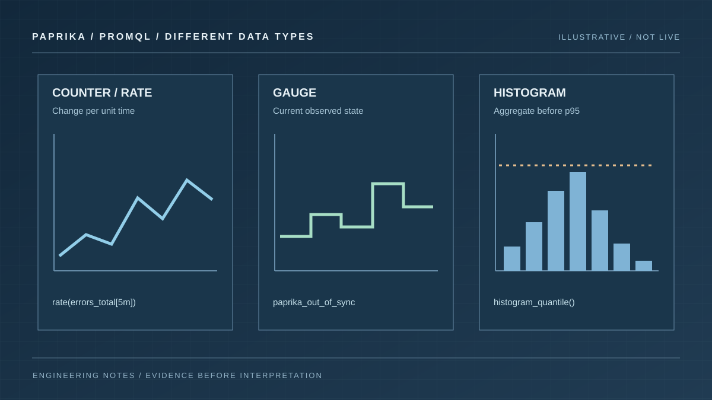

# Prometheus dashboard query patterns: rates, gauges and histograms

A Prometheus dashboard can be visually precise and analytically wrong. The usual problem is not the chart renderer; it is the query's type, aggregation or window. A counter plotted as an instantaneous value, a histogram bucket averaged as a latency, or an absent series displayed as zero can lead an operator in exactly the wrong direction.

Paprika Observe can query connected Prometheus-compatible providers and pass saved queries into Insights dashboards. The [observability gateway guide](../../../docs/guides/observability-gateway.md) documents metric discovery, bounded reads and provider permissions; it does not claim that any specific metric exists in your cluster. Use the deployment's actual schema and label set.

## Discover the shape of the data first

Start by listing available providers and the metric names, labels and metadata they expose. The Observe MCP tools include `list_observability_providers`, `list_metric_names`, `list_metric_series`, `list_label_names`, `list_label_values` and `get_metric_metadata`. For Insights authoring, use `list_insights_providers` for the actual IDs the UI accepts.

Inspect a small query result over a bounded interval before adding any widget. Verify its unit, type, labels, timestamp and sample count. `list_metric_series` returns a bounded sample of series, not a guaranteed global active-series count.

Paprika's [metrics reference](../../../docs/guides/metrics.md) documents concrete examples. Those names below are relevant to Paprika deployments **only when the corresponding metrics have been exported and scraped**.

Interact with the comparison below: switch counter, gauge and histogram states, inspect the series and read the corresponding illustrative query. The chart shape changes with the metric type.

```paprika-dashboard prometheus
```

## Gauges: observe a current state

An out-of-sync resource count is a gauge. It can rise or fall. To show the current value for each Application, preserve the relevant labels:

```promql
max by (app, namespace) (paprika_out_of_sync)
```

A max is often appropriate when duplicated scrape targets report the same state; it is not a universal solution to duplicate series. If target labels identify genuinely different controllers, investigate that topology first.

A gauge cannot answer how many times an event occurred over the past day. Plotting `paprika_out_of_sync` does not count drift incidents; it describes observed drift at each scrape.

## Counters: ask for a rate or an increase

Paprika's `paprika_sync_errors_total` is a counter. Its raw value reflects accumulated errors since process start and may reset after a restart. A request like "are apply errors occurring now?" calls for a rate:

```promql
sum by (app) (
  rate(paprika_sync_errors_total[5m])
)
```

The result has units of errors per second. If you want a recent count for a chosen window, use:

```promql
sum by (app) (
  increase(paprika_sync_errors_total[1h])
)
```

`rate` and `increase` account for counter resets using the samples available in their window, but short and sparse series can still make estimates unstable. Check the scrape interval before choosing a tiny range. Do not compare a per-second error rate with an absolute error threshold.

Preserve labels deliberately. Aggregating away `app` can make one repeatedly failing Application disappear into an otherwise quiet fleet.

## Histograms: aggregate buckets before taking a quantile

Paprika documents the `paprika_sync_duration_seconds` histogram with an `app` label. The conventional Prometheus histogram export exposes bucket series ending in `_bucket`. A p95 over a ten-minute window can be expressed as:

```promql
histogram_quantile(
  0.95,
  sum by (le, app) (
    rate(paprika_sync_duration_seconds_bucket[10m])
  )
)
```

This is an estimated quantile derived from configured bucket boundaries, not an exact measured duration. The bucket label `le` must survive aggregation. Do not average independent p95 values across Applications and label that a fleet p95; aggregate the underlying bucket observations before computing a fleet-level quantile.

Use the metric's unit on the axis. Seconds and milliseconds are not interchangeable merely because both are small numbers.



*The same chart treatment is not suitable for every metric. Counters, gauges and histograms have different aggregation and time-window semantics.*

## Treat missing data as a distinct state

These observations should not render identically:

| Data state | Suitable UI treatment |
| --- | --- |
| Queried series with a genuine zero | Zero with its unit and sample timestamp |
| No series matched the query | No matching series, with query/filter context |
| Provider unavailable or unauthorized | Query error, with source identifier |
| Old latest sample | Stale data warning and last observed time |
| Query was intentionally truncated | Partial-data indicator, not an unqualified total |

A chart component should not synthesize a baseline, invent a trend, or interpolate across a known outage without labelling the uncertainty. For an incident dashboard, the absence of recent telemetry can itself be a reason to investigate.

Paprika's `query_dashboard` response reports signal states and truncation in addition to readings. Read that structured result rather than relying on a screenshot alone. The [dashboard query contract](../../../docs/design/insights/dashboard-query.md) describes how duplicates are executed once, time ranges propagate and signals are bounded.

## Bind selectors to queries, not just to headings

A service or Application selector has to be connected to the saved query's parameters. Confirm that a filtered query actually returns different series when the selected identity changes. Test at least two values and an empty/no-match case.

For comparison panels, align the time range and units. Only compare response times that measure the same thing. If one provider reports request latency while another reports Kubernetes reconciliation duration, the two lines should not share a label such as "latency" without a visible distinction.

The [dashboard authoring walkthrough](./building-dashboards-with-mcp.md) covers discovering IDs, saving documents with ETags and executing the result. The [Kubernetes release dashboard guide](./kubernetes-release-dashboard.md) shows which operational questions those queries need to support. The goal is not the most elaborate expression. It is a query whose semantics still make sense when the pager goes off.
