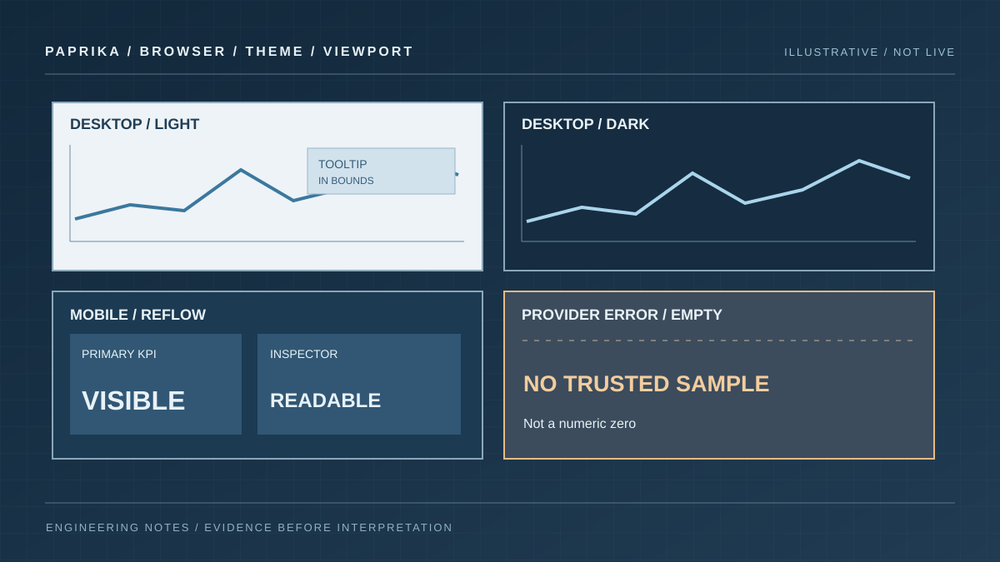

# Visual testing for observability dashboards: data, layout and MCP verification

A dashboard can pass JSON Schema validation and still fail its user. A legend might obscure the last data point, a KPI might scroll inside a fixed-height card, or a tooltip might render outside the browser viewport. Worse, a beautiful screenshot can conceal a failed query or a stale series. Dashboard quality needs two independent checks: **data semantics** and **rendered behaviour**.

Paprika Observe separates these concerns. `query_dashboard` reports live provider-backed signals and their states, while the optional `render_dashboard` capability captures the actual Insights interface using a controlled Chromium worker. The tools are complementary, not substitutes.

## Establish a repeatable source of truth

Start by reading the saved dashboard with `get_dashboard`. Keep its ID, ETag, time range, variables and referenced saved queries. If you plan to edit its layout through MCP, discover the current schema with `get_insights_schema` and make the smallest safe change.

Use `query_dashboard` to test the query side. The following is an illustrative request; replace the dashboard ID, widget ID and service name with values discovered from your workspace:

```json
{
  "name": "query_dashboard",
  "arguments": {
    "id": "service-overview",
    "widget_ids": ["request-rate"],
    "variables": {"service": "checkout"},
    "history_points": 12
  }
}
```

Inspect every returned signal's state, unit, timestamp and provider error before interpreting the chart. A value of zero is not interchangeable with no series, a truncated result or a stale sample. A widget can be visually correct while displaying the wrong source or time window.

The [dashboard query contract](../../../docs/design/insights/dashboard-query.md) documents deduplication, bounded results and how variables propagate.

## Use screenshots only when the renderer is available

The browser renderer is an optional private worker. The Observe deployment must advertise `render_dashboard`; a plugin installation by itself does not supply a browser worker or permission to render arbitrary sites.

When enabled, Paprika first authorizes the requested dashboard, passes a short-lived delegated token to the isolated worker, and checks that the UI read the expected document revision. The worker uses a trusted internal UI origin, rejects unrelated browser destinations and mutating requests, and fails captures with unresolved loading states or visible query errors. These constraints matter because a screenshot taken against a different document revision is not a valid visual comparison.

The [renderer deployment guide](../../../docs/guides/observe-browser-renderer.md) describes the opt-in configuration and its limits. If the renderer is unavailable, use the normal authenticated dashboard page in a browser. Do not report a nonexistent screenshot as proof of visual quality.

The following local demo lets you simulate a desktop view, narrow layout and a provider error. Check that missing data is presented as a state rather than a fabricated zero.

```paprika-dashboard testing
```

## Test the states that routinely break

Use an acceptance matrix rather than one polished desktop capture:

| View or state | What to inspect |
| --- | --- |
| Desktop, light | Hierarchy, axis labels, tooltip contrast, unused space |
| Desktop, dark | Grid contrast, colour semantics, focus indicators |
| Mobile, light | Card priority, legend wrapping, scroll/overflow |
| Mobile, dark | Inspector positioning, touch targets, readable units |
| Narrow KPI card | Primary value prominence, no internal scrollbar |
| Missing or failed query | Visible error/empty state, not a fabricated zero |
| Dense chart inspection | Crosshair, exact timestamp, correct series/units |
| Changed document ETag | Capture rejected or explicitly matched to the new revision |

For a chart with interactive inspection, deliberately focus an observation near both horizontal viewport edges. A fixed tooltip may appear correct in a centre screenshot yet clip when the selected point is close to the boundary.

Use a real viewport and a screenshot of the actual application, not a cropped marketing fixture. Compare only equivalent data windows if you intend to judge a visual regression.



*Illustrative acceptance matrix. A verified render must match the saved document revision, viewport and data state.*

## Keep verification separate from authoring

A useful workflow for an agent or engineer is:

1. Discover providers, queries and dashboard IDs. Confirm actual authorization and capabilities.
2. Query the dashboard with known variables; record its signal states and saved revision.
3. Render or open the UI in a browser; inspect layout at wide and narrow widths.
4. Identify one specific defect, such as a clipped legend or an excessively tall KPI card.
5. Apply a targeted presentation change with the exact current ETag.
6. Read the dashboard back, query again, and capture the revised layout.
7. Compare results, including the possibility that the edit had no visual effect.

The target should be an observable improvement, not just a larger diff. For MCP edits, `patch_dashboard` can update widgets by stable ID, but arrays replace in full and stale ETags are rejected. Reread rather than attempting a wildcard overwrite. See the [authoring walkthrough](./building-dashboards-with-mcp.md) for scope and conflict details.

## Measure the failure, not just the screenshot

A visual regression report needs a reproducible condition: viewport size, colour theme, dashboard ID, document revision, query window, widget/series identity and exact symptom. Include the expected state and observed state. Screenshots and query summaries are evidence; they are not a release guarantee.

A dashboard may also be intentionally empty. Test that emptiness without labelling it "healthy." Compare the incoming signals and the UI's empty state. Where a chart or provider supports only a limited sample, surface truncation and sampling limits.

Paprika's browser suite covers deterministic fixtures in light/dark modes and desktop/mobile viewports, but a passing fixture does not prove a particular production provider's data is correct. The [dashboard examples guide](../../../docs/guides/dashboard-repository-examples.md) explains that source-backed examples use sample data until each query is mapped to a connected provider.

For practical layout decisions, continue with [observability dashboard design](./observability-dashboard-layout.md). For the query semantics underneath those panels, read [Prometheus dashboard query patterns](./prometheus-dashboard-query-patterns.md). The result is a dashboard someone can trust, not merely one that screenshots well.
